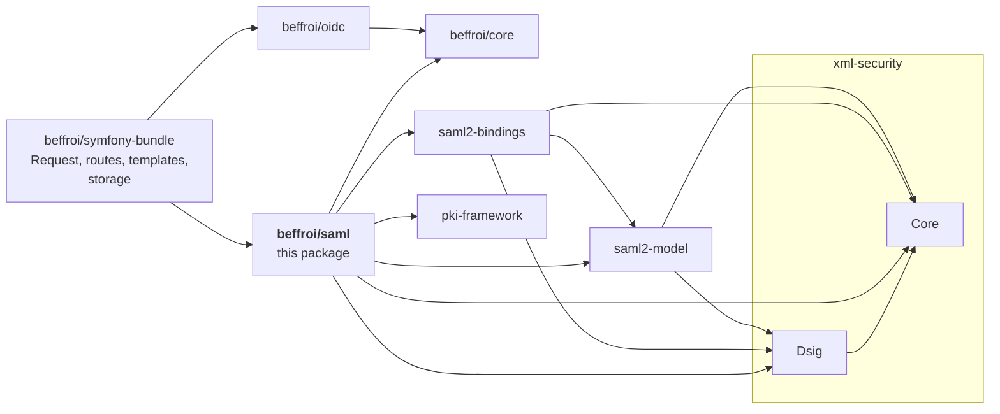

# saml: specification

The SAML 2.0 module of the identity provider: the profile written on `saml2-model` and `saml2-bindings` for the tenants, the users and the sessions of the core. It holds what both packages leave to their consumer, the HTTP request aside, which is the bundle's: the identity provider and the service providers of a tenant, their metadata, the attributes mapped from the claims, the `NameID` derived from the `sub`, Single Logout on the session of the core.

| | |
|---|---|
| Repository | `src/saml` of the monorepo `beffroi-php/beffroi`, mirrored read only into `beffroi-php/saml` (section 10) |
| Package | `beffroi/saml` |
| Namespace | `Beffroi\Saml`, next to `Beffroi\Oidc` of `beffroi/oidc` |
| Runtime | PHP 8.4 or later; `beffroi/core`; `beffroi/saml2-model`, `beffroi/saml2-bindings` and `beffroi/xml-security`, their public classes (section 2); `spomky-labs/pki-framework`, for the X.509 certificate around a tenant's key. Nothing else. |
| Consumers | `beffroi/symfony-bundle`, which holds the HTTP request, the routes, the templates and the storage (decision 0007) |
| Design | Sub-spike 9c of [spike 9](https://github.com/beffroi-php/design/blob/main/spikes/09-saml/README.md), the identity provider role (epic beffroi-php/beffroi#645); [decision 0013](https://github.com/beffroi-php/design/blob/main/docs/decisions/0013-saml-formats-xml-ecrits-ici.md) (the stack writes its SAML formats, `beffroi/saml` is the profile on them), [decision 0007](https://github.com/beffroi-php/design/blob/main/docs/decisions/0007-bibliotheque-et-bundle-des-le-premier-commit.md) (the bundle keeps HttpFoundation), [decision 0006](https://github.com/beffroi-php/design/blob/main/docs/decisions/0006-sur-par-defaut.md) (no option to do it wrong) of the identity provider's design repository |

This document states what the package does, what it refuses and what it guarantees; the code conforms to it, or the document changes first, in its own commit, with its reason. The specifications of `saml2-model` and `saml2-bindings` are cited as `model.md` and `bindings.md`, their invariants as `M-n` and `B-n`; those of `xml-security` as `core.md`, `dsig.md` and `enc.md`. Its sections bear the numbers of theirs, so that a reference to one holds while the stories of section 12 write the sections this document does not have yet: the package holds no class today, and its threat model, its invariants, its public API, its limits and its acceptance are written by the story that builds what they describe.

## 1. Why this package exists

`saml2-model` validates one message against what its consumer states, and `saml2-bindings` carries one message across one binding against what its consumer states; neither knows a tenant, a user, a session, a key the core keeps, or the state that makes a statement true. Both specifications end on the duties of that consumer, `bindings.md` section 6.8 and `model.md` section 6.9, and name it: `beffroi/saml`. Decision 0013 puts the profile here, the identity provider and the service provider of a tenant, the attributes, the `NameID` derived from the `sub`, the metadata, Single Logout on the session of the core, so that the SAML user and the OpenID Connect user are one user of the core, one model and two entry protocols.

Most of those duties are code this package writes (section 6). Two are the opposite, what its code never calls: the binding's authentication is the word of `saml2-bindings` only, and the guarantee that a received message and the signature verified over it come from one input holds only while nothing reaches into `Beffroi\Saml2\Bindings\Internal\`. `saml2-bindings` cannot close either from its side (`bindings.md` section 12); section 8 closes both here, by static analysis.

## 2. Position



The package is a module of the identity provider, at the level of `beffroi/oidc` (decision 0013), and takes its four layers (`docs/11-architecture.md` section 2): `Domain`, the objects, the values and the exceptions (`Exception/` belongs to it, as in the core and in `beffroi/oidc`); `Port`, the interfaces to the outside; `Application`, the use cases; `Bridge`, the implementations of the ports. It depends on the core, its use cases included, as `beffroi/oidc` does, and never on `beffroi/oidc`, nor `beffroi/oidc` on it: protocols never depend on each other.

The SAML stack is a brick of the module, as JOSE is of `beffroi/oidc`: the `Bridge` implements the ports on it, and sees the public classes of `saml2-model` (`model.md` section 5), of `saml2-bindings` (`bindings.md` section 5) and of the `Core` and `Dsig` namespaces of `xml-security`; never a class of their `Internal\` namespaces, nor of `Enc`, which the assertion encrypted for a service provider that asks for it brings (issue #733). `pki-framework` is the `Bridge`'s too, for the self-signed certificate around a tenant's key (decision 0013, `model.md` section 6.9). `Domain`, `Port` and `Application` see the core and the PSR interfaces, as those of `beffroi/oidc` do: a story whose class needs the stack in an inner layer adds that edge with its reason, as `.ci-tools/deptrac.yaml` asks of every new dependency.

It knows no HTTP object (decisions 0007, 0013): no `Request`, no PSR-7 message, no superglobal, no route, no template. The bundle holds the request and hands the package what `bindings.md` section 6.8 names, the raw query string, the fields of a form, the URL of the endpoint from the tenant's configuration; the bundle writes the HTTP answer and the page that posts the form (`bindings.md` section 6.7). Deptrac holds the layers and the graph, `.ci-tools/deptrac.yaml`: the `Saml*` layers, nothing of Symfony but its `Uid` component, nothing of `Psr\Http`, as for `beffroi/oidc`.

## 6. Processing rules

### 6.8 The contract with saml2-bindings and saml2-model

The duties `bindings.md` section 6.8 and `model.md` section 6.9 give `beffroi/saml` on the identity provider's side, each the rule of the story that builds the code it applies to (section 12). What this package's code never calls is section 8, and holds from the first line of it.

- **The raw query string.** `QUERY_STRING` as the bundle received it, never a normalised one nor the parsed query (`bindings.md` section 6.8, B-2).
- **The form.** The fields of an `application/x-www-form-urlencoded` body, any other content type refused before the package is called.
- **The method and the peer.** The endpoint chooses the method of the receiver; the unverified `Issuer` chooses the service provider's metadata.
- **`$receivedAt`.** The URL of the endpoint as the tenant's metadata publishes it, from the tenant's configuration, never rebuilt from the request (M-8).
- **`RelayState`.** The one it generates: an unguessable reference from `random_bytes()` to state kept on the server, at most 80 bytes, never a URL. The one it received: echoed exactly in the answer, up to the 1 024 bytes of B-9.
- **The binding of each message.** The service provider's metadata says it, by the `Binding` of the endpoint the message goes to.
- **The metadata of the identity provider.** Written with `MetadataWriter`, the X.509 certificate around the tenant's key in it: an HTTP-POST single sign-on service next to the HTTP-Redirect one, and `WantAuthnRequestsSigned` a setting of the tenant, `true` by default, passed to `IdentityProvider`, whose constructor defaults it to `false` (`model.md` section 6.9).
- **The peers.** The metadata of each service provider of a tenant, read with `MetadataReader`, `readTrusted()` or `readSigned()` and the reason, stored and refreshed, the newest document accepted kept against a rollback (`model.md` sections 6.5 and 6.9).
- **The logout endpoints.** A `LogoutResponse` goes to the `ResponseLocation`, or else the `Location`, of a `SingleLogoutService` of the service provider's metadata on the binding it answers over (M-9), never to a URL the request carried.
- **The cross-site post.** A post to a single logout service comes from the service provider's site, without a session cookie set `SameSite=Lax` or `Strict`: the state of a request sent is found by its `InResponseTo` or its `RelayState`.
- **The replay store.** Shared by every worker of the deployment, atomic, implementing `ReplayGuardInterface`. The model remembers the assertions of responses, and the logout messages it accepts once beffroi-php/beffroi#708 is built in the first story of Single Logout (`model.md` section 12); until then a `LogoutRequest` ID is forgotten once answered, and ending a session already ended is done.
- **The response.** Its `Destination`, its bearer `Recipient` and its `InResponseTo` from the `AcceptedAuthnRequest`, never from the request as received; the `NameID` derived from the `sub`; the attributes mapped from the claims, per service provider.
- **The answer.** A `302` or `303` to the URL `RedirectSender` returned, or the page that posts the form (`bindings.md` section 6.7), with the caching headers of the binding; a refusal is the bundle's page, and a request refused before its endpoint is established gets no SAML answer.
- **`validateAuthenticatedByBinding()`, and the scope of `Internal\`.** Never called, never reached: section 8.

## 8. What is refused, what is never called

**Never called**, in `src/` and in `tests/`, enforced by the rules of `.ci-tools/phpstan-saml.neon`, an analysis of its own at level max with no baseline, which `castor phpstan` runs after the other packages' and which `.ci-tools/phpstan.neon` excludes:

- `validateAuthenticatedByBinding()`, whatever the receiver: the binding's authentication is the word of `saml2-bindings` (B-5, `bindings.md` section 6.8, decided on 1 October 2026).
- `Closure::bind()`, `Closure::bindTo()` and `Closure::call()`, statically or on an instance: a closure bound to the scope of `Internal\Reception` builds a `Reception` that pairs the message of one input with the signature of another, which `validate()` accepts through the binding's authentication (`bindings.md` sections 9.8 and 12, decided on 1 October 2026).
- Reflection: every class of the Reflection API and what extends it, instantiated or called statically, and a method of a Reflection object however it was obtained (`ReflectionProperty::setValue()`, `ReflectionClass::newInstanceWithoutConstructor()`, a lazy ghost), for the same reason.
- `unserialize()` and `__unserialize()`, whatever the receiver: `unserialize()` builds an object of any class without its constructor, an `Internal\Reception` among them; the pairing holds today only because PHP refuses to serialize a `Dom\Element`, which the boundary must not rest on (finding 3 of the security review of `saml2-bindings`, 12 October 2026).

`bindings.md` section 6.8 bans the last three on the classes of `Beffroi\Saml2\Bindings\Internal\`; this package bans them everywhere in its code. What such a call reaches is known at runtime only: `unserialize()` names no class, `Closure::bind()` takes its scope as a value, a Reflection object of a public class leads to the classes it holds; a ban scoped by type would have a way around it, and the package has no use for any of them.

**How the rules read a call** (`tests/saml/PhpStan/`). `BannedCallsRule` reads the name of every function, method and class called, as resolved, whatever its case. A function, a method or a class given as a value is read as PHPStan knows it: a constant string (`'unserialize'`, `'Closure::bind'`) or a constant callable array (`[$validator, 'validateAuthenticatedByBinding']`) naming one of the above is that call, as the callee and as an argument of any call, so that one handed to `array_map()`, `call_user_func()` or `Closure::fromCallable()` is refused where it is written; a call whose function, method or class is a value PHPStan cannot read is refused, a `Closure` called as a value let through. `BannedCallablesRule` hands it the call a first-class callable is made of (`unserialize(...)`, `Closure::bind(...)`), which PHPStan visits as a node of its own (issue #693, closed for these rules as `saml2-bindings` closes it for its own). Not seen: a callable whose value PHPStan cannot read, handed to a function that calls it.

**Proven** on a probe of `src/` written for the purpose and removed once read, as the rules of the other SAML packages were: each form above refused with its message, a control class that uses none of them accepted; the commit that brought the rules records the run.

Every other refusal of the module, of a message, a metadata document, a request or a configuration, is the rule of the story that builds it (section 12).

## 10. Repository

In the shape of `beffroi/oidc` for the code, of the SAML packages for the specification: developed in `src/saml` of the monorepo `beffroi-php/beffroi` and mirrored read only into `beffroi-php/saml` by the split, the tests and the toolchain staying in the monorepo.

```
src/saml/              the package, what the mirror carries
  composer.json        beffroi/saml, MIT, php >=8.4; beffroi/core, beffroi/saml2-model, beffroi/saml2-bindings and
                       beffroi/xml-security at self.version (the release line of the monorepo), spomky-labs/pki-framework;
                       PSR-4 Beffroi\Saml\ => src/; no dev dependency: the tools live in the phpqa image
  README.md            the short version of this document
  spec/saml.md         this document, the law of the package
  src/                 Domain/, Exception/, Port/, Application/, Bridge/ (section 2), from the first class
tests/saml/            PhpStan/: the rules of section 8 (BannedCallsRule, BannedCallablesRule); the suite of the
                       package, a testsuite saml of .ci-tools/phpunit.xml.dist, from the first test
at the root            the toolchain of the monorepo:
  composer.json        beffroi/saml replaced at self.version, Beffroi\Saml\ and Beffroi\Saml\Tests\ autoloaded
  .castor/             stack/qa.php: phpstan runs .ci-tools/phpstan-saml.neon after the other configurations
  .ci-tools/           phpstan-saml.neon (level max, no baseline, strict rules, deprecation rules, phpunit, the bans
                       of section 8), deptrac.yaml (the Saml* layers of section 2), phpunit.xml.dist
  .github/workflows/   ci.yml: the analysis of section 8 and Deptrac in the quality job, its result cache kept;
                       gitsplit.yml, which pushes the mirror
  .gitsplit.yml        src/saml to beffroi-php/saml
  LICENSE, SECURITY.md
```

**Versioning.** The release line of the monorepo: a version is a milestone of `beffroi-php/beffroi`, tagged there and pushed to the mirror by the split.

## 11. Out of scope

Not built, not planned here, and not added without a change of this document:

- HttpFoundation's `Request` and `Response`, PSR-7, the routes, the templates, the page that posts the form, the cookies and the session storage, the tables and the migrations (the bundle, decision 0007).
- Everything a message is: its reading, its validity, its signature, its bytes on a binding (`saml2-model`, `saml2-bindings`, `xml-security`).
- A third-party SAML or XML Signature library (decision 0013); the Artifact and SOAP bindings; SAML 1.x, WS-Federation; inter-institution federations; an administration interface for the service providers, which are configuration and a console command (epic beffroi-php/beffroi#645).
- The service provider role, sub-spike 9d (epic beffroi-php/beffroi#646).

## 12. Left to the sub-spike

Each item is marked **left**, with the issue it goes to, or **open**, with who decides it. None is built ahead.

**Left**: the stories of sub-spike 9c, in the order of their dependencies, each a pull request that writes the part of this document its code needs.

- beffroi-php/beffroi#727, `saml2-bindings`: the senders refuse a `Destination` that is neither `http` nor `https` (finding 1 of the security review); nothing here.
- beffroi-php/beffroi#728: the identity provider of a tenant, its key, its certificate and its metadata.
- beffroi-php/beffroi#729: the service providers of a tenant, read from their metadata.
- beffroi-php/beffroi#730: an unsigned `AuthnRequest` accepted only from a service provider whose configuration says it does not sign, decided on 15 October 2026.
- beffroi-php/beffroi#731: single sign-on, the request received and the signed assertion posted back, the contract of section 6.8 on the request.
- beffroi-php/beffroi#732: the judge, a SimpleSAMLphp service provider played against the stack.
- beffroi-php/beffroi#733: the assertion encrypted for a service provider that asks for it, and `Enc` in the edges of section 2.
- beffroi-php/beffroi#734 and beffroi-php/beffroi#735: Single Logout, started by a service provider and by the identity provider, the session of the core as the pivot, the replay store of section 6.8.
- beffroi-php/beffroi#736: the Entra judge.
- beffroi-php/beffroi#737: the page that says what the identity provider signs, encrypts and refuses.

**Open**:

- **The scope of the bans of section 8.** `bindings.md` section 6.8 bans Reflection and the binding of a closure on the classes of `Internal\`, and finding 3 of the security review adds `unserialize()` and `__unserialize()`; this package bans them in the whole of its code, the only ban without a way around it (section 8). Open, the maintainer's: whether that stands, or whether a use the package one day has of one of them is a named exception of section 8.
