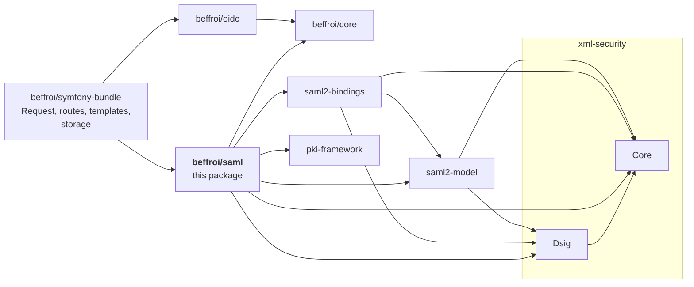

# saml: specification

The SAML 2.0 module of the identity provider: the profile written on `saml2-model` and `saml2-bindings` for the tenants, the users and the sessions of the core. It holds what both packages leave to their consumer, the HTTP request aside, which is the bundle's: the identity provider and the service providers of a tenant, their metadata, the attributes mapped from the claims, the `NameID` derived from the `sub`, Single Logout on the session of the core.

| | |
|---|---|
| Repository | `src/saml` of the monorepo `beffroi-php/beffroi`, mirrored read only into `beffroi-php/saml` (section 10) |
| Package | `beffroi/saml` |
| Namespace | `Beffroi\Saml`, next to `Beffroi\Oidc` of `beffroi/oidc` |
| Runtime | PHP 8.4 or later; `beffroi/core`; `beffroi/saml2-model`, `beffroi/saml2-bindings` and `beffroi/xml-security`, their public classes (section 2); `spomky-labs/pki-framework`, for the X.509 certificate around a tenant's key. Nothing else. |
| Consumers | `beffroi/symfony-bundle`, which holds the HTTP request, the routes, the templates and the storage (decision 0007) |
| Design | Sub-spike 9c of [spike 9](https://github.com/beffroi-php/design/blob/main/spikes/09-saml/README.md), the identity provider role (epic beffroi-php/beffroi#645); [decision 0013](https://github.com/beffroi-php/design/blob/main/docs/decisions/0013-saml-formats-xml-ecrits-ici.md) (the stack writes its SAML formats, `beffroi/saml` is the profile on them), [decision 0007](https://github.com/beffroi-php/design/blob/main/docs/decisions/0007-bibliotheque-et-bundle-des-le-premier-commit.md) (the bundle keeps HttpFoundation), [decision 0006](https://github.com/beffroi-php/design/blob/main/docs/decisions/0006-sur-par-defaut.md) (no option to do it wrong) of the identity provider's design repository |

This document states what the package does, what it refuses and what it guarantees; the code conforms to it, or the document changes first, in its own commit, with its reason. The specifications of `saml2-model` and `saml2-bindings` are cited as `model.md` and `bindings.md`, their invariants as `M-n` and `B-n`; those of `xml-security` as `core.md`, `dsig.md` and `enc.md`. Its sections bear the numbers of theirs, so that a reference to one holds while the stories of section 12 write the sections this document does not have yet: its threat model, its invariants (`S-n`), its public API, its limits and its acceptance hold what the stories built so far, each story adding what it builds, the identity provider of a tenant, its key, its certificate and its metadata first (issue #728), then the service providers of a tenant, read from their metadata (issue #729).

## 1. Why this package exists

`saml2-model` validates one message against what its consumer states, and `saml2-bindings` carries one message across one binding against what its consumer states; neither knows a tenant, a user, a session, a key the core keeps, or the state that makes a statement true. Both specifications end on the duties of that consumer, `bindings.md` section 6.8 and `model.md` section 6.9, and name it: `beffroi/saml`. Decision 0013 puts the profile here, the identity provider and the service provider of a tenant, the attributes, the `NameID` derived from the `sub`, the metadata, Single Logout on the session of the core, so that the SAML user and the OpenID Connect user are one user of the core, one model and two entry protocols.

Most of those duties are code this package writes (section 6). Two are the opposite, what its code never calls: the binding's authentication is the word of `saml2-bindings` only, and the guarantee that a received message and the signature verified over it come from one input holds only while nothing reaches into `Beffroi\Saml2\Bindings\Internal\`. `saml2-bindings` cannot close either from its side (`bindings.md` section 12); section 8 closes both here, by static analysis.

## 2. Position



The package is a module of the identity provider, at the level of `beffroi/oidc` (decision 0013), and takes its four layers (`docs/11-architecture.md` section 2): `Domain`, the objects, the values and the exceptions (`Exception/` belongs to it, as in the core and in `beffroi/oidc`); `Port`, the interfaces to the outside; `Application`, the use cases; `Bridge`, the implementations of the ports. It depends on the core, its use cases included, as `beffroi/oidc` does, and never on `beffroi/oidc`, nor `beffroi/oidc` on it: protocols never depend on each other.

The SAML stack is a brick of the module, as JOSE is of `beffroi/oidc`: the `Bridge` implements the ports on it, and sees the public classes of `saml2-model` (`model.md` section 5), of `saml2-bindings` (`bindings.md` section 5) and of the `Core` and `Dsig` namespaces of `xml-security`; never a class of their `Internal\` namespaces, nor of `Enc`, which the assertion encrypted for a service provider that asks for it brings (issue #733). `pki-framework` is the `Bridge`'s too, for the self-signed certificate around a tenant's key (decision 0013, `model.md` section 6.9). `Domain`, `Port` and `Application` see the core and the PSR interfaces, as those of `beffroi/oidc` do: a story whose class needs the stack in an inner layer adds that edge with its reason, as `.ci-tools/deptrac.yaml` asks of every new dependency.

It knows no HTTP object (decisions 0007, 0013): no `Request`, no PSR-7 message, no superglobal, no route, no template. The bundle holds the request and hands the package what `bindings.md` section 6.8 names, the raw query string, the fields of a form, the URL of the endpoint from the tenant's configuration; the bundle writes the HTTP answer and the page that posts the form (`bindings.md` section 6.7). Deptrac holds the layers and the graph, `.ci-tools/deptrac.yaml`: the `Saml*` layers, nothing of Symfony but its `Uid` component, nothing of `Psr\Http`, as for `beffroi/oidc`.

## 3. Threat model

Each row is an attack class this package answers, the rule that answers it, and where the rule lives; the invariants are numbered in section 4. The threats of a message, its reading, its signature and its bytes on a binding, are those of `model.md` and `bindings.md` section 3, answered there. This section grows with the stories of section 12, each adding the rows of what it builds.

| Threat | Vector | Rule | Where |
|---|---|---|---|
| A forged assertion | The private half of the SAML key of a tenant, read where the keys are stored, in a backup or in a dump | The key is a key of the tenant as every other one: generated in the process, sealed by the KMS before anything is written, opened in memory only | S-1, the core's key custody |
| A forged assertion | The private half read from what the identity provider publishes or keeps between two requests | The metadata carries certificates, public members only; what a process keeps is the certificate, never the key | S-1, `SigningCertificates` |
| An outage at a rotation | A service provider that knows the current certificate only, handed an assertion signed by the next key | The next key in the metadata, its certificate beside the current one, for its staging window before it signs anything | S-2, section 6.1 |
| Key substitution | A certificate in the metadata that is not around the key, or not signed by it | Built around the public half the tenant holds, signed by that key, its signature verified before it is published, `openssl_verify()` compared to `1` | S-3, `SelfSignedCertificateIssuer` |
| A broker that signs nothing | Metadata that does not ask for signed requests, read by a broker's importer | `WantAuthnRequestsSigned` is `true` unless the tenant turns it off (`model.md` section 6.9) | S-4 |
| A metadata the request rewrote | The `Host` header, or the path the request arrived at, written into the entity ID or an endpoint | Every URL of the metadata from the configuration of the tenant | S-4, section 6.1 step 3 |
| The KMS reached by anyone | The metadata, which anybody reads, opening every key with the KMS at every request | The certificate of a key built once per process and kept; the KMS asked once per key and per process | S-3, `SigningCertificates` |
| A service provider impersonated | Metadata read from a channel nobody vouches for, a plain HTTP URL, a redirect, a document that names another entity | The metadata of a service provider come from the location its declaration names, a file of the deployment or an `https` URL that is never redirected, read by `readTrusted()` for that channel or by `readSigned()` under the certificates the declaration pins; their entity ID is the declared one | S-5, section 6.2 steps 1 to 4 |
| A rollback | A document older than the one accepted served again, by a mirror, a cache or anybody who kept a copy signed by the pinned key | The newest accepted document is kept: one whose `validUntil` is earlier, or that has none where the accepted one had one, is refused; a signed document without `validUntil` is refused (`model.md` section 6.5 step 3) | S-6, section 6.2 steps 3 and 6 |
| Expired metadata | A document past its `validUntil`, kept or served again | Read under M-7 at every reading, the registration and every refresh, the accepted document kept when a newer one is refused | S-6, section 6.2 step 3 |
| An assertion in clear for a service provider that asked for it encrypted | A declaration asking for encryption, its metadata without an encryption key | Refused at the registration and at every refresh, the accepted document kept | S-7, section 6.2 step 5 |
| A person in a dump | The `md:ContactPerson` of a metadata document, its names, its electronic addresses and its telephone numbers | The accepted document sealed under the data key of its tenant (decision 0011) | S-8, the bundle's mapping |
| A worker held, memory exhausted | A metadata URL that never answers, or answers more than any metadata needs | A timeout, and a read that stops at the `maxBytes` of `Core` before the document is loaded | Section 7 |

## 4. Invariants

Each invariant is code, never a constructor option or a flag, has at least one test in section 9, and names the attack class it closes.

- **S-1. The key never leaves the KMS in clear.** The SAML signing key of a tenant is a key of the tenant (`TenantKey`, architecture §3.3) of an algorithm that implements `SamlSigningAlgorithmInterface`: drawn by the key pair generator in the process, its private half sealed by the KMS before anything is written and stored as that envelope only, opened in memory by the KMS when the process needs it, exactly as the keys of spike 2. It is never in the JWK Set, since `SamlSigningAlgorithmInterface` does not extend the core's `PublishedKeyAlgorithmInterface`; never in the metadata; never in what this package keeps between two calls, which is certificates. Nothing of this package writes, logs or returns a private member. A forged assertion.
- **S-2. The next certificate is published before it signs.** The metadata lists the certificate of every SAML key of the tenant in service, staged, active and retiring, in creation order: a staged key is there for its staging window before it signs anything, a retiring one until its retirement window ends. The steps of that life and their commands are those of every key of the tenant (`beffroi:keys:generate`, `beffroi:keys:rotate`, `beffroi:keys:activate`, `beffroi:keys:retire`, the scheduled step), and nothing of them is written again here. An outage at a rotation.
- **S-3. The certificate is the key's own.** A self-signed X.509 certificate around the public half of the key and signed by that key, built with `pki-framework`, its signature verified under that public half before it is published, the result of `openssl_verify()` compared to `1` and never to a boolean. Its bytes are a function of the key and of the tenant (section 6.1 step 2), so that two processes, or one that builds it again, publish the same certificate; a process builds it once and keeps it while the key is in service. Key substitution, the KMS reached by anyone.
- **S-4. The metadata states the configuration of the tenant.** Its entity ID, its endpoints and `WantAuthnRequestsSigned` come from the configuration of the tenant, never from the request that asked for the metadata; `WantAuthnRequestsSigned` is `true` unless the tenant turns it off (`model.md` section 6.9, decision 0006). A metadata the request rewrote, a broker that signs nothing.
- **S-5. The metadata of a service provider come from its declaration.** A service provider is declared in the configuration of the deployment, never registered by a request nor through a page (epic beffroi-php/beffroi#645); its metadata are read from the location the declaration names, a file of the deployment or an `https` URL, no redirect followed, nothing else reaching the network; through `MetadataReader::readSigned()` when the declaration pins the certificates of the signer of the metadata, and through `readTrusted()` otherwise, the reason being the channel: a file the operator of the deployment put there, the administrator's upload of `model.md` section 5.6, or a URL over TLS the configuration names, the pinned URL of the same section. The entity ID of the document is the declared one, compared exactly (M-8), and the document holds a service provider role. A service provider impersonated.
- **S-6. Never older, never expired.** A document past its `validUntil`, or past the `validUntil` of its service provider role, is refused at every reading (M-7). The newest document accepted for a service provider is kept, and a document is older than it when its `validUntil`, the one of its `md:EntityDescriptor`, is earlier than the accepted one's, or when it has none and the accepted one has one; an older document is refused and the accepted one kept. A document read by `readSigned()` carries a `validUntil`: without one, an older document signed by the same pinned key would verify as well, which is the rollback `model.md` section 6.5 step 3 leaves to this package. A rollback, expired metadata.
- **S-7. Encryption asked, encryption possible.** A declaration that asks for encrypted assertions is refused while the metadata of its service provider hold no key for encryption, a `KeyDescriptor` whose `use` is `encryption` or absent (`model.md` section 6.5 step 5): at the registration, and at a refresh, which keeps the accepted document. An assertion in clear for a service provider that asked for it encrypted.
- **S-8. The document is sealed.** The accepted document is kept as the bytes that were read, never written again, sealed under the data key of its tenant in the family of its own table (decisions 0011 and 0018), since an `md:ContactPerson` names people. A person in a dump.

## 5. Public API

### 5.1 The identity provider of a tenant

| Layer | Class | What it is |
|---|---|---|
| `Domain\Key` | `SamlSigningAlgorithmInterface` | The algorithm of a key a tenant signs its SAML messages with and publishes in its metadata as a certificate, kept out of its JWK Set (S-1): a `KeyAlgorithmInterface` of the core, of use `sig` and of key type `RSA`, the only keys `Dsig` takes (D-16). |
| `Domain\Metadata` | `Certificate` | `base64`, the DER of an X.509 certificate in the base64 of RFC 4648 §4, what an `X509Certificate` carries |
| | `IdentityProviderEndpoints` | `metadata`, `singleSignOn`, `singleLogout`: the URL of each, both bindings of a service at the same URL |
| | `IdentityProviderDescription` | `endpoints`, `signingCertificates` (one `Certificate` at least), `wantAuthnRequestsSigned`; `entityId()`, the URL of the metadata |
| | `IdentityProviderMetadata` | `document`, the serialized `md:EntityDescriptor`; `headers`; `CONTENT_TYPE`, `application/samlmetadata+xml` |
| `Port` | `CertificateIssuerInterface` | `selfSigned(UnsealedKey $key): Certificate`, the certificate of a key of the tenant opened by the KMS (S-3) |
| | `MetadataWriterInterface` | `write(IdentityProviderDescription $description): string` |
| | `IdentityProviderEndpointsInterface` | `locate(Tenant $tenant): IdentityProviderEndpoints`, the bundle's, which holds the routes |
| `Application` | `SigningCertificates` | `of(Tenant $tenant): list<Certificate>`: the certificate of each SAML key in service, built once per process (S-2, S-3) |
| | `IdentityProviderMetadataHandler` | `handle(Tenant $tenant): IdentityProviderMetadata` (section 6.1) |
| `Bridge\Pki` | `SelfSignedCertificateIssuer` | `CertificateIssuerInterface` on `pki-framework` |
| `Bridge\Model` | `ModelMetadataWriter` | `MetadataWriterInterface` on `MetadataWriter` and `Core`'s `Serializer` |

A tenant without a SAML key in service has no metadata: `IdentityProviderMetadataHandler` throws the core's `KeyNotFoundException`, which the bundle answers with a `404`. The bundle wires the algorithm `SAML-SIGNING`, an RSA key of the core's `RsaKeyBits` (3 072 bits by default), only when `beffroi.saml.identity_provider` is enabled, so that a deployment that serves no SAML draws no such key. A deployment that disables it after its tenant drew one leaves that key where it is: the key files read past a key whose algorithm the bundle knows and the configuration left off, so it is neither served, nor rotated, nor drawn again, the metadata answers `404` as for a tenant without a SAML key, the JWK Set, the tokens and the key commands go on with the other keys, and enabling the identity provider again puts the key back in service as it was; a key file that names an algorithm nothing of the bundle knows is still a fault of the storage. The bundle holds the routes, `beffroi_protocol_saml_metadata` served by this story, and the two the next stories serve, named now so that the metadata names them: `beffroi_interaction_saml_single_sign_on` (issue #731) and `beffroi_interaction_saml_single_logout` (issues #734 and #735), both reached by the browser.

### 5.2 The service providers of a tenant

| Layer | Class | What it is |
|---|---|---|
| `Domain\ServiceProvider` | `ServiceProvider` | The declaration of a service provider (S-5): `entityId`; `metadata`, its `MetadataLocation`; `metadataSigners`, the certificates that sign its metadata, none when the channel is trusted; `attributes`, a list of `AttributeMapping`; `encryptAssertions`, `false` by default (S-7); `signsAuthnRequests`, `true` by default, which issue #730 reads and this story only keeps; `readsSigned()` |
| | `MetadataLocation` | `value`: an `https` URL, or the absolute path of a file of the deployment |
| | `AttributeMapping` | `claim`, the name of a claim of the provider; `name`, `nameFormat` and `friendlyName`, the SAML attribute it is sent as (Core §2.7.3.1) |
| | `AttributeNameFormat` | The three name formats of Core §8.2, `uri` the default (section 6.2 step 1) |
| | `ServiceProviderMetadata` | What a reading returns: `entityId`, `validUntil`, `encryptionCertificates` |
| | `AcceptedMetadata` | The entity of the newest document accepted for a service provider of a tenant (S-6, S-8): `tenant`, `entityId`, `document`, `validUntil`, `acceptedAt`; `holds()`, `replaceWith()`, which refuses an older document |
| `Exception` | `MetadataRefusedException` | A document refused or out of reach, naming the rule, never a value of the document (M-16); a declaration that is not one is the core's `InvalidArgumentException`, as a `Certificate` that is not one is |
| `Port` | `ServiceProvidersInterface` | `of(Tenant $tenant): list<ServiceProvider>`, `find(Tenant $tenant, string $entityId): ?ServiceProvider` |
| | `MetadataFetcherInterface` | `fetch(MetadataLocation $location): string`, the bundle's, which holds the HTTP client and the file system |
| | `ServiceProviderMetadataReaderInterface` | `readTrusted(string $document): ServiceProviderMetadata`, `readSigned(string $document, list<Certificate> $signers): ServiceProviderMetadata` |
| | `AcceptedMetadataRepositoryInterface` | `find(Tenant $tenant, string $entityId): ?AcceptedMetadata`, `save(AcceptedMetadata $metadata): void`, the bundle's |
| `Application\ServiceProvider` | `ServiceProviderMetadataRefresh` | `refresh(Tenant $tenant, ServiceProvider $serviceProvider): MetadataRefreshment` (section 6.2), `refreshAll(Tenant $tenant): list<MetadataRefreshment>` |
| | `MetadataRefreshment` | `entityId`, `refused`, `what`: the outcome a terminal or a log reads |
| `Bridge\Model` | `ModelServiceProviderMetadataReader` | `ServiceProviderMetadataReaderInterface` on `MetadataReader` and `SamlLoader` |
| `Bridge\Configuration` | `ConfigurationServiceProviders` | `ServiceProvidersInterface` on the declarations of the deployment, validated at boot, those of one tenant named by its slug |

The bundle declares the service providers under `beffroi.saml.service_providers`, keyed by entity ID as the clients are keyed by `client_id`, refused at boot when the identity provider of the tenant is not enabled; it keeps the accepted documents in `beffroi_saml_service_provider`, one row per service provider of a tenant, the document sealed in the family `saml_service_provider`; it registers and refreshes them with `beffroi:saml:service-provider:refresh`, for one service provider or for all, and with a step of its schedule, hourly, which runs the same object and writes the outcome to the log. A declaration removed from the configuration leaves its row, which nothing reads (section 12).

## 6. Processing rules

### 6.1 The metadata of the identity provider, in order

`IdentityProviderMetadataHandler::handle()`:

1. **The keys.** The keys of the tenant in service (`TenantKeyRepositoryInterface::findInService()`) whose algorithm implements `SamlSigningAlgorithmInterface`, in creation order; none is `KeyNotFoundException`.
2. **The certificates.** One per key, from `SigningCertificates`: the one this process built already, or the key opened by the KMS (`KeySealerInterface::unseal()`), handed to `CertificateIssuerInterface::selfSigned()` and dropped; a certificate whose key is no longer in service is forgotten. The certificate (S-3):
   - X.509 version 3, its serial number one more than the first seven bytes of the SHA-256 of the `kid` read as an unsigned integer: positive and at most 20 octets (RFC 5280 §4.1.2.2);
   - its subject and its issuer `CN=` the slug of the tenant, which the core holds to 63 characters, within the 64 of `ub-common-name` (RFC 5280 Appendix A);
   - valid from the creation of the key, to the second, until `99991231235959Z`, the date RFC 5280 §4.1.2.5 gives a certificate with no well-defined expiration date: the life of the key is its status (S-2), and a certificate in metadata is the notation of a key whose validity period nobody evaluates (Metadata Interoperability Profile §2.6.1, M-3);
   - the public key of the key's public JWK, its `n` and `e`; a private half that does not match it is refused before anything is signed;
   - one extension, `keyUsage` with `digitalSignature` alone, critical (RFC 5280 §4.2.1.3);
   - signed `sha256WithRSAEncryption`, its parameters `NULL` as RFC 4055 §5 requires of a producer, a PKCS #1 v1.5 signature, deterministic, by the key itself, then verified under the public key the certificate carries, `openssl_verify()` compared to `1`, a certificate that does not verify refused: a private exponent that is not the key's is caught there.
3. **The endpoints.** From `IdentityProviderEndpointsInterface`, under the issuer of the tenant (S-4): the entity ID is the URL of the metadata, the well-known location an entity ID resolves to (Metadata §4.1); the single sign-on service and the single logout service each at one URL, listed with `HTTP-Redirect` then `HTTP-POST` (`model.md` section 6.9). The bundle refuses routes that are not mounted under the issuer, as it does for the discovery document.
4. **`WantAuthnRequestsSigned`.** The setting of the tenant, `true` unless it says otherwise (S-4).
5. **Written** by `MetadataWriter`, unsigned: one `md:EntityDescriptor` holding one `md:IDPSSODescriptor`, a `KeyDescriptor use="signing"` per certificate, no `validUntil`, no encryption certificate (issue #733) and no `NameIDFormat` (issue #731); serialized by `Core`'s `Serializer`. Unsigned, because the key that would sign it is a key it publishes: a service provider trusts it by the channel, the URL over TLS or the document an administrator hands it (`readTrusted()`, `model.md` section 6.9).
6. **Served** as `application/samlmetadata+xml`, `Cache-Control: public, max-age=` the `jwks_max_age` of the keys of the tenant, the number its staging window derives from, so that an HTTP cache holds no copy older than that window (S-2).

### 6.2 The metadata of a service provider, in order

`ServiceProviderMetadataRefresh::refresh()`, which registers a service provider the first time and refreshes it every time after, one procedure:

1. **The declaration.** From `ServiceProvidersInterface`, built when the deployment boots and refused there (the core's `InvalidArgumentException`) when it does not hold together: an entity ID of at most 1 024 characters with no whitespace, compared exactly to the metadata at step 4 (M-8); a `MetadataLocation` that is an `https` URL or an absolute path, nothing else, a plain `http` URL included (decision 0006); at most 16 metadata signers, each a `Certificate`; at most 256 attribute mappings, their names unique, each a claim name with no whitespace and an attribute name of at most 1 024 characters with no whitespace, an absolute URI under the `uri` format (Core §8.2.2), `uri` by default as the SAML V2.0 interoperability profiles ask, a friendly name when given that is not empty. A claim name is not checked against the claims of the provider here: what a claim is worth in an assertion is issue #731's.
2. **The bytes.** `MetadataFetcherInterface::fetch()`: a file read whole; an `https` URL fetched with one `GET`, `Accept: application/samlmetadata+xml`, nothing else sent, no redirect followed, a timeout, any status but `2xx` refused, the body read in chunks and refused as soon as it is longer than the `maxBytes` of `Core` (section 7). What cannot be read is `MetadataRefusedException`.
3. **The reading.** `ServiceProviderMetadataReaderInterface::readSigned()` with the metadata signers when the declaration pins any, `readTrusted()` otherwise (S-5). Either applies `model.md` section 6.5, the validity of M-7 among it, with the clock of the deployment and the bounds of `TimeBounds`; `readSigned()` then refuses a document without `validUntil` (S-6). A refusal of the model, or of `Core` and `Dsig` under it, is `MetadataRefusedException` carrying its message, which names a rule and no value (M-16).
4. **The entity.** The entity ID of the document is the declared one, compared exactly, and the document holds an `md:SPSSODescriptor` of SAML 2.0 (S-5); otherwise `MetadataRefusedException`.
5. **Encryption.** A declaration whose `encryptAssertions` is `true` is refused while the document holds no certificate for encryption (S-7).
6. **Against the accepted document.** The `AcceptedMetadata` of the tenant and the entity ID, from `AcceptedMetadataRepositoryInterface`: none, a new one is built, the service provider is registered; one that holds the same bytes, nothing is written, the service provider is unchanged; one that is newer, by S-6, refuses the document with `MetadataRefusedException` and is kept; otherwise it takes the bytes, the `validUntil` and the instant of the clock.
7. **Saved.** `AcceptedMetadataRepositoryInterface::save()`; the bundle seals the document (S-8).

Every refusal of steps 2 to 6 leaves the accepted document as it was, and `refresh()` returns it as a `MetadataRefreshment` whose `refused` is `true` rather than throwing, so that `refreshAll()` reads every service provider whatever one of them answers. `cacheDuration` is not read (`model.md` section 6.5 step 3): the bundle refreshes every service provider hourly, and a document that expires before a newer one is accepted is refused by every later reading of it, the accepted document being read back with `readTrusted()`, the channel being the provider's own sealed store.

### 6.8 The contract with saml2-bindings and saml2-model

The duties `bindings.md` section 6.8 and `model.md` section 6.9 give `beffroi/saml` on the identity provider's side, each the rule of the story that builds the code it applies to (section 12). What this package's code never calls is section 8, and holds from the first line of it.

- **The raw query string.** `QUERY_STRING` as the bundle received it, never a normalised one nor the parsed query (`bindings.md` section 6.8, B-2).
- **The form.** The fields of an `application/x-www-form-urlencoded` body, any other content type refused before the package is called.
- **The method and the peer.** The endpoint chooses the method of the receiver; the unverified `Issuer` chooses the service provider's metadata.
- **`$receivedAt`.** The URL of the endpoint as the tenant's metadata publishes it, from the tenant's configuration, never rebuilt from the request (M-8).
- **`RelayState`.** The one it generates: an unguessable reference from `random_bytes()` to state kept on the server, at most 80 bytes, never a URL. The one it received: echoed exactly in the answer, up to the 1 024 bytes of B-9.
- **The binding of each message.** The service provider's metadata says it, by the `Binding` of the endpoint the message goes to.
- **The metadata of the identity provider.** Written with `MetadataWriter`, the X.509 certificate around the tenant's key in it: an HTTP-POST single sign-on service next to the HTTP-Redirect one, and `WantAuthnRequestsSigned` a setting of the tenant, `true` by default, passed to `IdentityProvider`, whose constructor defaults it to `false` (`model.md` section 6.9); built by issue #728, section 6.1.
- **The peers.** The metadata of each service provider of a tenant, read with `MetadataReader`, `readTrusted()` or `readSigned()` and the reason, stored and refreshed, the newest document accepted kept against a rollback (`model.md` sections 6.5 and 6.9); built by issue #729, section 6.2.
- **The logout endpoints.** A `LogoutResponse` goes to the `ResponseLocation`, or else the `Location`, of a `SingleLogoutService` of the service provider's metadata on the binding it answers over (M-9), never to a URL the request carried.
- **The cross-site post.** A post to a single logout service comes from the service provider's site, without a session cookie set `SameSite=Lax` or `Strict`: the state of a request sent is found by its `InResponseTo` or its `RelayState`.
- **The replay store.** Shared by every worker of the deployment, atomic, implementing `ReplayGuardInterface`. The model remembers the assertions of responses, and the logout messages it accepts once beffroi-php/beffroi#708 is built in the first story of Single Logout (`model.md` section 12); until then a `LogoutRequest` ID is forgotten once answered, and ending a session already ended is done.
- **The response.** Its `Destination`, its bearer `Recipient` and its `InResponseTo` from the `AcceptedAuthnRequest`, never from the request as received; the `NameID` derived from the `sub`; the attributes mapped from the claims, per service provider.
- **The answer.** A `302` or `303` to the URL `RedirectSender` returned, or the page that posts the form (`bindings.md` section 6.7), with the caching headers of the binding; a refusal is the bundle's page, and a request refused before its endpoint is established gets no SAML answer.
- **`validateAuthenticatedByBinding()`, and the scope of `Internal\`.** Never called, never reached: section 8.

## 7. Limits

| Bound | Value | Why |
|---|---|---|
| Signing certificates in the metadata | the SAML keys of the tenant in service, three in a rotation (staged, active, retiring); 16 at most | The count of `model.md` section 7, which `IdentityProvider` refuses beyond (`LimitExceeded`) |
| The RSA modulus of the key | 2 048 bits at the least, 3 072 by default | The core's `RsaKeyBits`, shared with its RSA algorithms; `Dsig` refuses less than 2 048 (D-16) |
| The `CN` of the certificate | 63 characters | The slug of a tenant, within the 64 of `ub-common-name` |
| A metadata document of a service provider | 1 048 576 bytes | The `maxBytes` of `Core`'s `Limits`, which loads it: the fetch stops there rather than handing the loader what it refuses (`MetadataRefusedException`) |
| The fetch of a metadata URL | 10 s | A step of the schedule or a command, never a request a browser waits on; a URL that hangs holds a worker no longer |
| Metadata signers of a service provider | 16 | The `maxVerificationKeys` of `Dsig` (dsig.md section 7), which `readSigned()` hands them to |
| Attribute mappings of a service provider | 256 | The attributes per statement of `model.md` section 7, which the assertion of issue #731 carries |
| The refresh of the metadata | hourly | A step of the schedule of the bundle; `cacheDuration` is not read (section 6.2) |

## 8. What is refused, what is never called

**Never called**, in `src/` and in `tests/`, enforced by the rules of `.ci-tools/phpstan-saml.neon`, an analysis of its own at level max with no baseline, which `castor phpstan` runs after the other packages' and which `.ci-tools/phpstan.neon` excludes:

- `validateAuthenticatedByBinding()`, whatever the receiver: the binding's authentication is the word of `saml2-bindings` (B-5, `bindings.md` section 6.8, decided on 1 October 2026).
- `Closure::bind()`, `Closure::bindTo()` and `Closure::call()`, statically or on an instance: a closure bound to the scope of `Internal\Reception` builds a `Reception` that pairs the message of one input with the signature of another, which `validate()` accepts through the binding's authentication (`bindings.md` sections 9.8 and 12, decided on 1 October 2026).
- Reflection: every class of the Reflection API and what extends it, instantiated or called statically, and a method of a Reflection object however it was obtained (`ReflectionProperty::setValue()`, `ReflectionClass::newInstanceWithoutConstructor()`, a lazy ghost), for the same reason.
- `unserialize()` and `__unserialize()`, whatever the receiver: `unserialize()` builds an object of any class without its constructor, an `Internal\Reception` among them; the pairing holds today only because PHP refuses to serialize a `Dom\Element`, which the boundary must not rest on (finding 3 of the security review of `saml2-bindings`, 12 October 2026).

`bindings.md` section 6.8 bans the last three on the classes of `Beffroi\Saml2\Bindings\Internal\`; this package bans them everywhere in its code. What such a call reaches is known at runtime only: `unserialize()` names no class, `Closure::bind()` takes its scope as a value, a Reflection object of a public class leads to the classes it holds; a ban scoped by type would have a way around it, and the package has no use for any of them.

**How the rules read a call** (`tests/saml/PhpStan/`). `BannedCallsRule` reads the name of every function, method and class called, as resolved, whatever its case. A function, a method or a class given as a value is read as PHPStan knows it: a constant string (`'unserialize'`, `'Closure::bind'`) or a constant callable array (`[$validator, 'validateAuthenticatedByBinding']`) naming one of the above is that call, as the callee and as an argument of any call, so that one handed to `array_map()`, `call_user_func()` or `Closure::fromCallable()` is refused where it is written; a call whose function, method or class is a value PHPStan cannot read is refused, a `Closure` called as a value let through. `BannedCallablesRule` hands it the call a first-class callable is made of (`unserialize(...)`, `Closure::bind(...)`), which PHPStan visits as a node of its own (issue #693, closed for these rules as `saml2-bindings` closes it for its own). Not seen: a callable whose value PHPStan cannot read, handed to a function that calls it.

**Proven** on a probe of `src/` written for the purpose and removed once read, as the rules of the other SAML packages were: each form above refused with its message, a control class that uses none of them accepted; the commit that brought the rules records the run.

Every other refusal of the module, of a message, a metadata document, a request or a configuration, is the rule of the story that builds it (section 12).

## 9. Acceptance

Every test cites the rule it verifies. Infection leaves no escaped mutant in the classes of `Domain\Metadata` and `Domain\ServiceProvider`, in `SigningCertificates`, `IdentityProviderMetadataHandler`, `ModelMetadataWriter`, `ServiceProviderMetadataRefresh`, `MetadataRefreshment`, `ModelServiceProviderMetadataReader` and `ConfigurationServiceProviders`, the list of `.castor/stack/qa.php` that `castor infect --strict` mutates whole. `SelfSignedCertificateIssuer` is not on it: four of its refusals answer a failure of OpenSSL no test can provoke, a key it built and cannot export, a certificate it signed and cannot encode, one that does not verify under its own key, and the catch around pki-framework; every line a test reaches is mutated by the run on the diff, none escaping. The fetcher of the bundle is not on it either, being the bundle's and reaching the network. The suite `saml` of `.ci-tools/phpunit.xml.dist` (`tests/saml/Unit/`) holds the package's; the bundle's suite holds what needs the kernel, the route and the KMS.

**The package** (`tests/saml/Unit/`, on the in-memory key store of the core and a sealer of the test):

| Rule | What is shown |
|---|---|
| S-3, section 6.1 step 2 | The certificate a key gets verifies under its own public key, `openssl_verify()` returning `1`; its public key is the key's; its subject, its issuer, its serial number, its validity and its one extension are those of step 2; built twice, it is the same bytes; a private half that is not the key's is refused |
| S-1, S-3 | `SigningCertificates` opens each key once per process, keeps no private member, and forgets the certificate of a key that has retired |
| S-2 | A staged key's certificate is listed beside the active one's, in creation order, and a retired one's is not |
| S-4, section 6.1 | The metadata written is read back by `saml2-model`'s `MetadataReader` (`readTrusted()`): its entity ID, its certificates, the two bindings of each service, `WantAuthnRequestsSigned` as configured and `true` by default |
| Section 6.1 step 1 | A tenant with no SAML key in service has no metadata |
| S-5, section 6.2 step 1 | A declaration is refused when its entity ID, its location, a signer or an attribute mapping is not one; `encryptAssertions` is `false` and `signsAuthnRequests` `true` unless declared |
| S-5, section 6.2 steps 3 and 4 | The metadata of a SimpleSAMLphp 2.5.3.1 service provider (`tests/saml2-model/Fixture/real/`) read with `readTrusted()`: its entity ID and its encryption certificate; a document signed by a pinned key read with `readSigned()`, refused under another key; a document of another entity, and one without a service provider role, refused |
| S-6, section 6.2 step 3 | An expired document refused, the accepted one kept; a signed document without `validUntil` refused |
| S-6, section 6.2 step 6 | A document older than the accepted one refused, the accepted one kept; one without `validUntil` after one that had one refused; a later one accepted; the same bytes written nothing |
| S-7, section 6.2 step 5 | A service provider asking for encryption without an encryption key in its metadata refused at its registration, and at a refresh that drops the key, the accepted document kept |

**The bundle** (`tests/symfony/`): the route `beffroi_protocol_saml_metadata` serves the metadata of the tenant, read back by `MetadataReader`, with the media type and the caching of step 6; its certificate is around the public half of the SAML key the tenant holds (S-3), and that key is not in the JWK Set (S-1); after `beffroi:keys:rotate --algorithm=SAML-SIGNING`, the staged key's certificate is served beside the active one's before the staged key is active (S-2); a tenant that holds no SAML key answers `404`. A kernel whose identity provider is disabled after a SAML key was drawn (`tests/symfony/Functional/Saml/DisabledIdentityProviderTest.php`) answers `404` at the metadata, serves the JWK Set without that key, issues tokens and runs the key commands; the key files read past a dormant key, read it back once its algorithm is wired again, and still refuse a name nothing knows (`tests/symfony/Unit/Key/FileTenantKeyRepositoryTest.php`). The extension of the bundle wires the algorithm `SAML-SIGNING` only when `beffroi.saml.identity_provider` is enabled, leaves it dormant otherwise, and hands the metadata `WantAuthnRequestsSigned` and the `max-age` of the keys (`tests/symfony/Unit/BeffroiBundleExtensionTest.php`).

**The bundle, the service providers** (`tests/symfony/`): a SimpleSAMLphp service provider declared in the configuration of the test is registered by `beffroi:saml:service-provider:refresh` from its metadata, a file, its row holding the bytes read, sealed (S-8); an expired document and an older one are refused by the command, which fails and keeps the accepted row; the extension refuses a service provider declared while the identity provider is not enabled, and hands the declarations to `ConfigurationServiceProviders`; the walk of the schema finds the document sealed in the family of its own table (`ClassifiedSchema`).

**SimpleSAMLphp.** That a SimpleSAMLphp service provider reads the metadata the tenant serves is judged by issue #732, which configures its service provider from the URL of the metadata against the stack: the library half of `castor saml2-model-simplesamlphp --verify` refuses every certificate that is not one of the test certificates of `saml2-model`, which the certificate of a tenant is not. **Probed** on 15 October 2026, the probe written for the purpose and not kept: SimpleSAMLphp 2.5.3.1, installed apart, reads with `SAMLParser::parseDescriptorsString()` the metadata `IdentityProviderMetadataHandler` wrote for a tenant holding an active and a staged key, its entity ID, the two bindings of each service, two signing keys, and `sign.authnrequest` set from `WantAuthnRequestsSigned`.

## 10. Repository

In the shape of `beffroi/oidc` for the code, of the SAML packages for the specification: developed in `src/saml` of the monorepo `beffroi-php/beffroi` and mirrored read only into `beffroi-php/saml` by the split, the tests and the toolchain staying in the monorepo.

```
src/saml/              the package, what the mirror carries
  composer.json        beffroi/saml, MIT, php >=8.4; beffroi/core, beffroi/saml2-model, beffroi/saml2-bindings and
                       beffroi/xml-security at self.version (the release line of the monorepo), spomky-labs/pki-framework;
                       PSR-4 Beffroi\Saml\ => src/; no dev dependency: the tools live in the phpqa image
  README.md            the short version of this document
  spec/saml.md         this document, the law of the package
  src/                 Domain/, Exception/, Port/, Application/, Bridge/ (section 2), from the first class
tests/saml/            PhpStan/: the rules of section 8 (BannedCallsRule, BannedCallablesRule); Unit/: the suite of
                       the package, the testsuite saml of .ci-tools/phpunit.xml.dist (section 9)
at the root            the toolchain of the monorepo:
  composer.json        beffroi/saml replaced at self.version, Beffroi\Saml\ and Beffroi\Saml\Tests\ autoloaded
  .castor/             stack/qa.php: phpstan runs .ci-tools/phpstan-saml.neon after the other configurations
  .ci-tools/           phpstan-saml.neon (level max, no baseline, strict rules, deprecation rules, phpunit, the bans
                       of section 8), deptrac.yaml (the Saml* layers of section 2), phpunit.xml.dist
  .github/workflows/   ci.yml: the analysis of section 8 and Deptrac in the quality job, its result cache kept;
                       gitsplit.yml, which pushes the mirror
  .gitsplit.yml        src/saml to beffroi-php/saml
  LICENSE, SECURITY.md
```

**Versioning.** The release line of the monorepo: a version is a milestone of `beffroi-php/beffroi`, tagged there and pushed to the mirror by the split.

## 11. Out of scope

Not built, not planned here, and not added without a change of this document:

- HttpFoundation's `Request` and `Response`, PSR-7, the routes, the templates, the page that posts the form, the cookies and the session storage, the tables and the migrations (the bundle, decision 0007).
- Everything a message is: its reading, its validity, its signature, its bytes on a binding (`saml2-model`, `saml2-bindings`, `xml-security`).
- A third-party SAML or XML Signature library (decision 0013); the Artifact and SOAP bindings; SAML 1.x, WS-Federation; inter-institution federations; an administration interface for the service providers, which are configuration and a console command (epic beffroi-php/beffroi#645).
- The service provider role, sub-spike 9d (epic beffroi-php/beffroi#646).

## 12. Left to the sub-spike

Each item is marked **left**, with the issue it goes to, or **open**, with who decides it. None is built ahead.

**Left**: the stories of sub-spike 9c, in the order of their dependencies, each a pull request that writes the part of this document its code needs.

- beffroi-php/beffroi#727, `saml2-bindings`: the senders refuse a `Destination` that is neither `http` nor `https` (finding 1 of the security review); nothing here.
- beffroi-php/beffroi#730: an unsigned `AuthnRequest` accepted only from a service provider whose configuration says it does not sign, decided on 15 October 2026: it reads `signsAuthnRequests` of the declaration (section 5.2), which this story keeps and nothing reads yet, and says what an `AuthnRequestsSigned` of the metadata that contradicts it is.
- beffroi-php/beffroi#731: single sign-on, the request received and the signed assertion posted back, the contract of section 6.8 on the request; the `ServiceProvider` of `saml2-model` built from the accepted document read back, and the attributes of the declaration (section 5.2), a claim the provider does not hold included.
- beffroi-php/beffroi#732: the judge, a SimpleSAMLphp service provider played against the stack.
- beffroi-php/beffroi#733: the assertion encrypted for a service provider that asks for it, and `Enc` in the edges of section 2.
- beffroi-php/beffroi#734 and beffroi-php/beffroi#735: Single Logout, started by a service provider and by the identity provider, the session of the core as the pivot, the replay store of section 6.8.
- beffroi-php/beffroi#736: the Entra judge.
- beffroi-php/beffroi#737: the page that says what the identity provider signs, encrypts and refuses.

**Open**:

- **What "older" means for a document without `validUntil`.** The only time the model reads of a metadata document is its `validUntil` (`model.md` section 6.5 step 3), so S-6 refuses an earlier one and one without where the accepted one had one, and requires one of a signed document; two trusted documents without it cannot be told apart, and the newest read replaces the accepted one, the channel vouching for it. Open, the maintainer's: whether that stands, or whether a trusted document without `validUntil` is refused too, which would refuse the metadata SimpleSAMLphp publishes by default.
- **A declaration removed.** Its row stays, read by nothing, since nothing finds a service provider the configuration does not declare (S-5). Open, the maintainer's: whether `beffroi:saml:service-provider:refresh` deletes the rows of service providers no longer declared, as the scheduled step drops the clients nobody uses.

- **The staging window of a SAML key.** A key of the tenant is published for `beffroi.keys.staging_delay` before it signs, 360 s by default, derived from the `max-age` of the JWK Set, and the scheduled step stages a successor when a key has worked `beffroi.keys.age`, 90 days by default; both are one number for every key of the tenant (S-2). A service provider that refreshes the metadata daily, as SimpleSAMLphp's `metarefresh` is usually run, or that holds a certificate an administrator uploaded, as Entra may, meets a key it does not know for up to a day at every rotation. Open, the maintainer's: whether a family of keys declares its own staging window and its own age, and the SAML one a window counted in days and a `cacheDuration` in its metadata; until then, a deployment that serves SAML raises `staging_delay` for all its keys, or rotates its SAML key by hand.
- **The validity of the certificate.** `99991231235959Z` (section 6.1 step 2), since no peer evaluates it (Metadata Interoperability Profile §2.6.1). Open until Entra is played (issue #736): a peer that refreshes the metadata only when the certificate it holds expires would never refresh it, and the end of the validity would then be the date the key is due to be replaced.
- **The entity ID.** The URL of the metadata (section 6.1 step 3, Metadata §4.1), under the issuer, as SimpleSAMLphp and Shibboleth name theirs; a service provider keeps it, so changing it later is a new identity provider for every one of them. Open, the maintainer's: that, or the issuer of the tenant itself, as Keycloak names a realm.

- **The scope of the bans of section 8.** `bindings.md` section 6.8 bans Reflection and the binding of a closure on the classes of `Internal\`, and finding 3 of the security review adds `unserialize()` and `__unserialize()`; this package bans them in the whole of its code, the only ban without a way around it (section 8). Open, the maintainer's: whether that stands, or whether a use the package one day has of one of them is a named exception of section 8.
