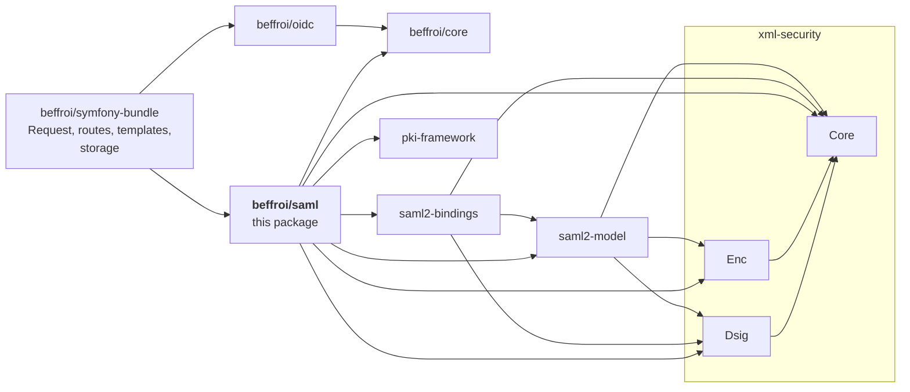

# saml: specification

The SAML 2.0 module of the identity provider: the profile written on `saml2-model` and `saml2-bindings` for the tenants, the users and the sessions of the core. It holds what both packages leave to their consumer, the HTTP request aside, which is the bundle's: the identity provider and the service providers of a tenant, the service provider a tenant is to the identity providers upstream of it, their metadata, the attributes mapped from the claims, the `NameID` derived from the `sub`, Single Logout on the session of the core.

| | |
|---|---|
| Repository | `src/saml` of the monorepo `beffroi-php/beffroi`, mirrored read only into `beffroi-php/saml` (section 10) |
| Package | `beffroi/saml` |
| Namespace | `Beffroi\Saml`, next to `Beffroi\Oidc` of `beffroi/oidc` |
| Runtime | PHP 8.4 or later; `beffroi/core`; `beffroi/saml2-model`, `beffroi/saml2-bindings` and `beffroi/xml-security`, their public classes (section 2); `spomky-labs/pki-framework`, for the X.509 certificate around a tenant's key. Nothing else. |
| Consumers | `beffroi/symfony-bundle`, which holds the HTTP request, the routes, the templates and the storage (decision 0007) |
| Design | Sub-spike 9c of [spike 9](https://github.com/beffroi-php/design/blob/main/spikes/09-saml/README.md), the identity provider role (epic beffroi-php/beffroi#645), and sub-spike 9d, the service provider role (epic beffroi-auth/beffroi#646); [decision 0013](https://github.com/beffroi-php/design/blob/main/docs/decisions/0013-saml-formats-xml-ecrits-ici.md) (the stack writes its SAML formats, `beffroi/saml` is the profile on them), [decision 0007](https://github.com/beffroi-php/design/blob/main/docs/decisions/0007-bibliotheque-et-bundle-des-le-premier-commit.md) (the bundle keeps HttpFoundation), [decision 0006](https://github.com/beffroi-php/design/blob/main/docs/decisions/0006-sur-par-defaut.md) (no option to do it wrong) of the identity provider's design repository |

This document states what the package does, what it refuses and what it guarantees; the code conforms to it, or the document changes first, in its own commit, with its reason. The specifications of `saml2-model` and `saml2-bindings` are cited as `model.md` and `bindings.md`, their invariants as `M-n` and `B-n`; those of `xml-security` as `core.md`, `dsig.md` and `enc.md`. Its sections bear the numbers of theirs, so that a reference to one holds while the stories of section 12 write the sections this document does not have yet: its threat model, its invariants (`S-n`), its public API, its limits and its acceptance hold what the stories built so far, each story adding what it builds, the identity provider of a tenant, its key, its certificate and its metadata first (issue #728), then the service providers of a tenant, read from their metadata (issue #729), then the authentication a request of one of them needs (issue #730), then single sign-on, the request received and the signed assertion posted back (issue #731), then the assertion encrypted for a service provider that asks for it (issue #733), then Single Logout started by a service provider, the session of the core ended and the signed answer sent back (issue #734), then Single Logout started by the identity provider, every service provider of the session told through the browser (issue #735); then, in sub-spike 9d, the service provider of a tenant, its entity ID, its metadata and the key it signs with (issue #778).

## 1. Why this package exists

`saml2-model` validates one message against what its consumer states, and `saml2-bindings` carries one message across one binding against what its consumer states; neither knows a tenant, a user, a session, a key the core keeps, or the state that makes a statement true. Both specifications end on the duties of that consumer, `bindings.md` section 6.8 and `model.md` section 6.9, and name it: `beffroi/saml`. Decision 0013 puts the profile here, the identity provider and the service provider of a tenant, the attributes, the `NameID` derived from the `sub`, the metadata, Single Logout on the session of the core, so that the SAML user and the OpenID Connect user are one user of the core, one model and two entry protocols.

Most of those duties are code this package writes (section 6). Two are the opposite, what its code never calls: the binding's authentication is the word of `saml2-bindings` only, and the guarantee that a received message and the signature verified over it come from one input holds only while nothing reaches into `Beffroi\Saml2\Bindings\Internal\`. `saml2-bindings` cannot close either from its side (`bindings.md` section 12); section 8 closes both here, by static analysis.

## 2. Position



The package is a module of the identity provider, at the level of `beffroi/oidc` (decision 0013), and takes its four layers (`docs/11-architecture.md` section 2): `Domain`, the objects, the values and the exceptions (`Exception/` belongs to it, as in the core and in `beffroi/oidc`); `Port`, the interfaces to the outside; `Application`, the use cases; `Bridge`, the implementations of the ports. It depends on the core, its use cases included, as `beffroi/oidc` does, and never on `beffroi/oidc`, nor `beffroi/oidc` on it: protocols never depend on each other.

The SAML stack is a brick of the module, as JOSE is of `beffroi/oidc`: the `Bridge` implements the ports on it, and sees the public classes of `saml2-model` (`model.md` section 5), of `saml2-bindings` (`bindings.md` section 5) and of the `Core`, `Dsig` and `Enc` namespaces of `xml-security`; never a class of their `Internal\` namespaces. `Enc` is there for the key of the service provider an assertion is encrypted for, `PeerKey`, built from a certificate of its accepted metadata (S-19), and the scheme it is encrypted under (S-20): the encryption itself is the model's writer's (`model.md` section 6.7), as the signature is. `pki-framework` is the `Bridge`'s too, for the self-signed certificate around a tenant's key (decision 0013, `model.md` section 6.9). `Domain`, `Port` and `Application` see the core and the PSR interfaces, as those of `beffroi/oidc` do: a story whose class needs the stack in an inner layer adds that edge with its reason, as `.ci-tools/deptrac.yaml` asks of every new dependency.

It knows no HTTP object (decisions 0007, 0013): no `Request`, no PSR-7 message, no superglobal, no route, no template. The bundle holds the request and hands the package what `bindings.md` section 6.8 names, the raw query string, the fields of a form, the URL of the endpoint from the tenant's configuration; the bundle writes the HTTP answer and the page that posts the form (`bindings.md` section 6.7). Deptrac holds the layers and the graph, `.ci-tools/deptrac.yaml`: the `Saml*` layers, nothing of Symfony but its `Uid` component, nothing of `Psr\Http`, as for `beffroi/oidc`.

## 3. Threat model

Each row is an attack class this package answers, the rule that answers it, and where the rule lives; the invariants are numbered in section 4. The threats of a message, its reading, its signature and its bytes on a binding, are those of `model.md` and `bindings.md` section 3, answered there. This section grows with the stories of section 12, each adding the rows of what it builds.

| Threat | Vector | Rule | Where |
|---|---|---|---|
| A forged assertion | The private half of the SAML key of a tenant, read where the keys are stored, in a backup or in a dump | The key is a key of the tenant as every other one: generated in the process, sealed by the KMS before anything is written, opened in memory only | S-1, the core's key custody |
| A forged assertion | The private half read from what the identity provider publishes or keeps between two requests | The metadata carries certificates, public members only; what serving them leaves in a process is the certificate, never the key, the only private half a process keeps open being the active key of a process that signs, held by the core to sign (S-15) | S-1, `SigningCertificates` |
| An outage at a rotation | A service provider that knows the current certificate only, handed an assertion signed by the next key | The next key in the metadata, its certificate beside the current one, for its staging window before it signs anything | S-2, section 6.1 |
| An outage at a rotation | A service provider that refreshes the metadata once a day, or holds a certificate an administrator uploaded, handed an assertion signed by a key staged minutes ago | The SAML key a family of its own, its staging window counted in days; the metadata saying, in its `cacheDuration`, how long it may be kept, shorter than that window | S-12, sections 6.1 and 7 |
| Key substitution | A certificate in the metadata that is not around the key, or not signed by it | Built around the public half the tenant holds, signed by that key, its signature verified before it is published, `openssl_verify()` compared to `1` | S-3, `SelfSignedCertificateIssuer` |
| A broker that signs nothing | Metadata that does not ask for signed requests, read by a broker's importer | `WantAuthnRequestsSigned` is `true` unless the tenant turns it off (`model.md` section 6.9) | S-4 |
| A request nobody signed, under the name of a provider that signs | An `AuthnRequest` stripped of its signature, or written by anybody, whose `Issuer` is a service provider that signs its requests | A signature required unless the declaration of the provider says it does not sign and its metadata do not say it does; no setting of the tenant or of the deployment relaxes it | S-9, section 6.3 |
| Assertion theft through the request | An `AssertionConsumerServiceURL` or an index naming a location of the attacker, in a request nobody had to sign | The assertion consumer service is one of the accepted document of the provider, resolved by M-9; the declaration holds none and the request adds none | S-10, section 6.3 |
| A metadata the request rewrote | The `Host` header, or the path the request arrived at, written into the entity ID or an endpoint | Every URL of the metadata from the configuration of the tenant | S-4, section 6.1 step 3 |
| The KMS reached by anyone | The metadata, which anybody reads, opening every key with the KMS at every request | The certificate of a key built once per process and kept, the private half opened for it dropped at once: the KMS asked at most once per key and per process for the metadata, never once per request; a process that signs opens the active key and keeps it to sign (S-15), the KMS asked for that key at most twice, once for its certificate when the metadata are served first and once to sign, and once when the process signs first, the certificate then built from the key it opened (S-37) | S-3, `SigningCertificates` |
| A service provider impersonated | Metadata read from a channel nobody vouches for, a plain HTTP URL, a redirect, a document that names another entity | The metadata of a service provider come from the location its declaration names, a file of the deployment or an `https` URL that is never redirected, read by `readTrusted()` for that channel or by `readSigned()` under the certificates the declaration pins; their entity ID is the declared one | S-5, section 6.2 steps 1 to 4 |
| A rollback | A document older than the one accepted served again, by a mirror, a cache or anybody who kept a copy signed by the pinned key | A document read under the pinned signers is held to the newest accepted: one whose `validUntil` is earlier, or that has none where the accepted one had one, is refused; a signed document without `validUntil` is refused (`model.md` section 6.5 step 3); only an operator forgets the accepted document, by hand. A document its channel vouches for is not held to it, whoever holds the channel serving whatever document he likes through it | S-6, section 6.2 steps 3 and 6 |
| A compromise of the host of the metadata made lasting | A document of the declared entity, valid until a far date and listing the attacker's certificate and assertion consumer service, served for one refresh by whoever held the host, then kept against the genuine one as the newer | A document read by `readTrusted()` replaces the accepted one whatever its `validUntil`, so the genuine one takes its place at the first refresh after the host is the provider's again; a refusal of the hourly refresh is written to the log as an error | S-6, section 6.2 step 6 |
| Expired metadata | A document past its `validUntil`, kept or served again | Read under M-7 at every reading, the registration and every refresh, the accepted document kept when a newer one is refused | S-6, section 6.2 step 3 |
| An assertion in clear for a service provider that asked for it encrypted | A declaration asking for encryption, its metadata without an encryption key, at the registration, at a refresh, or when a request of that provider arrives or is answered | Refused at the registration and at every refresh, the accepted document kept; a request refused, without a SAML answer, when the document holds no such key; never an assertion in clear | S-7, S-19, sections 6.2 step 5 and 6.4 steps 2 and 7 |
| A provider no request can be verified for | A declaration that keeps `signs_authn_requests` `true`, the default, or metadata saying `AuthnRequestsSigned`, with no signing key in the metadata to verify the signature by: every request of that provider is refused, and it is found at its first login | Refused at the registration and at every refresh, the accepted document kept | S-11, section 6.2 step 5 |
| An assertion or a logout message sent in clear, or run by the browser | A `Location` or a `ResponseLocation` of the metadata of a service provider in `http`, or a `javascript:` or `data:` URI, which becomes the action of a form or the target of a redirection | Every endpoint the identity provider sends a browser to is `https` on a host (`EndpointLocation`, the core's `Host`), refused at every reading, the reading back at a request included | S-11, section 6.2 step 3 |
| A person in a dump | The `md:ContactPerson` of a metadata document, its names, its electronic addresses and its telephone numbers | The accepted document sealed under the data key of its tenant (decision 0011) | S-8, the bundle's mapping |
| A worker held, memory exhausted | A metadata URL that never answers, or answers more than any metadata needs | A timeout, and a read that stops at the `maxBytes` of `Core` before the document is loaded | Section 7 |
| A person followed from one service provider to the next | The `NameID` two service providers compare, or one that holds the `sub` an OpenID Connect client was given | A persistent identifier of its own per service provider, the hash of its entity ID, the `sub` and a secret of the tenant, which nobody computes without that secret | S-13, section 6.4 step 5 |
| An assertion used where it was not addressed | An assertion posted to another service provider, or to another endpoint of the same one, or presented as the answer to another request | Its `Audience` the entity ID of the service provider that asked, its `Destination` and `Recipient` the endpoint the model resolved, its `InResponseTo` the ID of that request, its `Issuer` the entity ID of the tenant | S-14, section 6.4 step 7 |
| An assertion kept and played later | An assertion read from a browser, a log or a proxy and posted again | Five minutes of validity, the response and the assertion both signed by the SAML key of the tenant | S-15, section 6.4 step 7 |
| A claim sent where it was not meant to go, a value forged by its owner | An attribute nobody declared for that service provider, or a claim a user writes holding a NUL, which the DOM cuts, or a character XML 1.0 does not carry | Only the attributes the declaration maps, from claims the provider serves, refused otherwise right after the container of the deployment is compiled, in the same build, and at its first use for a declaration holding an environment variable; a value outside the `Char` of XML 1.0 refused when it is built, its attribute not sent | S-16, section 6.4 step 6 |
| A session used against the wish of the service provider | A `ForceAuthn` answered from a session opened earlier, an `IsPassive` answered with a login page | A login of the second the request was received in, or later, for `ForceAuthn`; `NoPassive` rather than a page for `IsPassive` | S-17, section 6.4 step 4 |
| A second assertion for one request, a request finished in another browser | A request parked for the login, resumed twice, or resumed from a browser that did not send it | The request parked in the session of the browser that sent it, for ten minutes, forgotten when it is answered | S-18, section 6.4 step 3 |
| The attributes and the identifier of a person read on their way | The assertion read from the browser, its history, an extension, a proxy that terminates TLS or the log of one, by anyone but the service provider that asked for it encrypted | The assertion encrypted for the key of the accepted metadata of that provider, which nobody else holds | S-19, section 6.4 step 7 |
| Key substitution | A key, a certificate or a `KeyInfo` a request carries, or a key a refresh replaced while the request waited, taken as the key the assertion is encrypted for | The first key for encryption of the accepted document, read at the answer; nothing of the request is read for it | S-19, section 6.4 step 7 |
| A padding oracle, a downgrade | An assertion encrypted in CBC, whose padding errors a service provider leaks, or a scheme chosen from what metadata or a request list | One scheme, `aes256-gcm` under `rsa-oaep-mgf1p`, a fresh key and IV for every assertion; the `md:EncryptionMethod` of the metadata not read; nothing ever encrypted in CBC | S-20, section 6.4 step 7 |
| A ciphertext altered on its way, an assertion that stands for nothing once decrypted | A ciphertext a service provider decrypts before anything authenticates it; a decrypted assertion whose issuer nothing proves | The assertion signed, then encrypted with its signature inside, then the response signed over the ciphertext | S-21, section 6.4 step 7 |
| A session ended by somebody else | A `LogoutRequest` nobody signed, or signed by a key that is not the service provider's, or posted to another endpoint, naming the session of a user | The signature the profile requires, the request's own or the binding's, verified under the keys of the accepted metadata of its issuer, at the URL of the single logout service of the tenant; whatever the declaration says of the signature of its `AuthnRequest` | S-22, section 6.5 step 1 |
| A logout message replayed | The signed URL of a `LogoutRequest` over HTTP-Redirect read from a log, a history or a `Referer`, presented again to end the session the user opened since | The issuer and the `ID` of an accepted request remembered by every worker, written atomically, until its window closes | S-23, section 6.5 step 1 |
| A session ended by a service provider that holds its identifier | A `SessionIndex` read elsewhere, the `sid` an OpenID Connect client was given among them, sent by a service provider under a `NameID` of another user | The session ends only when its user is the principal the `NameID` names, the persistent identifier S-13 computes for that service provider | S-24, section 6.5 step 2 |
| A session left open at a relying party | A logout at a service provider that leaves the session of the provider, or the clients it signed in, signed in | The session of the core ended as every session ends, `AuthenticationSessionEnded` reaching the back-channel logout of the OpenID Connect clients; each service provider's part in the session recorded for the stories that tell them | S-25, S-26, section 6.5 step 3 |
| A logout response sent to an attacker | A URL the request names, or a `SingleLogoutService` the metadata do not list | The `ResponseLocation`, or else the `Location`, of a `SingleLogoutService` of the accepted metadata of the service provider (M-9), never a URL of the request | S-27, section 6.5 step 4 |
| A signed-in user asked to sign in again, a session replaced | An `AuthnRequest` a service provider posts from its own site, which a `SameSite=Lax` session cookie does not accompany, answered with a login whose new cookie replaces the one the browser held | The post answered with a page of the provider's origin that posts the same body again, once, so that the cookie comes with the second post, validated as the first | S-28, section 6.4 step 1 |
| A browser signed out by another site | Any page of another site posting a form to any endpoint of the interaction plane, the login, the consent, a page of the account, the choice of a language, the single logout service, the end session endpoint, a post that forges the marker among them, without the session cookie `SameSite=Lax` keeps back: the endpoint starts an HTTP session whose cookie replaces the one the browser held, the session of the core left active | No answer of the interaction plane to a request from another site, by a method other than `GET` or `HEAD` and without the session cookie, carries a session cookie; the four endpoints a party posts a browser to post it again from the origin of the provider, the marker forged or not | S-28 |
| A session left open at a relying party | A logout at the provider, at the end session endpoint, on the page of the account or by a service provider, that leaves the other service providers of the session signed in | Every service provider of the ended sessions sent a signed `LogoutRequest` through the browser, one after the other, and the clients of OpenID Connect that registered a front-channel logout URI given its page first | S-29, S-30, S-35, section 6.6 |
| A session kept open by a service provider | A service provider that never answers, a browser closed half way through the chain, a chain that expires | The sessions of the core ended before the chain begins; the chain closes at its ten minutes and holds nothing of the provider open | S-29, S-34 |
| A logout of another person, or at another service provider | A `NameID` or a `SessionIndex` stored, or read from a request, sent to a service provider; a single logout service a request named | The `NameID` computed again for that service provider and the user of the session, the `SessionIndex` the ID of the session, the `Destination` a single logout service of its accepted metadata | S-31, section 6.6 step 3 |
| A chain played twice, a step skipped, the state of a chain read off the browser | A reference or a request ID presented again, by a second tab or a replayed URL; a cookie the browser does not send on a post from another site | The state kept by the provider, under the digest of a reference drawn from `random_bytes()` and under the ID of the request that waits, taken by one request only, closed after ten minutes | S-32, section 6.6 |
| A chain played by a client that is not the browser | The server of a service provider answering the outstanding request with no cookie, to be handed the next request and the identifier it names for another service provider; a reference read in an access log, presented after a step the KMS failed | The chain bound to a secret of 32 bytes of `random_bytes()` that the browser which began it holds in a `__Host-` cookie of its own, `SameSite=None`, its SHA-256 in the row, compared by `hash_equals()` before the row is taken and before the answer is read | S-32, S-33, section 6.6 |
| A forged answer of a service provider | A `LogoutResponse` nobody signed, signed by another key, of another issuer, answering another request, or replayed | The answer of the outstanding request only, validated by `LogoutResponseValidator` under the accepted metadata of the service provider it went to, remembered by the store of S-23 | S-33, section 6.6 step 4 |
| A page frozen, a policy rewritten | A host holding a `;` or a `,`, which RFC 3986 admits in a registered name, in an endpoint of a service provider or a URI a client of OpenID Connect registered, its origin pasted into the `form-action` of the pages of logout or into the policy of a page of the client: the `;` ends the directive and starts one of its own, `sandbox` stopping the form and the script of the page, the `,` starts a policy of its own | The host of an endpoint and of a URI a client registers held to the core's `Host`; an origin a page names refused with a `LogicException` where the page names it unless it is a scheme, a host and a port (`SourceOrigin`) | S-11, S-36 |
| A redirection the browser refuses | The `form-action` of the page that ends the session, or of the page that posts a `LogoutRequest` to a service provider, which a browser checks over every redirection of the submission, refusing the first redirection to a service provider, or the answer of that service provider redirected back to the provider | The pages whose form may start or continue the chain name the origins of where it may still go, the single logout service of the tenant among them | S-36 |
| A redirection the browser refuses | The `form-action` of the page that posts the response of single sign-on, which a browser checks over the redirection by which the assertion consumer service sends the browser on to where its application lives, often another origin no metadata state | The page names no `form-action`; its one form is the provider's, its action the assertion consumer service of the accepted metadata and every value escaped, so that no other form is in it to carry the assertion elsewhere | S-36, section 6.8 |
| A signature a service provider cannot attribute | A service provider that finds the key a signature was made with by its `KeyInfo`, Entra among them, handed a signature that carries none, or one that names a key the metadata do not publish | The certificate the metadata publish for the key that signed, in the `KeyInfo` of every signature of the provider, never another | S-37, `TenantSigning` |
| Two roles taken for one | One entity ID for the identity provider and the service provider of a tenant: two documents describing one entity to a peer that finds an entity by its entity ID, one Entra tenant holding the federation of guests under the one and the enterprise application under the other | The two entity IDs distinct, an equal one refused when the container is compiled, or at its first use when a value holds an environment variable | S-38 |
| A metadata the request rewrote | The `Host` header, or the path the request arrived at, written into the entity ID or the assertion consumer service of the metadata of the service provider | Every URL of those metadata from the configuration of the tenant | S-39, section 6.9 step 3 |
| An upstream identity provider that signs only what it is asked to | An identity provider configured from the metadata of the service provider, signing the response alone, or accepting its requests unsigned | `WantAssertionsSigned` and `AuthnRequestsSigned` `true`, with no setting that turns them off | S-39 |
| An outage at a rotation | An upstream identity provider that verifies the requests of the service provider under the certificate it fetched, handed one signed by the next key | The certificate of every SAML key in service in the metadata of both roles, which carry the `cacheDuration` of S-12 | S-40, section 6.9 |
| A role served that the deployment turned off | The SAML key kept in service for one role, the metadata of the other served with it, naming endpoints the deployment does not mean to serve | The handler of a role wired only when the role is enabled, its metadata answering `404` otherwise | S-41 |

## 4. Invariants

Each invariant is code, never a constructor option or a flag, has at least one test in section 9, and names the attack class it closes.

- **S-1. The key never leaves the KMS in clear.** The SAML signing key of a tenant is a key of the tenant (`TenantKey`, architecture §3.3) of an algorithm that implements `SamlSigningAlgorithmInterface`: drawn by the key pair generator in the process, its private half sealed by the KMS before anything is written and stored as that envelope only, opened in memory by the KMS when the process needs it, exactly as the keys of spike 2. It is never in the JWK Set, since `SamlSigningAlgorithmInterface` does not extend the core's `PublishedKeyAlgorithmInterface`; never in the metadata; never in what this package keeps between two calls, which is certificates. Nothing of this package writes, logs or returns a private member. A forged assertion.
- **S-2. The next certificate is published before it signs.** The metadata lists the certificate of every SAML key of the tenant in service, staged, active and retiring, in creation order: a staged key is there for its staging window before it signs anything, a retiring one until its retirement window ends. The steps of that life and their commands are those of every key of the tenant (`beffroi:keys:generate`, `beffroi:keys:rotate`, `beffroi:keys:activate`, `beffroi:keys:retire`, the scheduled step), and nothing of them is written again here. An outage at a rotation.
- **S-3. The certificate is the key's own.** A self-signed X.509 certificate around the public half of the key and signed by that key, built with `pki-framework`, its signature verified under that public half before it is published, the result of `openssl_verify()` compared to `1` and never to a boolean. Its bytes are a function of the key and of the tenant (section 6.1 step 2), so that two processes, or one that builds it again, publish the same certificate; a process builds it once and keeps it while the key is in service. The private half opened to build it is dropped as soon as it is built, the active key's as any other, so that serving the metadata leaves no private half open in the process (S-1): the KMS is asked at most once per key and per process for its certificate, and a process that signs opens the active key through the core, which keeps it open to sign (S-15, the core's `OpenedKeys`): the KMS is asked for the active key at most twice, once for its certificate when the metadata are served first and once to sign, and once in a process that signs first, which builds the certificate from the key it opened to sign (`SigningCertificates::ofOpened()`, S-37). Custody is worth that one opening more when the metadata come first. Key substitution, the KMS reached by anyone.
- **S-4. The metadata states the configuration of the tenant.** Its entity ID, its endpoints and `WantAuthnRequestsSigned` come from the configuration of the tenant, never from the request that asked for the metadata; `WantAuthnRequestsSigned` is `true` unless the tenant turns it off (`model.md` section 6.9, decision 0006). It is what the metadata announce to the service providers, never what a request received needs, which is S-9's: the setting neither adds a signature to that requirement nor takes one from it. A metadata the request rewrote, a broker that signs nothing.
- **S-5. The metadata of a service provider come from its declaration.** A service provider is declared in the configuration of the deployment, never registered by a request nor through a page (epic beffroi-php/beffroi#645); its metadata are read from the location the declaration names, a file of the deployment or an `https` URL, no redirect followed, nothing else reaching the network; through `MetadataReader::readSigned()` when the declaration pins the certificates of the signer of the metadata, and through `readTrusted()` otherwise, the reason being the channel: a file the operator of the deployment put there, the administrator's upload of `model.md` section 5.6, or a URL over TLS the configuration names, the pinned URL of the same section. The entity ID of the document is the declared one, compared exactly (M-8), and the document holds a service provider role. A service provider impersonated.
- **S-6. Never older when signed, never expired.** A document past its `validUntil`, or past the `validUntil` of its service provider role, is refused at every reading (M-7), whatever it was read by. A document read by `readSigned()` carries a `validUntil`, and is never older than the document accepted for its service provider: older when its `validUntil`, the one of its `md:EntityDescriptor`, is earlier than the accepted one's, kept to the second, or when it has none and the accepted one has one; an older document is refused and the accepted one kept, since an older document signed by the same pinned key verifies as well, which is the rollback `model.md` section 6.5 step 3 leaves to this package. Nothing but an operator goes back on it: forgetting the accepted document of a service provider is a command run by hand, never a step of the schedule nor a request, after which the next reading registers the service provider as a first one (section 6.2). A document read by `readTrusted()` replaces the accepted one whatever its `validUntil`, earlier, absent or later: the channel vouches for the newer reading as it vouched for the older one, and whoever serves an older copy through it serves any document he likes. So a document of the declared entity written by whoever held the host of the metadata for one refresh, valid until a far date and listing his certificate and his assertion consumer service, gives way at the first refresh after the host is the provider's again, the genuine document carrying an earlier `validUntil` or none, rather than pinning his keys and his endpoints until an operator forgets it. Which of the two read a document is said by the reading (`ServiceProviderMetadata::$readSigned`), never by whoever replaces the accepted one. The hourly refresh of the bundle writes a refusal to its log as an error, the level an operator is alerted on, since the refused document comes back at every hour while the accepted one serves on. A rollback, expired metadata, a compromise of the host of the metadata made lasting.
- **S-7. Encryption asked, encryption possible.** A declaration that asks for encrypted assertions is refused while the metadata of its service provider hold no key for encryption, a `KeyDescriptor` whose `use` is `encryption` or absent (`model.md` section 6.5 step 5): at the registration, and at a refresh, which keeps the accepted document. The declaration decides whether the assertions of a provider are encrypted, and the metadata only which key they are encrypted for (S-19): a provider whose declaration does not ask gets them in clear whatever keys its metadata hold, as a SimpleSAMLphp identity provider does unless `assertion.encryption` is set for it. An assertion in clear for a service provider that asked for it encrypted.
- **S-8. The document is sealed.** The accepted document is kept as the bytes that were read, never written again, sealed under the data key of its tenant in the family of its own table (decisions 0011 and 0018), since an `md:ContactPerson` names people. A person in a dump.
- **S-9. A request is unsigned only where its provider says so.** An `AuthnRequest` needs a signature, XML or over its binding, unless the declaration of its service provider says it does not sign (`signsAuthnRequests` `false`) and the accepted metadata of that provider do not say it does (`AuthnRequestsSigned` absent or `false`): the provider's own statement wins towards safety, a declaration that signs refusing an unsigned request whatever the metadata say, metadata that sign requiring a signature whatever the declaration says. Nothing else decides it: not `WantAuthnRequestsSigned` of the tenant, which is what the metadata announce (S-4), nor any setting of the deployment (decision 0006). A signature a request carries is verified whatever the requirement (M-2), under the keys of the provider's metadata (M-3). The requirement reaches `saml2-model` as both its flags, the `authnRequestsSigned` of the service provider and the `wantAuthnRequestsSigned` of the identity provider handed to `validate()`, the model refusing an unsigned request when either is `true` (`model.md` section 6.2 step 2). A request nobody signed, under the name of a provider that signs.
- **S-10. The assertion goes where the accepted metadata say.** The assertion consumer services a request is resolved among are those of the accepted document of its service provider, read back, and none other: the declaration holds none, and an `AssertionConsumerServiceURL` or an `AssertionConsumerServiceIndex` of the request is honoured only when it designates one of them (M-9, `UnknownEndpoint` otherwise), signed or not. A request refused so gets no SAML answer (`model.md` section 6.2). Assertion theft through the request.
- **S-11. A signature required, a key to verify it by.** A service provider whose requests need a signature under S-9, because its declaration says it signs them (`signsAuthnRequests` `true`, the default) or its metadata say `AuthnRequestsSigned`, is refused while the metadata hold no key for signing, a `KeyDescriptor` whose `use` is `signing` or absent (`model.md` section 6.5 step 5): at the registration, and at a refresh, which keeps the accepted document. Without that key every request of the provider is refused (section 6.3 step 4), at its first login and not at the command, as S-7 refuses encryption without a key for it. A provider declared unsigned whose metadata say nothing of signing needs none (S-9). The metadata hold, besides, nothing a browser is sent to but `https` on a host: every endpoint the identity provider uses, the `Location` of each `md:AssertionConsumerService` and the `Location` and the `ResponseLocation` of each `md:SingleLogoutService` the model keeps, is an `https` URL, its scheme compared without regard to case (RFC 3986 §3.1), whose authority is a host and an optional port and nothing else, no userinfo, the host a name of letters, digits, hyphens and dots for the DNS (RFC 3986 §3.2.2, RFC 1123 §2.1), an IPv4 address or an IPv6 literal between brackets (`EndpointLocation`, on the core's `Host`, the rule the URIs a client of OpenID Connect registers are held to as well); a document holding another is refused at every reading, the registration, a refresh, which keeps the accepted document, and the reading back of section 6.3 step 1, which refuses a document accepted before, the refusal naming the endpoint and never its value (M-16). `saml2-model`, a model of the standard, accepts any absolute URI (M-6), and the reg-name of RFC 3986 admits the `;` and the `,` its sub-delimiters hold, which end a directive and a policy of the page that names the origin of the endpoint (S-36). A provider no request can be verified for; an assertion or a logout message sent in clear, or to a script or a document of the browser's own (`javascript:`, `data:`) the action of a form or a redirection would run; a policy split by the host of an endpoint.
- **S-12. The window of a SAML key outlasts the cache of its metadata.** The SAML signing key is a family of keys of its own: it declares its own staging delay and its own age, seven days and 365 days by default (section 7), where every other key of the tenant keeps the figures of `beffroi.keys`, 360 s and 90 days, so that a rotation of the SAML key publishes the next certificate for days before it signs and a rotation of a JOSE key is not slowed by it. The metadata carries a `cacheDuration` (Metadata §2.3.2), one day by default, strictly shorter than that staging delay and refused otherwise, by `IdentityProviderMetadataHandler` when it is built and by the configuration of the bundle when it is read: a service provider that honours it has fetched the metadata again, and with it the next certificate, before that certificate signs. An outage at a rotation.
- **S-13. One persistent identifier per service provider.** The `NameID` of an assertion is of the `persistent` format (Core §8.3.7), its `NameQualifier` the entity ID of the tenant and its `SPNameQualifier` the entity ID of the service provider; its value is the SHA-256 of the entity ID of the service provider, the `sub` of the user and the salt of the tenant, each followed by a NUL, in base64url without padding: 43 characters, within the 256 of the format. Core §8.3.7 asks for "pseudo-random values that have no discernible correspondence with the subject's actual identifier", so it is never the `sub`, nor a username, nor an address. It is computed and never drawn: the same user signing in to the same service provider gets the same value at every login, in every worker, after a restore and after an import that keeps the subjects (decision 0002), and two service providers get two values they cannot relate. The salt is the secret of the tenant its pairwise subjects are computed with (OIDC Core §8.1), sealed by its KMS, so that one secret of the tenant makes every pseudonym of its users, and nobody who knows a `sub` an OpenID Connect client holds computes the `NameID` of a service provider. A person followed from one service provider to the next.
- **S-14. The assertion is addressed to the request that asked for it.** The `Destination` of the response and the `Recipient` of its bearer confirmation are the location of the `AssertionConsumerService` the model resolved among the accepted metadata (S-10), its `InResponseTo` and the one of the confirmation the ID of the accepted request, the one `AudienceRestriction` holds one `Audience`, the entity ID of the service provider, compared exactly as the declaration holds it, and the `Issuer` of the response and of the assertion is the entity ID of the tenant, the URL of its metadata, with no `Format`. Nothing of it is read from the request as it arrived (`model.md` section 6.9). An assertion used where it was not addressed.
- **S-15. Short, and signed.** An assertion is issued at the instant of the clock and is valid five minutes from it: its `Conditions` begin at that instant, their `NotBefore` the `IssueInstant` of the assertion, and its `Conditions` and its bearer confirmation end at that instant plus 300 seconds, within the `maxBearerWindow` of 3 600 seconds a validator of `saml2-model` applies and the `maxMessageAge` of 300 seconds within which it accepts the assertion at all (`model.md` section 7); the bearer confirmation carries no `NotBefore`, which Profiles §4.1.4.2 forbids it, and the authentication statement no `SessionNotOnOrAfter`. The `NotBefore` of the `Conditions` is there for Entra, which refuses an assertion whose `Conditions` carry none, `AADSTS500089: SAML 2.0 assertion validation failed: SAML token is invalid` (played on 19 October 2026, section 7), the sample response Microsoft documents carrying one; it is the `IssueInstant` and not earlier, so that the assertion is valid for its five minutes and not before it was issued, which a validator of `saml2-model` accepts, refusing a `NotBefore` only when it is later than its clock plus its skew (M-7), and which its writer writes, the `NotBefore` earlier than the `NotOnOrAfter` to the second (`model.md` section 6.6). The assertion is signed, then the response over it (`SignedParts::AssertionAndResponse`), under RSA-SHA256, by the active SAML key of the tenant, opened by its KMS once per process to sign and kept for that by the core, besides the opening its certificate made and dropped when the metadata were served first, a process that signs first building that certificate from the key it opened to sign (S-3, S-37); a service provider that wants either signed finds it, as SimpleSAMLphp signs both by default. A failure response is signed the same way. An assertion kept and played later.
- **S-16. The attributes the declaration maps, values XML carries.** An assertion carries one `Attribute` per mapping of the declaration of its service provider whose claim the user holds, under the name, the name format and the friendly name the mapping gives, and nothing else. A mapping names a claim the provider serves, refused otherwise right after the container of the deployment is compiled, in the same build, and at its first use for a declaration holding an environment variable (section 6.2 step 1). A value is the text of the claim: a string as it is, an integer in decimal, a boolean `true` or `false` (XML Schema Part 2 §3.2.2.1), a list each of its members; it holds only the `Char` of XML 1.0 §2.2, the NUL and the other control characters but the tab, the line feed and the carriage return, a surrogate, U+FFFE and U+FFFF, and bytes that are not UTF-8 refused when the value is built: the DOM cuts a string at its first NUL, so that a value written past it would be signed short, and the serializer of `Core` refuses the rest (issue #670). A claim whose value is none of these, a JSON object such as `address`, or that holds a value so refused, is not sent, and the refusal is written to the log, naming the service provider, the claim and the rule and never the value: an attribute is the user's statement to that provider, and a statement cut or rewritten by this provider would be one the user never made, while the sign-on, which the attribute does not decide, goes on. A claim sent where it was not meant to go, a value forged by its owner.
- **S-17. A session reused as the service provider allows.** A request is answered from the session the browser holds when that session is active, of the tenant, and, when the request says `ForceAuthn`, holds a proof made in the second the request was received in or later (Core §3.4.1): the core keeps a proof to the second, a Unix timestamp, so the instant of the request is compared at that precision, and a login typed in the same second as the request answers it instead of sending the browser to the login again; otherwise the browser goes to the login of the provider, its second factor included, the pages every flow of the provider signs in through, unless the request says `IsPassive`, which is answered `Responder` and `NoPassive` without a page (Core §3.4.1). That answer, as the two other failures of section 6.4 step 4, is written before any login, so that whoever sends a request in the name of a service provider that does not sign its requests (S-9) obtains it: it is kept, since Core §3.4.1 asks for it and such a provider, the Entra federation among them, has to read it, and it opens nothing but a refusal signed at the service provider's own endpoint, a `Response` of a status and no assertion (`model.md` M-13), signed as every response of the provider (section 6.4 step 7), its `InResponseTo` the `ID` of the request, an NCName (`model.md` M-6), posted to an assertion consumer service of the accepted metadata and to none other (S-10). A session used against the wish of the service provider.
- **S-18. A request waiting for a login is the browser's, once.** A request that waits for a login is kept in the session of the browser that sent it, never in a URL, under a reference drawn from `random_bytes()`, for ten minutes; it is answered once, and forgotten when it is answered, so that no second assertion is written for it; a browser that did not send it, or comes back later, finds nothing and is shown the page of a refusal. A second assertion for one request, a request finished in another browser.
- **S-19. Encrypted, for the key the accepted metadata hold.** The assertion of a success answered to a service provider whose declaration asks for encrypted assertions is a `saml:EncryptedAssertion`, never an assertion in clear. It is encrypted for the first certificate for encryption of the accepted document of that provider, a `KeyDescriptor` whose `use` is `encryption` or absent, in document order, the one a SimpleSAMLphp identity provider takes (`getPublicKeys('encryption')[0]`); the document is read back when the request is answered and not when it arrived, so that the key a refresh put in place while the request waited for its login is the one used. Never a key, a certificate or a `KeyInfo` a request carries, never one of the declaration, which pins none. A request of such a provider whose accepted document holds no key for encryption, when it arrives or when it is answered, is refused, `SignOnRefusedException`, without a SAML answer: nothing is sent in clear. A failure response carries no assertion and nothing in it is encrypted. The `EncryptedKey` carries no `KeyInfo`: the service provider decrypts with the key it holds, as SimpleSAMLphp and xmlsec1 do, every key of its own tried in turn. The attributes and the identifier of a person read on their way, key substitution.
- **S-20. One scheme, nothing in CBC.** The content is encrypted under `aes256-gcm`, its session key under `rsa-oaep-mgf1p`, SHA-1 for the OAEP mask and for MGF1 (`enc.md` E-1), a fresh session key and IV drawn for every assertion (`enc.md` E-8). Nothing is ever encrypted in CBC (decision 0013, beffroi-php/beffroi#689), whatever a service provider asks: the `md:EncryptionMethod` elements of its metadata are not read, so that no scheme is negotiated and none is downgraded, and a service provider that decrypts no AES-GCM gets nothing it can read rather than an assertion in CBC. `rsa-oaep-mgf1p` and not the `rsa-oaep` of XML Encryption 1.1 with SHA-256: SimpleSAMLphp's library unwraps under SHA-1 only (`enc.md` section 13), and PHP 8.4 wraps under nothing else; the hash inside OAEP is not a collision property. A padding oracle, a downgrade.
- **S-21. Signed, encrypted, then signed again.** The assertion is signed by the SAML key of the tenant (S-15), then encrypted with its signature inside (Core §6.2: sign before encrypting), and the response is then signed over the `saml:EncryptedAssertion` (`SignedParts::AssertionAndResponse`, `model.md` section 6.7). Both, for two readers of two things: the signature of the response covers the ciphertext, the one thing a service provider can verify before it decrypts, so that a service provider that verifies first refuses an altered ciphertext before any decryption touches it, which is the order the service provider role of the stack reads (`model.md` section 6.7) and the one SimpleSAMLphp calls in (`saml\Message::processResponse()` checks the response, then `processAssertion()` decrypts, then verifies the assertion), although its library reads a response whose signature fails as unsigned and decrypts it anyway, the tag of AES-GCM then refusing the altered ciphertext (measured on 15 October 2026, SimpleSAMLphp 2.5.3.1: "Failed to decrypt XML element."); the signature of the assertion travels inside the ciphertext and verifies once it is decrypted (`enc.md` E-9), so that the assertion stands alone as the statement of the tenant, as a service provider that wants the assertion signed (`WantAssertionsSigned`) needs. A ciphertext altered on its way, an assertion that stands for nothing once decrypted.
- **S-22. A logout request is the service provider's.** A `LogoutRequest` received at the single logout service of the tenant, over HTTP-Redirect or HTTP-POST, is validated by `saml2-model`'s `LogoutRequestValidator` with the URL of that service as the tenant publishes it (M-8): its signature is required, its own in its XML or the binding's over its query string (M-2, Profiles §4.4.4.1), verified under the signing keys of the accepted metadata of the service provider its unverified `Issuer` names (M-3). A declaration that says it does not sign its `AuthnRequest` (S-9) relaxes nothing here, nor does any setting of the tenant or of the deployment (decision 0006). A request of an issuer nobody declared, of a service provider with no accepted document, of one whose document lists no single logout service it can be answered at (S-27), and a request the binding or the model refuses, end nothing and get no SAML answer; a `LogoutResponse` is the answer of S-33, read at the same service: the page of a refusal, naming the rule and never a value of the message (M-16, B-11). A session ended by somebody else.
- **S-23. A logout request ends sessions once.** The model remembers the issuer and the `ID` of every `LogoutRequest` it accepts until the window in which it would accept it again has closed (M-11, model.md sections 6.3 and 6.9), and refuses it, `Replayed`, when it comes again: then it ends nothing and gets no SAML answer, as any refusal of S-22. Nothing is remembered before the active SAML key of the tenant is opened (section 6.5 step 1): a tenant without one, or a KMS that does not answer when it is opened, remembers nothing, so that the same request is accepted once the key or the KMS is back. The store it remembers them in is the bundle's, one for every worker of the deployment, and atomic: a row per message under its tenant, keyed by the SHA-256 of the tenant, the issuer and the `ID`, inserted with `ON CONFLICT DO NOTHING`, so that of two workers handed the same message at the same instant one only is told it is new; a row whose window has closed is deleted before each insertion. A logout message replayed.
- **S-24. The sessions named, of the principal named.** The sessions a request ends are those its `SessionIndex` elements name, a `SessionIndex` being the ID of a session of the core, the one the assertion carried (section 6.4 step 7): each found by that ID when it is a UUID, and ended only when it is a session of the tenant whose user is the principal of the `NameID`, a `persistent` `NameID` (Core §8.3.7) whose value is the one S-13 computes for that service provider and that user, compared with `hash_equals()`, whose `NameQualifier`, when present, is the entity ID of the tenant and whose `SPNameQualifier`, when present, is the entity ID of the service provider. Nothing is stored for it: the `NameID` is computed again (section 12). A `SessionIndex` that names no session of the tenant, and a session that has ended already, are ended already, and the answer is `Success`; a session of another principal ends nothing, no session of the request ending, and the answer is `Requester` with `UnknownPrincipal` (Core §3.2.2.2); a request naming no `SessionIndex` ends nothing, and the answer is `Requester` with `RequestUnsupported` (section 12). A session ended by a service provider that holds its identifier.
- **S-25. A session ends as every session ends.** The sessions S-24 ends are ended by the core's `SessionTerminator`, `SessionEnd::RelyingParty`, with the `RequestContext` of the request, synchronously, since the status of the answer says whether they ended (Core §3.7.3.2), and only once the key that signs that answer is open (S-27), so that no session ends whose answer cannot be signed: it announces `AuthenticationSessionEnded`, on which the back-channel logout of spike 4 tells every client of OpenID Connect the session signed in that registered a back-channel logout URI (Back-Channel Logout 1.0 §2.6), as a logout from the end session endpoint, from the page of the account or by an administrator does; on the same event, the refresh tokens of OpenID Connect issued in the session are revoked and its opaque access tokens removed (issue #741), whatever ended it, so that `beffroi/saml`, which cannot reach `beffroi/oidc`, has nothing to revoke itself. That revocation runs on the lane of the events, and a refresh in flight when the session ends, which read the session as active before `SessionTerminator` wrote it ended and saves its rotated successor after the revocation ran, leaves that successor recorded active: the window is the record's only, since every token of an ended session is refused at its use, and it closes at the first use of that token, whose refusal announces `RefreshTokenOutlivedItsSession`, on which the same revocation runs again, dated by the end of the session and asynchronously too, the refusal needing nothing of it; no lock is taken for it. The browser that held the session finds none at its next request. The other service providers of the session are told through that browser, from what S-26 records (S-29 to S-34), and the answer of S-27 waits for them. A session left open at a relying party.
- **S-26. Each service provider's part in a session is recorded.** When single sign-on answers a request with an assertion (section 6.4 step 7), it announces `ServiceProviderSignedIn`, which names the tenant, the session by its ID, the `SessionIndex` of the assertion, the entity ID of the service provider and the subject of the user; a handler of the bundle records it, one row per session and service provider, written once whatever the number of sign-ons (`ON CONFLICT DO NOTHING`), deleted with the session. The write is asynchronous, as every write the protocol does not need the result of in the same request (architecture §5.6): the assertion needs nothing of it, so the event leaves through the queue of the events and nothing is added to the writes `messenger.yaml` lists as synchronous; the window between the assertion and its row is the queue's. The logout the identity provider starts reads them, `SessionParticipationRepositoryInterface::ofSession()`, to tell each service provider of an ended session (S-30). A session left open at a relying party.
- **S-27. The answer goes where the accepted metadata say, signed.** A `LogoutResponse` goes to a `SingleLogoutService` of the accepted document of the service provider (M-9), never to a URL of the request: the first one listed on the binding the request arrived over, or else the first one listed, kept by the model on HTTP-Redirect or HTTP-POST (model.md section 6.5 step 6), at its `ResponseLocation`, or else its `Location` (Metadata §2.2.2), which is its `Destination`. It is resolved when the request is received, so that a service provider whose document lists none ends nothing (S-22). Its `InResponseTo` is the ID of the request, its `Issuer` the entity ID of the tenant, its `Status` the one of S-24, or the one of S-34 when the request ended sessions and the chain was played first, its `IssueInstant` the instant of the clock it is written at; it is signed by the active SAML key of the tenant under RSA-SHA256, over the query string for HTTP-Redirect (B-12), in its XML for HTTP-POST, a key opened before the request is read (section 6.5 step 1): a tenant without one, or a KMS that does not answer when it is opened, ends nothing, remembers nothing (S-23) and gets no SAML answer, the page of a tenant that serves no identity provider or the `503` of a KMS that does not answer, whatever the request would have been answered; and it carries back the `RelayState` received byte for byte (B-9). A logout response sent to an attacker.
- **S-28. A post from another site is posted again, as it came, once.** Under `SameSite=Lax` a browser sends the session cookie with a top-level `GET` from another site and with no `POST` from one (RFC 6265bis, "SameSite" cookies), so that an `AuthnRequest` or a logout message a service provider posts over HTTP-POST, and an authorization request or a logout request a client of OpenID Connect posts (OIDC Core §3.1.2.1, RP-Initiated Logout §2), arrive without the session the browser holds: a user signed in is asked to sign in again, and a logout misses the session it ends, its confirmation page holding its token in a session the browser never receives. At the four endpoints a party posts a browser to from another site (**Where**), a post whose body is a form (`application/x-www-form-urlencoded`), that the browser says came from another site (`Sec-Fetch-Site: cross-site`, Fetch Metadata Request Headers), and that carries no session cookie, is answered with a page of the provider's origin that posts the same body again to the same URL, the marker `_beffroi_posted_again` added to the query of its action unless that query carries it already: the second post is same-origin, and the cookie comes with it. Every other request is served as it came, a browser that sends no `Sec-Fetch-Site` among them, as before this rule. It opens nothing HTTP-Redirect does not: a top-level `GET` from the site of the service provider carries that cookie already, and the second post carries that cookie and nothing more.
  - **The body as it came.** What is posted again is the body received, pair by pair, in its order, a repeated name included, decoded as PHP decodes it, and nothing is added to it: the endpoint reads the second post as it would have read the first, and verifies and refuses it the same way, a request repeated or malformed refused there and not hidden here. A body a browser would not send back as it went is served as it came: a name or a value that is not UTF-8, or that holds a control character other than the tab, or a carriage return or a line feed that is not one of a CR LF pair, which a browser reads as a line feed and writes back as CR LF (HTML, "preprocessing the input stream" and "converting an entry list to a list of name-value pairs"); an empty name; the name `_charset_`, whose value a browser replaces with its encoding (HTML, "constructing the entry list"); an empty body.
  - **The marker.** It names the second post and decides nothing. It travels in the query of the action, which neither endpoint reads on a post, so that the fields are not touched. What stops a loop is the second post itself: posted from the provider's own page, it is one no browser says came from another site, and it is served as it came; a browser that holds no session at all, which the provider cannot tell from one whose cookie was kept back, is sent to the login by it, once. A post from another site that carries the marker, forged or not, is posted again as one that does not carry it, the marker not added twice, so that no post from another site is served without the session the browser holds.
  - **The bounds.** None of its own: the body is bounded where it already was, by the `post_max_size` of PHP before anything reads it, and by the bounds of the endpoint on the second post, `maxFormValueBytes` of `saml2-bindings` for a `SAMLRequest` (B-7); the page holds that body and nothing more.
  - **The session.** The page reads, starts and sets no HTTP session: a cookie set on that answer would replace the one the browser holds, which is what the page exists to avoid.
  - **The plane.** Whatever the endpoint, no answer to such a request carries a session cookie. A request of the interaction plane (a route named `beffroi_interaction_*`, architecture §5.2) that the browser says came from another site, whose method is neither `GET` nor `HEAD`, the condition under which `SameSite=Lax` keeps the cookie back, and that carries no session cookie, is answered without the cookie of the session its endpoint started, a login form or the token of a form written in it: the bundle's `CrossSiteSessionCookie` takes it off the answer once the session listener of Symfony has written it, by the name of the session and the path and domain it was written with. `SameSite` keeps the cookie from a cross-site post and does not keep the answer of a top-level navigation from setting one (RFC 6265bis, the storage model), so the cookie of a session started there would replace the one the browser holds, and any page of another site posting a form to the login, the consent, a page of the account, the choice of a language or any other endpoint of the plane would sign the browser out of the provider, its session of the core left active and orphaned. What the endpoint wrote in that session is saved and read by nobody, no browser holding its identifier, until the store expires it; not saving it would take a second hook emptying it before the session listener saves it, and is not done. A `GET` is left alone: one from another site carries the cookie, so a `GET` without it comes from a browser that holds no session, and the authorization endpoint starts one for the request that waits for the login. The page of a post from another site at the other endpoints of the plane is no page the browser goes on from: their forms are the provider's own, which no other site posts on purpose.
  - **The page.** As `bindings.md` section 6.7 asks of a page that posts a form: every name and value escaped for an HTML attribute by Twig, a script of one line, `document.forms[0].submit();`, the only one its `Content-Security-Policy` allows, by its SHA-256, `default-src 'none'`, `base-uri 'none'`, `frame-ancestors 'none'`, never `unsafe-inline`; a submit button inside `noscript`; `Cache-Control: no-cache, no-store` and `Pragma: no-cache`. It names no `form-action`: the second post is answered where the endpoint sends it, the login of the provider, the page that posts to an assertion consumer service, the redirection URI of a client of OpenID Connect, the next step of a chain of logout or where a logout ends, and a browser checks that directive over the whole chain of redirections a submission follows (the bundle's `FormTarget`), while the one form of the page is written by the provider and posts to the provider. Its words are in the language every page of the interaction plane chooses (architecture §5.7), and nothing of the HTTP session is read for it: at the authorization endpoint and at the end session endpoint the `ui_locales` of the posted body (OIDC Core §3.1.2.1, RP-Initiated Logout §2), read as those endpoints read it and left aside when they would refuse it, which the second post then does, then `Accept-Language`; at the single sign-on and single logout services, whose messages name no language, `Accept-Language`; each against the locales the deployment serves, the default one last.
  - **Where.** The bundle's `CrossSitePost` (`post_again.html.twig`), which each endpoint a party posts a browser to from another site asks first, opting in, before anything of the request is read, so that the first post spends nothing the second needs: the single sign-on service and the single logout service once the body is known to be a form (section 6.8), so that a logout message is read on the second post only, the store of S-23 and the chain of S-32 left as they were by the first, the cookie of the chain, `SameSite=None`, coming with both; the authorization endpoint of OpenID Connect before it reads anything, so that the first post spends no pushed request (RFC 9126 §4); and the end session endpoint before it reads anything, so that the second post finds the session the browser holds and renders a confirmation page whose token lives in that session, a confirmation forged on another site posted again and refused there by that token.
  - **What is left.** A browser that sends no `Sec-Fetch-Site` is served as it came, the cookie of a session its endpoint started included: the provider cannot tell its post from another site from one of its own pages. A post from another site at one of the four endpoints whose body the page cannot post again, one that is not a form or would not come back from a browser as it went (**The body as it came**), is served as it came and answered without the session cookie: a browser that holds no session is then sent to a login whose form is bound to a session it never receives; no service provider and no client writes such a body (section 6.8, OIDC Core §3.1.2.1). The page an endpoint of the plane answers such a request with, a refusal most often, still carries the token of its form of languages, written in the session no browser receives, so that this form, posted, is refused (`403`).

  A signed-in user asked to sign in again, a session replaced, a logout that misses the session it ends, a browser signed out of the provider by any page of another site.
- **S-29. The provider tells the service providers after the session has ended, through the browser that ended it.** The logout the identity provider starts begins where a browser ends the session it holds: the end session endpoint of OpenID Connect once it has ended the session (RP-Initiated Logout §2), the page of the account when the session it ends is the one of the browser reading it, and the single logout service when a `LogoutRequest` of a service provider ended sessions (S-24, S-25). Each of them has ended the sessions of the core first, by `SessionTerminator`, synchronously; the chain begins after, so that a service provider that never answers, a browser closed half way, or a chain that closes (S-32), keeps no session of the provider open: the session has ended whatever becomes of the chain. The chain is the front channel of the Single Logout profile (Profiles §4.4.3.1 and §4.4.3.3, HTTP-Redirect and HTTP-POST): the browser goes from one service provider to the next, carrying a `LogoutRequest` to each and its `LogoutResponse` back; SOAP, which would tell a service provider without a browser, is out of scope (section 11). A session ended without its browser, by the console, from the page of the account in another browser, with every other session of the account, or replaced by a new login, tells no service provider: the clients of OpenID Connect learn it by the back channel (S-25), and a service provider has no channel without the browser (section 12). A session left open at a relying party, a session kept open by a service provider.
- **S-30. Every service provider of the sessions, but the one that asked.** The service providers told are those S-26 recorded for each ended session, session by session, each in the order of its first sign-on, the one whose `LogoutRequest` started the logout left out, since it is answered (S-34). A service provider is told when its declaration is still in the configuration, its accepted document reads back now (`readTrusted()`, section 6.3 step 1) and lists a `SingleLogoutService` on HTTP-Redirect or HTTP-POST (the model keeps no other binding, `model.md` section 6.5 step 6), and the session is still in the store, the user it names being the one whose `NameID` is computed (S-31); otherwise it is passed over, and counts as a service provider that did not answer `Success` (S-34). So is a service provider whose request cannot be written, what it is written from refused by the model or by the binding that carries it, a single logout service the sender refuses among them (`SignOutNoticeRefusedException`): the chain goes on to the next one, and the one that asked is answered `PartialLogout`. A sign-on whose part the queue has not written yet (S-26) is not told: the window is the queue's. A session left open at a relying party.
- **S-31. The request the provider sends names the principal and the session the service provider knows.** A `LogoutRequest` of a new `ID` (the model's `SamlId`, 160 bits of `random_bytes()`), its `IssueInstant` the instant of the clock, its `Issuer` the entity ID of the tenant with no `Format`; its `Destination` the `Location` of the first `SingleLogoutService` of the accepted document of the service provider, read back when the request is written and never taken from a request (M-9; the `ResponseLocation` is where responses go, Metadata §2.2.2); its `NotOnOrAfter` the `IssueInstant` plus 300 seconds, the `maxMessageAge` within which a validator of `saml2-model` accepts it at all (`model.md` section 7); its `NameID` the `persistent` one S-13 computes again for that service provider and the user of the session, its `NameQualifier` the entity ID of the tenant and its `SPNameQualifier` the entity ID of the service provider, as the assertion carried it (S-14), nothing of it stored; one `SessionIndex`, the ID of the session, the one the assertion carried (section 6.4 step 7). It is signed by the active SAML key of the tenant under RSA-SHA256, over the query string for HTTP-Redirect (B-12), in its XML for HTTP-POST, and carries no `RelayState`: its answer is found by its `InResponseTo` (S-32), and a `RelayState` would be a second handle nothing reads. A logout of another person, or at another service provider.
- **S-32. The chain is kept by the provider, played once, by the browser that began it.** The state of a chain is a row of the bundle, and nothing the browser holds: the HTTP session of the browser was invalidated when the session of the core ended, and an answer posted from the site of a service provider comes without the session cookie of the provider, which says `SameSite=Lax` (section 6.8). The row holds the ended sessions, the service providers left to tell, the one the outstanding request went to, whether every service provider told so far answered `Success`, and where the chain ends (S-34), and nothing else; it is found by the SHA-256 of a reference of 32 bytes of `random_bytes()`, which the provider's own pages hand to the route that resumes the chain (S-35), and by the `ID` of the outstanding request, which the `InResponseTo` of its answer names (S-33). It is bound to the browser that began it: when the chain begins, the provider draws a secret of 32 bytes of `random_bytes()`, keeps its SHA-256 in the row beside the one of the reference, and gives the secret to that browser in a cookie of its own (`LogoutChainCookie`), its name `__Host-` prefixed, `Secure`, `HttpOnly`, its path `/` and no `Domain`, so that only the origin of the provider sets it and reads it; `SameSite=None`, since an answer over HTTP-POST is a top-level post from the site of a service provider, which a browser does not accompany with a cookie that says `Lax`, and the chain is a series of top-level navigations, which the blocking of third-party cookies leaves alone; its `Max-Age` the ten minutes the chain is open, given again with each step and cleared where the chain ends (S-34). The cookie binds and carries nothing else, where the chain stands being the row's. Every step, the one a reference resumes as the one an answer moves on, compares the SHA-256 of the secret the browser presents with the one the row keeps, by `hash_equals()`, before it takes the row, and, for an answer, before the answer is read (S-33): a secret missing, or another one, is refused as a reference no row holds, and the row is left as it was, for the browser that began the chain. It is open ten minutes from its last step, the wait of a request for a login (S-18); a row past it is closed, and deleted before each insertion. Each step takes it first, by a deletion whose count says whether this request deleted it, so that of two requests presenting the same reference or answering the same request one only plays the next step, the other refused; the next step then writes it again under the same reference, bound to the same secret. A reference, or an answer, that no open row holds is refused, `LogoutRefusedException`, the page of a refusal. A step that fails once it took the row, for a reason that is not one service provider's (S-30), the KMS that does not answer, the tenant that holds no active SAML key, the salt that can neither be read nor drawn, or anything else, does not lose the chain: the row is written back. A step resumed by its reference writes it back as it took it, under the same reference, waiting for nothing, its ten minutes unchanged, a failed step being no step, and the failure goes up: the same request at the route that resumes the chain plays the step again, which the `503` and its `Retry-After` of a KMS that does not answer ask for. A step that read an answer cannot be played again by that answer, which the store of S-23 remembers already: the answer is counted, and the row written back under a new reference, bound to the same secret, waiting for nothing, its ten minutes unchanged, and handed on as a chain begun is (section 6.6 step 4), so that the step is played again at once from that reference and the browser, when it fails again on a KMS that does not answer, is given the route that resumes the chain with it (S-35); another failure goes up there, the chain kept under that reference until it closes. Rather than putting the row back, the step could take it only once the request is written; it is not done so, since an answer would be spent all the same, and two requests presenting the same reference would both write a request that one only sends. The write is one the next request of the browser reads, so it is written at once and not through the queue (architecture §5.6), as the store of S-23 is; it is no message, so nothing is added to the writes `messenger.yaml` lists as synchronous. A chain played twice, a step skipped, the state of a chain read off the browser, a chain played by a client that is not the browser that began it: the server of a service provider answering the outstanding request in place of the browser, handed the request to the next service provider and the `NameID` of the person there, or a reference read in an access log.
- **S-33. The answer of a service provider is the one of the request it was sent, carried by the browser of the chain.** A `LogoutResponse` received at the single logout service of the tenant, over HTTP-Redirect or HTTP-POST, is read for the open chain whose outstanding request its unverified `InResponseTo` names and that is bound to the secret the browser presents (S-32), and refused when there is none, `LogoutRefusedException`, before any key is read and before the store of S-23 remembers it, so that a client that is not that browser spends neither the chain nor the answer. It is validated by `LogoutResponseValidator`, through `ReceivedLogoutResponse::validate()`, under the accepted document of the service provider that request went to, read back now, never the one its `Issuer` names: its signature required, its own or the binding's (M-2, Profiles §4.4.4.2), its `Issuer` that service provider (M-8), its `Destination` the single logout service of the tenant, its `InResponseTo` that request (M-10), remembered last in the store of S-23 (M-11). What the binding or the model refuses gets the page of a refusal and no SAML answer, and leaves the chain as it was, for the answer of the service provider itself until it closes. A status other than `Success` is an answer and not a refusal (`model.md` section 6.4): the chain goes on, counting that service provider as one that did not answer `Success`. A forged answer of a service provider, an answer its server plays in place of the browser.
- **S-34. Where the chain ends.** Once every service provider has been told, or passed over (S-30): for a logout a service provider started, the `LogoutResponse` of S-27 to that service provider, written then, its status `Success` when every other service provider told answered `Success`, and `Success` with the second-level `PartialLogout` otherwise (Core §3.2.2.2, §3.7.3.2: the session authority propagates the logout before it answers, and says when it could not); for the end session endpoint, its `post_logout_redirect_uri` with its `state`, as RP-Initiated Logout §3 builds it, or else the page that says the browser is signed out; for the page of the account, that page. A service provider that never answers holds the browser where it is: the chain closes at its ten minutes, the service providers after it are not told, the service provider that asked gets no answer, and the provider holds nothing open, the sessions having ended first (S-29). A session kept open by a service provider.
- **S-35. The clients of OpenID Connect told by the front channel, first.** Before the first service provider, the browser is given the page of Front-Channel Logout 1.0 for the ended sessions, the one the end session endpoint renders (`FrontChannelLogout` of `beffroi/oidc`, one frame per client of those sessions that registered a front-channel logout URI, Front-Channel Logout 1.0 §2 and §3), which then sends the browser on to the route that resumes the chain, and to where the logout ends when there is nothing to chain; a session no such client signed in has no page, and the chain begins at once; when that first step meets a KMS that does not answer, the browser is sent to the route that resumes the chain, with its reference, where the step is played again (S-32), the `503` and the announcement of the outage coming from that route. The page and that redirection give the browser the cookie of the chain (S-32), without which the route resumes nothing, so that the reference the URL carries, which an access log keeps, resumes nothing for anybody else. Whatever started the logout: the end session endpoint, as before; a service provider, whose logout told no such client before (section 12); the page of the account, which rendered no such page before. `beffroi/saml` knows no client of OpenID Connect nor `beffroi/oidc` a service provider (section 2): the bundle puts the page before the chain, and the chain knows the page only as the reference it is resumed by. A session left open at a relying party.
- **S-36. The form that starts the chain, and the form that carries it on, name where it goes.** A browser checks the `form-action` of a page over every redirection of a submission (the bundle's `FormTarget`), and the chain that answers a form is redirections from the provider to a service provider and back: the confirmation page of the end session endpoint and the sessions page of the account, whose form may end the session of the browser, name in their `form-action` the origin of the single logout service each service provider of that session would be told at (S-30, S-31). The page that posts a `LogoutRequest` to a service provider over HTTP-POST (section 6.6 step 3) is such a form too: a service provider that answers over HTTP-Redirect sends its `LogoutResponse` back by a redirection of that very submission to the single logout service of the tenant, and the provider answers it with a redirection to the next service provider, to the one that asked (S-34) or to where the starter of the logout named, until a page ends the navigation. So that page names, beside the origin of the single logout service it posts to, the origin of the single logout service of the tenant, as its metadata publish it, of the single logout service of each service provider left to tell, and of where the chain ends, the single logout service the requester is answered at or the `continueTo` of the starter (`PostedForm::reaches`, filled by `ProviderLogout`); each of them stated by accepted metadata, by a URI a client registered or by the configuration of the tenant. The page that posts a `LogoutResponse`, which nobody answers, names the origin of the service it posts to and nothing else. The page that posts the response of single sign-on, a success or a failure, names no `form-action` at all (section 6.8): an assertion consumer service answers the post with a redirection to where its application lives, often another origin, which no metadata state and the provider cannot name, `login.srf` sending the browser on to the redirection URI of the client that asked Entra, the result of the sign-in or its error in its query; Chromium checks the directive over that redirection, and left the browser on a blank page while the page named the origin of `login.srf` alone (played on 19 October 2026, section 7). `form-action` "does not fall back to the default sources" (CSP Level 2 §7.6), so that the `default-src 'none'` of the page does not stand for it and the submission goes wherever the service provider sends it; the rest of the policy holds, the one script by its hash, `default-src 'none'`, `base-uri 'none'`, `frame-ancestors 'none'`. What a `form-action` would still close is a form injected into the page posting the assertion elsewhere, which needs markup the page does not let in: its one form is written by the provider, its action the assertion consumer service of the accepted metadata (S-10), every value, the `RelayState` received among them, escaped for an HTML attribute by Twig. An origin a page names is written into the header as it is, so it is a scheme, `://`, a host of letters, digits, hyphens and dots or an IPv6 literal between brackets, and an optional port of digits, and nothing else (CSP Level 3 §2.3.1, the bundle's `SourceOrigin`, on the core's `Host`): `SamlPostPage::originOf()` and `PolicyCompletion::mayReach()`, through which every origin of `FormTarget` and `ImageSource` passes, refuse another with a `LogicException` where the page names it, before anything is written, rather than paste it into the policy or leave it out in silence, the reading of the metadata refusing such an endpoint first (S-11). A redirection the browser refuses; a page frozen by the host of an endpoint, a `;` in it ending `form-action` and starting a directive of its own, `sandbox` with no flag stopping the form and the script of the confirmation page of the end session endpoint, of the sessions page of the account and of the page that posts a hop of the chain, a `,` starting a policy of its own.
- **S-37. Every signature carries the certificate the metadata publish.** Every `ds:Signature` the identity provider writes, the one of a response and the one of its assertion, a failure's (S-15, S-21), a `LogoutResponse`'s (S-27) and a `LogoutRequest`'s (S-31), carries in its `ds:KeyInfo` one `ds:X509Data` holding one `ds:X509Certificate`: the certificate the metadata publish for the key that signed, the active SAML key of the tenant (section 6.1 step 2), the one `SigningCertificates` built for that key, and never another. It is there for every service provider, with no setting that takes it off (decision 0006), and it reveals nothing: the metadata publish it already (S-1). A peer may need it to tell which key signed: Entra refuses a response whose signatures carry none, `AADSTS5000810: Unable to verify token signature. Signing key identifier is missing.` (section 7). It is a hint and nothing more: `Dsig` verifies under the keys the metadata of the signer give it and never reads `KeyInfo` (`dsig.md` D-7, D-17), and a reader that does read it finds the certificate of the metadata. A message over HTTP-Redirect is signed over its query string (B-12), a signature that has no `KeyInfo` to carry one. A signature a service provider cannot attribute.
- **S-38. The service provider of a tenant is an entity of its own.** Its entity ID is the URL of its metadata under the issuer of the tenant (section 6.9 step 3), the well-known location an entity ID resolves to (Metadata §4.1), as the one of the identity provider is (section 6.1 step 3), unless the deployment names another, `beffroi.saml.service_provider.entity_id`, for a service provider whose upstream identity providers already know it by a name it keeps: a string, and a URI of M-6 as the model reads one, the `entityIDType` of Metadata §2.2.1 (`ModelEntityId`, on `saml2-model`'s `Uri::read()`): absolute, at most 1 024 characters, with no whitespace, no control character and no format or invisible character, so that what the configuration accepts is what the writer of the metadata writes. It is never the entity ID of the identity provider of the tenant, the URL of the metadata of that identity provider, compared exactly (M-8). An entity ID the deployment names that is no string is refused when the configuration is read; one that is no URI of M-6, or that is the entity ID of the identity provider, is refused when the container of the deployment is compiled (the bundle's `ServiceProviderEntityIdPass`), and, when it or the issuer holds an environment variable, whose value only the running deployment knows, at the first use of the service provider, where its endpoints are located, as a declaration holding one is refused at its first use (section 6.2 step 1); whether the identity provider is enabled or not, so that enabling it later never makes the two one. Metadata §2.3.2 makes an entity ID the name of one `md:EntityDescriptor`, which holds every role of that entity: two documents of one entity ID, one per role, describe one entity twice to a peer that finds an entity by its entity ID, and one Entra tenant holds the federation of guests of sub-spike 9c under the Issuer URI of the identity provider (section 7) and the enterprise application of sub-spike 9d under the Identifier of the service provider (issue #789); whether Entra takes one URI for both is not documented, and is not tried. Two roles taken for one.
- **S-39. The metadata of the service provider state the configuration of the tenant, and ask for signatures.** One `md:EntityDescriptor` whose entity ID is the one of S-38, holding one `md:SPSSODescriptor` of SAML 2.0: `AuthnRequestsSigned` `true`, the requests the service provider sends being signed by the SAML key of the tenant (issue #783), and `WantAssertionsSigned` `true`, so that an upstream identity provider configured from the metadata signs its assertion, as a SimpleSAMLphp identity provider does once it reads it (`saml20.sign.assertion`); neither has a setting, of the tenant or of the deployment (decision 0006). A `KeyDescriptor use="signing"` per certificate of a SAML key in service (S-40). One `md:AssertionConsumerService`, on `HTTP-POST`, the one binding a response is received over (`model.md` section 8), of `index` `0`, its `Location` the URL of the assertion consumer service of the tenant under its issuer, the route `beffroi_interaction_saml_assertion_consumer_service`, which issue #784 serves: until it does, nothing answers there, as nothing answered at the single sign-on and single logout services the metadata of the identity provider named before issues #731 and #734 served them, and a URL taken from the configuration instead would be a second statement of a route that is the only one. No `md:SingleLogoutService`: Single Logout with an upstream identity provider is out of sub-spike 9d (section 11), and a service listed is one an identity provider sends a `LogoutRequest` to. No key for encryption, until issue #787 publishes one; no `NameIDFormat`, the format the service provider asks for being the `NameIDPolicy` of its request (issue #783); no `validUntil`; unsigned, as the metadata of the identity provider are, and for the same reason (section 6.1 step 5). Every URL comes from the configuration of the tenant, never from the request that asked for the metadata (S-4). A metadata the request rewrote, an upstream identity provider that signs only what it is asked to.
- **S-40. One SAML key for both roles.** The SAML signing key of the tenant (S-1, S-12) is the key of its service provider too: the bundle wires its algorithm when `beffroi.saml.identity_provider` or `beffroi.saml.service_provider` is enabled, and leaves it dormant when both are off (section 5.1), so that a deployment that serves either role draws it and one that serves neither draws none. The metadata of the service provider list the certificate of every SAML key in service, in creation order, from the same `SigningCertificates`, built once per process for both roles (S-2, S-3), and carry the same `cacheDuration`, which `ServiceProviderMetadataHandler` refuses when it is built under the rule of S-12, so that an upstream identity provider that verifies the signed requests of the service provider (S-39) fetches the next certificate before that key signs one. The figures of the family, its staging delay, its age and the `cacheDuration`, are those of `beffroi.saml.identity_provider` whichever role draws the key (section 12). One key and not one per role: one family, one rotation for whoever runs the deployment, and one certificate for a peer that is both an upstream identity provider and a service provider of the tenant. An outage at a rotation.
- **S-41. A role the deployment does not enable serves nothing.** The metadata of each role are served by a handler the bundle wires only when that role is enabled: a role left off answers `404` at its metadata whatever keys the tenant holds, its route mounted and its handler not wired, so that the SAML key a tenant keeps in service for one role (S-40) publishes no metadata for the other. An identity provider left off declares no service provider (section 5.2), so that its single sign-on and single logout services refuse every message as one of an issuer nobody declared (sections 6.3 step 1 and 6.5 step 1), with no SAML answer. A role served that the deployment turned off.

## 5. Public API

### 5.1 The identity provider of a tenant

| Layer | Class | What it is |
|---|---|---|
| `Domain\Key` | `SamlSigningAlgorithmInterface` | The algorithm of a key a tenant signs its SAML messages with and publishes in its metadata as a certificate, kept out of its JWK Set (S-1): a `KeyAlgorithmInterface` of the core, of use `sig` and of key type `RSA`, the only keys `Dsig` takes (D-16). Its constants `STAGING_DELAY` and `AGE` are the default figures of its family (S-12). |
| `Domain\Metadata` | `Certificate` | `base64`, the DER of an X.509 certificate in the base64 of RFC 4648 §4, what an `X509Certificate` carries; `pem()`, the same in the textual encoding of RFC 7468 §5, which `Dsig` takes for the `KeyInfo` of S-37 |
| | `IdentityProviderEndpoints` | `metadata`, `singleSignOn`, `singleLogout`: the URL of each, both bindings of a service at the same URL |
| | `IdentityProviderDescription` | `endpoints`, `signingCertificates` (one `Certificate` at least), `wantAuthnRequestsSigned`, `cacheDuration` (seconds, S-12); `entityId()`, the URL of the metadata |
| | `PublishedMetadata` | The answer of the metadata of either role of the tenant, its identity provider's or its service provider's (section 5.6): `document`, the serialized `md:EntityDescriptor`; `headers`; `CONTENT_TYPE`, `application/samlmetadata+xml`; `assertCacheDuration(int $cacheDuration, int $stagingDelay)`, the rule of S-12, which both handlers and the configuration of the bundle call |
| `Port` | `CertificateIssuerInterface` | `selfSigned(UnsealedKey $key): Certificate`, the certificate of a key of the tenant opened by the KMS (S-3) |
| | `MetadataWriterInterface` | `write(IdentityProviderDescription $description): string` |
| | `IdentityProviderEndpointsInterface` | `locate(Tenant $tenant): IdentityProviderEndpoints`, the bundle's, which holds the routes |
| `Application` | `SigningCertificates` | `of(Tenant $tenant): list<Certificate>`: the certificate of each SAML key in service, built once per process, here or by `ofOpened()`, and kept, the private half opened for it here dropped at once (S-1, S-2, S-3); `ofOpened(UnsealedKey $key): Certificate`, the one `of()` lists for a key already opened, the active one a signature carries it for, built from that key without asking the KMS again, so that a process that signs first asks the KMS once for the active key (S-37) |
| | `IdentityProviderMetadataHandler` | `handle(Tenant $tenant): PublishedMetadata` (section 6.1) |
| `Bridge\Pki` | `SelfSignedCertificateIssuer` | `CertificateIssuerInterface` on `pki-framework` |
| `Bridge\Model` | `ModelMetadataWriter` | `MetadataWriterInterface` on `MetadataWriter` and `Core`'s `Serializer` |

A tenant without a SAML key in service has no metadata: `IdentityProviderMetadataHandler` throws the core's `KeyNotFoundException`, which the bundle answers with a `404`. The bundle wires the algorithm `SAML-SIGNING`, an RSA key of the core's `RsaKeyBits` (3 072 bits by default), only when `beffroi.saml.identity_provider` or `beffroi.saml.service_provider` is enabled (S-40), so that a deployment that serves no SAML draws no such key. A deployment that disables both after its tenant drew one leaves that key where it is: the key files read past a key whose algorithm the bundle knows and the configuration left off, so it is neither served, nor rotated, nor drawn again, the metadata of both roles answer `404` as for a tenant without a SAML key, the JWK Set, the tokens and the key commands go on with the other keys, and enabling either role again puts the key back in service as it was; a key file that names an algorithm nothing of the bundle knows is still a fault of the storage. The handler of the metadata of the identity provider is wired only when `beffroi.saml.identity_provider` is enabled, so that a deployment that serves the service provider alone, its key in service, answers `404` at the metadata of the identity provider all the same (S-41). The bundle holds the routes the metadata names, `beffroi_protocol_saml_metadata`, `beffroi_interaction_saml_single_sign_on` (section 5.3) and `beffroi_interaction_saml_single_logout`, named so that the metadata names it and served by issues #734 and #735, the last two reached by the browser. The figures of S-12 are settings of the deployment, as those of `beffroi.keys` are, and of no tenant: `beffroi.saml.identity_provider.staging_delay`, `age` and `cache_duration`, in seconds, their defaults the constants `SamlSigningAlgorithmInterface::STAGING_DELAY` and `AGE` and `IdentityProviderMetadataHandler::DEFAULT_CACHE_DURATION`, which the bundle hands to the family of the SAML keys and to the handler of each role, whichever role draws the key (section 7, S-40).

### 5.2 The service providers of a tenant

| Layer | Class | What it is |
|---|---|---|
| `Domain\ServiceProvider` | `ServiceProvider` | The declaration of a service provider (S-5): `entityId`; `metadata`, its `MetadataLocation`; `metadataSigners`, the certificates that sign its metadata, none when the channel is trusted; `attributes`, a list of `AttributeMapping`; `encryptAssertions`, `false` by default (S-7); `signsAuthnRequests`, `true` by default (S-9); `readsSigned()` |
| | `MetadataLocation` | `value`: an `https` URL, or the absolute path of a file of the deployment |
| | `AttributeMapping` | `claim`, the name of a claim of the provider; `name`, `nameFormat` and `friendlyName`, the SAML attribute it is sent as (Core §2.7.3.1) |
| | `AttributeNameFormat` | The three name formats of Core §8.2, `uri` the default (section 6.2 step 1) |
| | `ServiceProviderMetadata` | What a reading returns: `entityId`, `validUntil`, `encryptionCertificates`, `signingCertificates`, the certificates of its service provider role a key for signing is in, a `KeyDescriptor` whose `use` is `signing` or absent (S-11), `authnRequestsSigned`, the `AuthnRequestsSigned` of its service provider role, `false` when absent (Metadata §2.4.4); every member required, none defaulted, so that a reading that leaves out what decides S-9 and S-11 fails where it is written rather than reporting a provider that says nothing and holds no key; `encryptionCertificate()`, the first of `encryptionCertificates`, the key an assertion is encrypted for (S-19), `null` when there is none |
| | `AuthnRequestSigning` | The requirement of S-9 for the requests of one service provider: `entityId`, `required`; `of(ServiceProvider $declaration, ServiceProviderMetadata $metadata)` (section 6.3) |
| | `AcceptedMetadata` | The entity of the newest document accepted for a service provider of a tenant (S-6, S-8): `tenant`, `entityId`, `document`, `validUntil`, `acceptedAt`; `holds()`, `replaceWith()`, which refuses an older document |
| `Exception` | `MetadataRefusedException` | A document refused or out of reach, naming the rule, never a value of the document (M-16); a declaration that is not one is the core's `InvalidArgumentException`, as a `Certificate` that is not one is |
| `Port` | `ServiceProvidersInterface` | `of(Tenant $tenant): list<ServiceProvider>`, `find(Tenant $tenant, string $entityId): ?ServiceProvider` |
| | `MetadataFetcherInterface` | `fetch(MetadataLocation $location): string`, the bundle's, which holds the HTTP client and the file system |
| | `ServiceProviderMetadataReaderInterface` | `readTrusted(string $document): ServiceProviderMetadata`, `readSigned(string $document, list<Certificate> $signers): ServiceProviderMetadata` |
| | `AcceptedMetadataRepositoryInterface` | `find(Tenant $tenant, string $entityId): ?AcceptedMetadata`; `register(AcceptedMetadata $metadata): bool`, the first document of a service provider, `false` and nothing written when another process registered it first; `save(AcceptedMetadata $metadata): void`, the document that replaces the accepted one; the bundle's |
| | `CanForgetAcceptedMetadataInterface` | `forget(AcceptedMetadata $metadata): void`, the companion of the repository for the one use case that removes a row, the bundle's |
| `Application\ServiceProvider` | `ServiceProviderMetadataRefresh` | `refresh(Tenant $tenant, ServiceProvider $serviceProvider): MetadataRefreshment` (section 6.2), `refreshAll(Tenant $tenant): list<MetadataRefreshment>` |
| | `MetadataRefreshment` | `entityId`, `refused`, `what`: the outcome a terminal or a log reads, registered, registered by another process meanwhile, refreshed, unchanged, refused, or failed (section 6.2) |
| | `AcceptedMetadataForgetting` | `forget(Tenant $tenant, string $entityId): bool`, the accepted document of a service provider of the tenant removed, `false` when none is accepted for that entity ID (section 6.2) |
| `Bridge\Model` | `ModelServiceProviderMetadataReader` | `ServiceProviderMetadataReaderInterface` on `MetadataReader` and `SamlLoader` |
| | `ModelAuthnRequestParties` | The requirement of S-9 in the model's terms: built from an `AuthnRequestSigning`, the model's `ServiceProvider` read from the accepted document and the model's `IdentityProvider` of the tenant; `serviceProvider` and `identityProvider`, the two `validate()` is handed (section 6.3) |
| `Bridge\Configuration` | `ConfigurationServiceProviders` | `ServiceProvidersInterface` on the declarations of the deployment, validated when its container is compiled, the claim of a mapping right after, in the same build, a declaration holding an environment variable at its first use (section 6.2 step 1), those of one tenant named by its slug |

The bundle declares the service providers under `beffroi.saml.service_providers`, keyed by entity ID as the clients are keyed by `client_id`, refused at boot when the identity provider of the tenant is not enabled, and builds `ConfigurationServiceProviders` from them when its container is compiled, and again against the claims the provider serves right after, in the same build, so that a declaration that does not hold together fails the build of the deployment rather than its first refresh or its first login, one holding an environment variable excepted (section 6.2 step 1); it keeps the accepted documents in `beffroi_saml_service_provider`, one row per service provider of a tenant, the document sealed in the family `saml_service_provider`; it registers and refreshes them with `beffroi:saml:service-provider:refresh`, for one service provider or for all, and with a step of its schedule, hourly, which runs the same object and writes the outcome to the log; it forgets the accepted document of one service provider with `beffroi:saml:service-provider:forget`, by its entity ID, a command that writes and nothing else (section 6.2). A declaration removed from the configuration leaves its row, which nothing reads until an operator forgets it (section 12).

### 5.3 Single sign-on

| Layer | Class | What it is |
|---|---|---|
| `Domain\SingleSignOn` | `SignOnRequest` | An accepted request as the identity provider keeps it (S-18): `serviceProvider`, its entity ID; `id`; `assertionConsumerService`, the location the model resolved (S-10); `relayState`, as received; `forceAuthn`, `isPassive`; `nameIdFormat`, the `Format` of its `NameIDPolicy`, `null` without one; `authnContextRequested`; `receivedAt`; `expiresAt()`, ten minutes later; `toDocument()` and `fromDocument()` |
| | `SignOnStatus` | The failures section 6.4 answers with, a status the protocol fixes: `NoPassive` and `NoAuthnContext` under `Responder`, `InvalidNameIdPolicy` under `Requester` (Core §3.2.2.2) |
| | `PersistentNameId` | S-13: `value`; `derive(string $serviceProvider, Subject $subject, string $salt)` |
| | `AttributeValue` | S-16: `value`, refused when it holds a character outside the `Char` of XML 1.0; `ofClaim(mixed $claim)`, the values of a claim |
| | `ReleasedAttribute` | `name`, `nameFormat`, `friendlyName`, `values`, at least one |
| | `SignOnResponse` | What a success is written from: `identityProvider`, `request`, `nameId`, `attributes`, `sessionIndex`, `authnInstant`, `issuedAt`; `encryptFor`, the certificate of S-19 the assertion is encrypted for, `null` for a provider that does not ask; `notOnOrAfter()`, `issuedAt` and the 300 seconds of S-15 |
| | `SignOnFailure` | What a failure is written from: `identityProvider`, `request`, `status`, `issuedAt` |
| | `PostedForm` | `action`, `fields`: the form the browser posts, the values as they go on the wire, not escaped for HTML; `reaches`, the URLs a redirection of its submission may go through after its action, empty but for the `LogoutRequest` of a chain (S-36) |
| `Exception` | `SignOnRefusedException` | A request refused before its endpoint is established, or that cannot be answered any more: no SAML answer, the page of a refusal, naming the rule and never a value of the message (M-16, B-11) |
| `Port` | `AuthnRequestReceiverInterface` | `redirect(Tenant $tenant, string $queryString): SignOnRequest`, `post(Tenant $tenant, array $fields): SignOnRequest` (section 6.3) |
| | `SignOnResponderInterface` | `success(Tenant $tenant, SignOnResponse $response): PostedForm`, `failure(Tenant $tenant, SignOnFailure $failure): PostedForm` (section 6.4 step 7) |
| | `ServedClaimsInterface` | `names(): list<string>`, the claims the provider serves; `of(User $user, list<string> $names): array<string, mixed>`, their values for a user, the bundle's, which reads them where OpenID Connect does |
| | `PersistentIdentifierSaltInterface` | `saltOf(Tenant $tenant): string`, the secret of S-13, the bundle's |
| `Application\SingleSignOn` | `SingleSignOn` | `receiveRedirect()`, `receivePost()`: the request accepted (sections 6.3 and 6.4 steps 1 and 2); `answer(Tenant $tenant, SignOnRequest $request, ?AuthenticationSession $session, RequestContext $context): ?PostedForm`, the form, or `null` when a login is needed (section 6.4) |
| | `AttributeRelease` | `of(ServiceProvider $declaration, User $user): list<ReleasedAttribute>` (S-16) |
| `Bridge\Model` | `ModelAuthnRequestReceiver` | `AuthnRequestReceiverInterface` on `RedirectReceiver`, `PostReceiver` and `AuthnRequestValidator` (section 6.3) |
| | `ModelSignOnResponder` | `SignOnResponderInterface` on `PostSender` and the model's objects, signed by `Dsig`'s `PrivateKey` around the opened SAML key; for a `SignOnResponse` with `encryptFor`, the model's `Encryption` of `Enc`'s `PeerKey` around that certificate, under the scheme of S-20 (S-21) |
| | `ModelIdentityProvider` | The model's `IdentityProvider` of a tenant, which the metadata writer and the receiver both build |

The key that signs is the core's `KeptSigningKeyProviderInterface::activeKeptSigningKey()`, the active key of an algorithm the tenant keeps out of its JWK Set and signs with (`KeptSigningAlgorithmInterface`, which `SamlSigningAlgorithmInterface` extends), opened by the KMS once per process and forgotten at a rotation, as the keys the core signs JWS with are: the KMS is never asked at every login (decision 0018). That opening is the signer's own: the one that built the certificate of the same key, when the metadata are served first, was dropped (section 6.1 step 2), so a process that serves the metadata and signs asks the KMS for the active key at most twice, once for its certificate when the metadata are served first and once to sign; a process that signs first builds the certificate from the key it opened to sign (`SigningCertificates::ofOpened()`, S-37) and asks once. The bundle holds the two routes of the browser, `beffroi_interaction_saml_single_sign_on`, `GET` for HTTP-Redirect and `POST` for HTTP-POST at the one URL the metadata publish, and `beffroi_interaction_saml_single_sign_on_resume`, where the login of the provider sends the browser back (S-18); the page that posts the form (section 6.8); and the implementations of the two ports of the claims and the salt, the first reading the claims OpenID Connect serves and the second the salt of its pairwise subjects.

### 5.4 Single logout started by a service provider

| Layer | Class | What it is |
|---|---|---|
| `Domain\SingleLogout` | `SignOutRequest` | An accepted `LogoutRequest` as the identity provider handles it: `serviceProvider`, its entity ID; `id`; `nameId`, `nameIdFormat`, `nameQualifier`, `spNameQualifier`, the `NameID` as received, its format `unspecified` when it carries none (Core §2.2.2); `sessionIndexes`; `relayState`, as received; `answerBinding` and `answerLocation`, the binding and the URL of the `SingleLogoutService` resolved when it was received (S-27); `requester()`, what its answer is written from |
| | `LogoutRequester` | What the answer to a `LogoutRequest` is written from, kept with the chain while it is played (S-34): `serviceProvider`, `requestId`, `relayState`, `answerBinding`, `answerLocation`; `toDocument()` and `fromDocument()` |
| | `SignOutStatus` | What the answer says (S-24, S-34): `Success`, `Success` with `PartialLogout`, or `Requester` with `UnknownPrincipal` or `RequestUnsupported` (Core §3.2.2.2); `topLevel()`, `secondLevel()` |
| | `SignOutResponse` | What the answer is written from: `identityProvider`, `requester`, `status`, `issuedAt` |
| | `RedirectedMessage` | `url`: where the browser is sent with a message over HTTP-Redirect, the signed query string included |
| | `SessionParticipation` | S-26: `id`, `tenant`, `session`, `serviceProvider`, `signedInAt`; one row per session and service provider |
| | `RememberedLogoutMessage` | S-23: the row of the replay store, `key` and `tenant`, `expiresAt`; `keyOf(Tenant $tenant, string $issuer, string $id)` |
| `Domain\Event` | `ServiceProviderSignedIn` | S-26: `occurredAt`, `tenant`, `sessionId`, `serviceProvider`, `subject`, `context` |
| `Exception` | `LogoutRefusedException` | A logout message refused before its answer is established, or a chain no open row holds: no SAML answer, the page of a refusal, naming the rule and never a value of the message (M-16, B-11) |
| `Port` | `LogoutMessageReceiverInterface` | `redirect(Tenant $tenant, string $queryString, ?LogoutChainSecret $secret)`, `post(Tenant $tenant, array $fields, ?LogoutChainSecret $secret)`, each `SignOutRequest\|SignOutAnswer`: a `LogoutRequest` accepted (section 6.5 step 1), or the `LogoutResponse` of the outstanding request of a chain bound to `$secret` (section 6.6 step 4, S-32) |
| | `SignOutResponderInterface` | `open(Tenant $tenant): void`, the active SAML key of the tenant opened before the request is read (section 6.5 step 1); `answer(Tenant $tenant, SignOutResponse $response): PostedForm\|RedirectedMessage` (section 6.5 step 4) |
| | `LogoutReplayStoreInterface` | `remember(Tenant $tenant, string $issuer, string $id, DateTimeImmutable $expiresAt): bool`, the store of S-23, the bundle's, which the `Bridge` hands the model as its `ReplayGuardInterface` |
| | `SessionParticipationRepositoryInterface` | `record(SessionParticipation $participation): void`, written once; `ofSession(Uuid $sessionId): list<SessionParticipation>`, which the chain reads (S-26, S-30) |
| `Application\SingleLogout` | `SingleLogout` | `redirect(Tenant $tenant, string $queryString, RequestContext $context, ?LogoutChainSecret $secret)` and `post(Tenant $tenant, array $fields, RequestContext $context, ?LogoutChainSecret $secret)`, `$secret` the one the browser presents, each `PostedForm\|RedirectedMessage\|LogoutChainStarted\|LogoutChainEnded`: a request accepted (section 6.5 step 1), the sessions ended and the answer written (steps 2 to 4), or the chain begun when it ended sessions (S-34); an answer of a service provider handed to the chain (section 6.6 step 4) |
| | `SessionParticipants` | `signedIn(ServiceProviderSignedIn $event): void`, the row of S-26 written for a session that still exists |
| `Bridge\Model` | `DeclaredServiceProviderReader` | Section 6.3 step 1, which single sign-on and single logout share: `read(Tenant $tenant, ?string $issuer): DeclaredServiceProvider`, the declaration and the accepted document read back once |
| | `ModelLogoutMessageReceiver` | `LogoutMessageReceiverInterface` on `RedirectReceiver`, `PostReceiver`, `LogoutRequestValidator`, the endpoint of the answer resolved (S-27), and `LogoutResponseValidator` for the answer of a chain (S-33) |
| | `TenantReplayGuard` | The model's `ReplayGuardInterface` over `LogoutReplayStoreInterface`, for one tenant |
| | `ModelSignOutResponder` | `SignOutResponderInterface` on `RedirectSender` and `PostSender`, signed by the active SAML key of the tenant |
| | `TenantSigning` | The active SAML key of a tenant as `Dsig` signs with it, under RSA-SHA256, and its certificate from `SigningCertificates`, which every signature carries (S-37); `ModelSignOnResponder`, `ModelSignOutResponder` and `ModelSignOutNotifier` share it (S-15, S-27, S-31) |

`SingleSignOn::answer()` takes the `RequestContext` of the request, which `ServiceProviderSignedIn` carries (S-26). The bundle holds the route `beffroi_interaction_saml_single_logout`, `GET` for HTTP-Redirect and `POST` for HTTP-POST at the one URL the metadata publish, reached by the browser; the page of a refusal, `saml_logout_refused`; the store of S-23 in `beffroi_saml_logout_message` and the rows of S-26 in `beffroi_saml_session_participant`, with their migration; and the handler of `ServiceProviderSignedIn`.

### 5.5 Single logout started by the identity provider

| Layer | Class | What it is |
|---|---|---|
| `Domain\SingleLogout` | `LogoutHop` | A service provider left to tell, for one ended session (S-30): `session`, `serviceProvider`; `toDocument()` and `fromDocument()` |
| | `LogoutProgress` | Where a chain stands (S-32): `sessions`, the IDs of the ended sessions; `hops`, the `LogoutHop` left; `awaitingFrom`, the service provider the outstanding request went to; `partial`, whether one told did not answer `Success` or was passed over; `requester`, the `LogoutRequester` of a logout a service provider started; `continueTo`, where the chain ends otherwise (S-34); `toDocument()` and `fromDocument()` |
| | `LogoutChain` | The row of a chain (S-32): `reference`, the SHA-256 of the reference the provider's pages hand on; `secret`, the SHA-256 of the secret of the browser the chain is bound to; `tenant`; `awaitingRequest`, the `ID` of the outstanding request; `progress`; `expiresAt`; `isOpen()`; `isHeldBy(LogoutChainSecret $secret)`, by `hash_equals()`; `digestOf()`; `TTL`, 600 seconds |
| | `LogoutChainSecret` | The secret that binds a chain to the browser that began it (S-32): `value`, 32 bytes of `random_bytes()` in base64url; `draw()`; `digest()`, what the chain keeps of it |
| | `LogoutChainStarted` | A chain written, to be resumed by its `reference`, once the page of S-35 is shown when it has sessions; `secret`, the `LogoutChainSecret` the bundle gives the browser; `sessions`, the ended sessions that page is about, none for a chain an answer handed on (S-32) |
| | `LogoutChainEnded` | Nothing left to tell: `answer`, the `LogoutResponse` to the service provider that asked, as the browser carries it, or else `continueTo`, where the browser goes, or `null` for the page that says it is signed out (S-34) |
| | `SignOutNotice` | What the provider's `LogoutRequest` is written from (S-31): `identityProvider`, `serviceProvider`, `nameId`, `sessionIndex`, `issuedAt`; `notOnOrAfter()`, `issuedAt` plus `VALIDITY`, 300 seconds |
| | `SentSignOutNotice` | `id`, the `ID` of the request written; `message`, the `RedirectedMessage` or the `PostedForm` that carries it |
| | `SignOutAnswer` | The `LogoutResponse` of the outstanding request of a chain, validated (S-33): `chain`; `success`, whether its top-level status is `Success`; `secret`, the `LogoutChainSecret` of the browser that carried it, the one the chain is bound to (S-32) |
| `Port` | `LogoutChainRepositoryInterface` | `save(LogoutChain $chain)`; `ofReference(Tenant $tenant, string $reference): ?LogoutChain`; `awaiting(Tenant $tenant, string $requestId): ?LogoutChain`; `take(LogoutChain $chain): bool`, true for the one request that deleted it (S-32), the bundle's |
| | `SignOutNotifierInterface` | `destination(Tenant $tenant, string $serviceProvider): ?string`, the single logout service a service provider would be told at, `null` when it cannot be (S-30); `notify(Tenant $tenant, SignOutNotice $notice): ?SentSignOutNotice`, the request written and signed (S-31), `null` the same way, `SignOutNoticeRefusedException` when what it is written from is refused (S-30) |
| `Application\SingleLogout` | `ProviderLogout` | `begin(Tenant $tenant, list<AuthenticationSession> $sessions, ?LogoutRequester $requester, ?string $continueTo): LogoutChainStarted\|LogoutChainEnded`; `resume(Tenant $tenant, string $reference, ?LogoutChainSecret $secret)`, `PostedForm\|RedirectedMessage\|LogoutChainEnded`, the next step, and `answered(Tenant $tenant, SignOutAnswer $answer)`, the same or `LogoutChainStarted` when the next step failed (section 6.6, S-32); `destinations(AuthenticationSession $session): list<string>`, the single logout services of S-36 |
| `Exception` | `SignOutNoticeRefusedException` | A `LogoutRequest` the provider cannot write for one service provider of a chain, what it is written from refused by the model or the binding: that service provider passed over (S-30), the message naming the rule and never a value |
| `Bridge\Model` | `ModelSignOutNotifier` | `SignOutNotifierInterface` on `RedirectSender` and `PostSender`, the accepted document read back by `DeclaredServiceProviderReader`, signed by the active SAML key of the tenant (`TenantSigning`) |

The bundle keeps the chains in `beffroi_saml_logout_chain`, their progress a JSON column written by `LogoutProgress` (`LogoutProgressType`), with its migration; holds the route that resumes a chain, `beffroi_interaction_saml_single_logout_continue`, `GET` at `/saml/slo/continue` with the reference in its query, reached by the browser; binds a chain to its browser by the cookie `__Host-beffroi_saml_logout` (`LogoutChainCookie`, S-32), which it reads at that route and at the single logout service, gives with the page of S-35, the redirection to that route and every step, and clears where the chain ends; and puts the chain behind the three places of S-29, the page of S-35 first (`LogoutChainPages`), a first step resumed at once that meets a KMS that does not answer sent to that route with its reference (S-35). `FrontChannelLogout::pageFor()` of `beffroi/oidc` takes the list of the ended sessions, a logout of a service provider ending up to 16 (section 7).

### 5.6 The service provider of a tenant

| Layer | Class | What it is |
|---|---|---|
| `Domain\Metadata` | `ServiceProviderEndpoints` | Where and as whom the service provider of a tenant is reached (S-38, S-39): `entityId`, the URL of its metadata unless the deployment names another; `metadata`; `assertionConsumerService`; `assertOwnEntityId(string $entityId, string $identityProvider)`, the second rule of S-38, which the bundle calls when its container is compiled and the locator of the bundle at its first use |
| | `ServiceProviderDescription` | `endpoints`, `signingCertificates` (one `Certificate` at least), `cacheDuration` (seconds, S-12); `entityId()` |
| `Port` | `ServiceProviderEndpointsInterface` | `locate(Tenant $tenant): ServiceProviderEndpoints`, the bundle's, which holds the routes and the setting of the entity ID |
| | `ServiceProviderMetadataWriterInterface` | `write(ServiceProviderDescription $description): string` |
| `Application\Metadata` | `ServiceProviderMetadataHandler` | `handle(Tenant $tenant): PublishedMetadata` (section 6.9) |
| `Bridge\Model` | `ModelServiceProviderMetadataWriter` | `ServiceProviderMetadataWriterInterface` on `MetadataWriter` and `Core`'s `Serializer` |
| | `ModelEntityId` | `read(string $entityId): string`, the first rule of S-38, an entity ID the deployment names held to `saml2-model`'s `Uri::read()` (M-6), its refusal the core's `InvalidArgumentException`, which the bundle calls when its container is compiled and the locator at its first use |

The bundle declares the role under `beffroi.saml.service_provider`, disabled by default, its one setting `entity_id`, `null` by default for the URL of the metadata (S-38); wires `ServiceProviderMetadataHandler` and `RouterServiceProviderEndpoints`, the locator under the issuer of the tenant, only when it is enabled (S-41); reads `entity_id` as a string (a `stringNode`), and refuses, when its container is compiled (`ServiceProviderEntityIdPass`), an `entity_id` that is no URI of M-6, or that is equal to the URL of the metadata of the identity provider, the issuer and the path of `beffroi_protocol_saml_metadata`, which `RouterIdentityProviderEndpoints` requires them to be (section 6.1 step 3), leaving an `entity_id` or an issuer that holds an environment variable to the locator, which applies both rules at its first use; and holds the routes the metadata name (`ServiceProviderRoutes`): `beffroi_protocol_saml_service_provider_metadata`, `GET` at `/saml/sp/metadata`, server to server, which serves them, and `beffroi_interaction_saml_assertion_consumer_service`, at `/saml/sp/acs`, reached by the browser, named so that the metadata name it and served by issue #784. A tenant without a SAML key in service has no metadata of its service provider, `KeyNotFoundException`, answered `404` as for the identity provider.

## 6. Processing rules

### 6.1 The metadata of the identity provider, in order

`IdentityProviderMetadataHandler::handle()`:

1. **The keys.** The keys of the tenant in service (`TenantKeyRepositoryInterface::findInService()`) whose algorithm implements `SamlSigningAlgorithmInterface`, in creation order; none is `KeyNotFoundException`.
2. **The certificates.** One per key, from `SigningCertificates`: the one this process built already, the active key's built from the key a signature opened when the process signed first, the KMS not asked again (`ofOpened()`, S-37); or the key opened by the KMS (`KeySealerInterface::unseal()`), handed to `CertificateIssuerInterface::selfSigned()` and dropped at once, never kept, the active key included, which a signature of the same process then opens again for itself, the KMS asked twice for it (S-1, S-3); a certificate whose key is no longer in service is forgotten. The certificate (S-3):
   - X.509 version 3, its serial number one more than the first seven bytes of the SHA-256 of the `kid` read as an unsigned integer: positive and at most 20 octets (RFC 5280 §4.1.2.2);
   - its subject and its issuer `CN=` the slug of the tenant, which the core holds to 63 characters, within the 64 of `ub-common-name` (RFC 5280 Appendix A);
   - valid from the creation of the key, to the second, for ten years (`SelfSignedCertificateIssuer::VALIDITY`, `P10Y`), its end computed in UTC and written as `UTCTime`, which RFC 5280 §4.1.2.5 requires of a date before 2050: ten years, as hosted identity providers issue theirs, and not the `99991231235959Z` in `GeneralizedTime` the same section gives a certificate with no well-defined expiration date, which Entra refuses (section 7; decided on 16 October 2026, issue #736). The life of the key is its status (S-2): it signs for a year (section 7), far inside its ten, and a certificate in metadata is the notation of a key whose validity period a service provider of the Metadata Interoperability Profile does not evaluate (§2.6.1, M-3);
   - the public key of the key's public JWK, its `n` and `e`; a private half that does not match it is refused before anything is signed;
   - one extension, `keyUsage` with `digitalSignature` alone, critical (RFC 5280 §4.2.1.3);
   - signed `sha256WithRSAEncryption`, its parameters `NULL` as RFC 4055 §5 requires of a producer, a PKCS #1 v1.5 signature, deterministic, by the key itself, then verified under the public key the certificate carries, `openssl_verify()` compared to `1`, a certificate that does not verify refused: a private exponent that is not the key's is caught there.
3. **The endpoints.** From `IdentityProviderEndpointsInterface`, under the issuer of the tenant (S-4): the entity ID is the URL of the metadata, the well-known location an entity ID resolves to (Metadata §4.1), which a service provider keeps, so that changing it is a new identity provider for every one of them (decided on 15 October 2026); the single sign-on service and the single logout service each at one URL, listed with `HTTP-Redirect` then `HTTP-POST` (`model.md` section 6.9). The bundle refuses routes that are not mounted under the issuer, as it does for the discovery document.
4. **`WantAuthnRequestsSigned`.** The setting of the tenant, `true` unless it says otherwise (S-4).
5. **Written** by `MetadataWriter`, unsigned: one `md:EntityDescriptor` holding one `md:IDPSSODescriptor`, a `KeyDescriptor use="signing"` per certificate, the `cacheDuration` of S-12 on the `md:EntityDescriptor`, no `validUntil`, no encryption certificate, since the identity provider decrypts nothing a service provider sends it (section 11), and one `NameIDFormat`, the `persistent` one of S-13 (issue #731); serialized by `Core`'s `Serializer`. Unsigned, because the key that would sign it is a key it publishes: a service provider trusts it by the channel, the URL over TLS or the document an administrator hands it (`readTrusted()`, `model.md` section 6.9).
6. **Served** as `application/samlmetadata+xml`, `Cache-Control: public, max-age=` the `jwks_max_age` of the keys of the tenant, five minutes by default: an HTTP cache on the way holds no copy older than that, so that a service provider that fetches the metadata finds the next certificate within minutes of its staging, far inside the staging window of the SAML key (S-2, S-12). The `cacheDuration` is the other number, how long a service provider keeps the document it fetched before it fetches it again.

### 6.2 The metadata of a service provider, in order

`ServiceProviderMetadataRefresh::refresh()`, which registers a service provider the first time and refreshes it every time after, one procedure:

1. **The declaration.** From `ServiceProvidersInterface`, a declaration that does not hold together refused in the build of the container of the deployment, the core's `InvalidArgumentException` turned by the bundle into the `InvalidConfigurationException` of the configuration, which names `beffroi.saml.service_providers` and the service provider. The checks are the constructors of the declaration and nothing else: no file is opened and nothing reaches the network, a container being built before the metadata exist. They run twice in the same build. When the container is compiled (the bundle's `ServiceProvidersPass`), every rule but the claim of a mapping: the claims the provider serves are those of the claims providers of the deployment, which a container being compiled has not built, so the declarations are built there with every claim they map served (the bundle's `DeclaredClaims`), and a refusal fails the compilation, before any container is written. Right after the compilation (the bundle's `MappedClaimsWarmer`, a cache warmer that is not optional, which Symfony runs as soon as it has compiled a container, in `cache:clear` and `cache:warmup` as at the first boot of a process that finds no container compiled), the same declarations built again against `ServedClaimsInterface::names()`, the claims providers built by then: a claim name the provider does not serve (S-16) fails the build there. A declaration holding an environment variable, whose value only the running deployment knows, is left out of both and built and refused, its claims included, when the container builds the service, at its first use. The container is written before the warmer runs: when it was compiled by a process that serves rather than by a command of the build, that process fails, and the next one, which reads the container back, runs no warmer, so the claim of a mapping is refused at the first use there, as a declaration holding an environment variable is. A declaration holds together with an entity ID of at most 1 024 characters with no whitespace, compared exactly to the metadata at step 4 (M-8); a `MetadataLocation` that is an `https` URL or an absolute path, nothing else, a plain `http` URL included (decision 0006); at most 16 metadata signers, each a `Certificate`; at most 256 attribute mappings, their names unique, each a claim name with no whitespace that the provider serves (S-16) and an attribute name of at most 1 024 characters with no whitespace, an absolute URI under the `uri` format (Core §8.2.2), `uri` by default as the SAML V2.0 interoperability profiles ask, a friendly name when given that is not empty.
2. **The bytes.** `MetadataFetcherInterface::fetch()`: a file read whole; an `https` URL fetched with one `GET`, `Accept: application/samlmetadata+xml`, nothing else sent, no redirect followed, a timeout, any status but `2xx` refused, the body read in chunks and refused as soon as it is longer than the `maxBytes` of `Core` (section 7). What cannot be read is `MetadataRefusedException`.
3. **The reading.** `ServiceProviderMetadataReaderInterface::readSigned()` with the metadata signers when the declaration pins any, `readTrusted()` otherwise (S-5). Either applies `model.md` section 6.5, the validity of M-7 among it, with the clock of the deployment and the bounds of `TimeBounds`; `readSigned()` then refuses a document without `validUntil` (S-6). Either refuses a document one of whose endpoints the identity provider sends a browser to, the `Location` of an `md:AssertionConsumerService`, the `Location` or the `ResponseLocation` of an `md:SingleLogoutService`, is not `https` on a host, the refusal naming the endpoint (S-11), as the reading back of section 6.3 step 1 does. A refusal of the model, or of `Core` and `Dsig` under it, is `MetadataRefusedException` carrying its message, which names a rule and no value (M-16).
4. **The entity.** The entity ID of the document is the declared one, compared exactly, and the document holds an `md:SPSSODescriptor` of SAML 2.0 (S-5); otherwise `MetadataRefusedException`.
5. **Keys.** A declaration whose `encryptAssertions` is `true` is refused while the document holds no certificate for encryption (S-7). A service provider whose requests need a signature, `AuthnRequestSigning::of()` of the declaration and the document read (S-9), is refused while the document holds no certificate for signing (S-11).
6. **Against the accepted document.** The `AcceptedMetadata` of the tenant and the entity ID, from `AcceptedMetadataRepositoryInterface`: none, a new one is built and registered, unless another process registered the service provider between that reading and this write, the console and the hourly step at the same minute: the unique index of the tenant and the entity ID keeps the first row, nothing is written, and the reading is skipped, reported as registered by another process, the next refresh comparing against what that process accepted; one that holds the same bytes, nothing is written, the service provider is unchanged; one that is newer than a document read by `readSigned()`, by S-6, refuses that document with `MetadataRefusedException` and is kept; otherwise, a document read by `readTrusted()` whatever its `validUntil` among them, it takes the bytes, the `validUntil` and the instant of the clock.
7. **Saved.** `AcceptedMetadataRepositoryInterface::register()` for the first document, `save()` for the one that replaces it; the bundle seals the document (S-8), and registers it with one `INSERT` that does nothing on a conflict with that index, rather than a flush of its unit of work, which a violation of the index would close for every service provider read after it.

Every refusal of steps 2 to 6 leaves the accepted document as it was, and `refresh()` returns it as a `MetadataRefreshment` whose `refused` is `true` rather than throwing, so that `refreshAll()` reads every service provider whatever one of them answers. `refreshAll()` isolates each service provider besides: an exception of any other kind thrown while one is read, a store or a reader that fails, is returned as a `MetadataRefreshment` whose `refused` is `true`, naming the class of the exception and never its message, which may carry a value of the document or of the query that failed (M-16), and the next service provider is read. `cacheDuration` is not read (`model.md` section 6.5 step 3): the bundle refreshes every service provider hourly, and a document that expires before a newer one is accepted is refused by every later reading of it, the accepted document being read back with `readTrusted()`, the channel being the provider's own sealed store.

**Forgotten.** S-6 holds a service provider whose metadata are read signed to the newest document accepted, and nothing in the procedure above goes back on it: a service provider that published a signed document with a `validUntil` once, and went back to an earlier one, is refused at every refresh, until its accepted document expires and every login with it; one whose metadata its channel vouches for is not held, its next document replacing the accepted one whatever its `validUntil`. `AcceptedMetadataForgetting::forget()` removes the accepted document of a service provider of the tenant, its entity ID compared exactly, whether the configuration still declares it or not, through `CanForgetAcceptedMetadataInterface`; the next refresh finds none at step 6 and registers the service provider as a first one, its document read under steps 2 to 5 as any other. It is run by an operator, with `beffroi:saml:service-provider:forget`, and by nothing else, since dropping what S-6 holds is a person's decision; an entity ID for which nothing is accepted removes nothing and is answered so, the command failing as invalid, so that a mistyped entity ID is never taken for a forgotten one.

### 6.3 The authentication an authentication request needs, in order

What issue #731 does with every `AuthnRequest` it receives, before `ReceivedAuthnRequest::validate()`:

1. **The service provider.** The declaration the unverified `Issuer` names (`ServiceProvidersInterface::find()`, section 6.8) and its accepted document (`AcceptedMetadataRepositoryInterface::find()`), read back once with `readTrusted()`, the channel being the provider's own sealed store (section 6.2): into the `ServiceProviderMetadata` of step 2 and into the model's `ServiceProvider` of step 3, both from that one reading (`ModelServiceProviderMetadataReader::readAccepted()`). No declaration, no accepted document, or a document the reading refuses now, is a refusal that gets no SAML answer.
2. **The requirement.** `AuthnRequestSigning::of($declaration, $metadata)`, a signature required under S-9:

   | `signsAuthnRequests` of the declaration | `AuthnRequestsSigned` of the metadata | An unsigned request |
   |---|---|---|
   | `true`, the default | `true`, `false` or absent | refused, `SignatureRequired` |
   | `false` | `true` | refused, `SignatureRequired` |
   | `false` | `false` or absent | accepted, `Authentication::None` |

   The declaration and the metadata are of one entity ID, compared exactly; two entities are a programming error (the core's `InvalidArgumentException`). The `WantAuthnRequestsSigned` of the tenant is not read.
3. **The parties.** `ModelAuthnRequestParties`: the model's `ServiceProvider` with its `authnRequestsSigned`, and the model's `IdentityProvider` of the tenant with its `wantAuthnRequestsSigned`, each set to the requirement, every other value as it was. The identity provider the metadata publish carries the tenant's setting (section 6.1 step 4), which `validate()` would read as a requirement of its own: it is never the one handed over. A `ServiceProvider` of another entity ID than the requirement's, or whose `authnRequestsSigned` is `true` where the requirement says none, a requirement built from another document, is refused (the core's `InvalidArgumentException`).
4. **The validation.** `ReceivedAuthnRequest::validate()` with the two parties of step 3 and the URL of the endpoint (section 6.8). A signature present is verified whatever the requirement (M-2), under the signing keys of the accepted document (M-3): a signed request from a provider whose document holds none is refused, `NoVerificationKey` over HTTP-Redirect (B-4), `SignatureRequired` in the XML (M-3). An unsigned request accepted says `Authentication::None`.
5. **The endpoint.** The `assertionConsumerService` of the `AcceptedAuthnRequest`, resolved by the model among those of the document read back (S-10, M-9): an `AssertionConsumerServiceURL` or an index the document does not list is `UnknownEndpoint`, whatever step 2 required.

### 6.4 Single sign-on, in order

`SingleSignOn`, from the request the bundle received to the form the browser posts:

1. **Received.** `receiveRedirect()` with the raw query string, `receivePost()` with the fields of the form (section 6.8), a form posted from another site without the session cookie first posted again from the origin of the provider (S-28), and section 6.3 in order, at the URL of the single sign-on service of the tenant (`IdentityProviderEndpointsInterface`); what the binding or the model refuses there is `SignOnRefusedException`, with its message, and gets no SAML answer. The result is a `SignOnRequest`: the entity ID of the service provider, the request's ID, the location of the resolved `AssertionConsumerService` (S-10), the `RelayState` as `saml2-bindings` decoded it, `ForceAuthn`, `IsPassive`, the `Format` of the `NameIDPolicy`, whether a `RequestedAuthnContext` came, and the instant of the clock.
2. **The declaration.** The declaration of the service provider, read again at each step that needs it: one removed from the configuration since the request came is refused, `SignOnRefusedException`; one that asks for encrypted assertions is refused the same way while its accepted document, read back by `ServiceProviderMetadataReaderInterface::readTrusted()`, holds no key for encryption (S-7, S-19), so that nobody signs in to be refused at step 7.
3. **Parked.** When a login is needed (step 4), the bundle keeps the `SignOnRequest` in the session of the browser under a reference of 32 bytes of `random_bytes()`, at most eight per browser, the oldest forgotten first, and sends the browser to the login of the provider, which sends it back to the resume route with that reference; a request found there past its ten minutes is refused, `SignOnRefusedException`; one answered is forgotten (S-18).
4. **What the request allows.** In this order, so that nobody signs in to be refused: a `NameIDPolicy` whose `Format` is neither `persistent` nor `unspecified` (Core §8.3.1, its 1.1 URI) is answered `Requester`, `InvalidNameIDPolicy` (Core §3.4.1.1), the identity provider writing no other format; a `RequestedAuthnContext` is answered `Responder`, `NoAuthnContext` (Core §3.3.2.2.1), the identity provider stating no class of its own (step 7); then the session of S-17: an active session of the tenant, holding a proof of the second of `receivedAt` or of a later one when the request says `ForceAuthn`, is answered (step 5), an `IsPassive` request without one is answered `Responder`, `NoPassive`, and any other request waits for a login (step 3).
5. **The subject.** `PersistentNameId::derive()` with the entity ID of the service provider, the `sub` of the user of the session and `PersistentIdentifierSaltInterface::saltOf()` (S-13).
6. **The attributes.** `AttributeRelease::of()`: the claims the mappings of the declaration name, from `ServedClaimsInterface::of()`, each turned into its values by `AttributeValue::ofClaim()`, a claim the user does not hold sending nothing, a claim refused under S-16 sending nothing and written to the log.
7. **Written.** `SignOnResponse` with the entity ID of the tenant, the request, the `NameID`, the attributes, the ID of the session as its `SessionIndex`, the one the `sid` of OpenID Connect carries, so that the session of the provider is the one Single Logout ends (issues #734 and #735), its latest proof as the `AuthnInstant`, and the instant of the clock; or `SignOnFailure` with the status of step 4. For a provider whose declaration asks for encrypted assertions, the `SignOnResponse` carries the key of S-19, `ServiceProviderMetadata::encryptionCertificate()` of its accepted document read back now, its absence refused as at step 2. `SignOnResponderInterface` builds the model's objects (S-14, S-15): a `Response` of a new ID, its `Status` `Success`, its assertion of a new ID, its `Conditions` from its `IssueInstant`, their `NotBefore`, to five minutes later (S-15), the `AuthnContextClassRef` `urn:oasis:names:tc:SAML:2.0:ac:classes:unspecified`, the class that says nothing the identity provider has not mapped (section 12), each attribute without `xsi:type` (`model.md` section 12); it opens the active SAML key of the tenant, signs through `PostSender::response()`, or `failure()`, which writes, signs and encodes them, each signature carrying the certificate of that key (S-37), the assertion encrypted between its signature and the response's when the `SignOnResponse` names a key (S-20, S-21, `model.md` section 6.7), the `RelayState` received passed as it is, and returns the form, which the page of section 6.8 posts naming no `form-action` (S-36). A success announces `ServiceProviderSignedIn` (S-26).

### 6.5 Single logout started by a service provider, in order

`SingleLogout`, from the request the bundle received to the answer the browser carries back:

1. **Received, the key opened first.** A form posted from another site without the session cookie is posted again from the origin of the provider before anything below, the key not opened and nothing of the message read on the first post (S-28). `SignOutResponderInterface::open()` opens the active SAML key of the tenant before anything of the message is read, the KMS opening it once per process (section 5.3): `KeyNotFoundException` when the tenant holds none, `KmsUnavailableException` when the KMS does not answer, and nothing read, remembered or ended (S-23, S-27). Then `redirect()` with the raw query string, `post()` with the fields of the form (section 6.8), by `RedirectReceiver::logoutMessage()` or `PostReceiver::logoutMessage()`; a `LogoutResponse` there is the answer of a chain, section 6.6 step 4. The service provider is read as section 6.3 step 1 reads it, from the unverified `Issuer`; its `SingleLogoutService` of S-27 is resolved, none being a refusal; the request is validated by `LogoutRequestValidator`, through `ReceivedLogoutRequest::validate()`, with the model's service provider read back, the model's identity provider of the tenant and the URL of the single logout service of the tenant (S-22), the validator remembering the request last (S-23). What the binding or the model refuses there is `LogoutRefusedException`, with its message, and gets no SAML answer. The result is a `SignOutRequest`.
2. **The sessions.** S-24 in order: no `SessionIndex`, `RequestUnsupported`; then each `SessionIndex` that is a UUID, the session of that ID from `AuthenticationSessionRepositoryInterface::find()`, kept when it is of the tenant and active; any kept whose user is not the principal of the `NameID`, `PersistentNameId::derive()` with `PersistentIdentifierSaltInterface::saltOf()`, is `UnknownPrincipal` and ends nothing; otherwise `Success`.
3. **Ended.** On `Success`, each session kept ended by `SessionTerminator::end()`, `SessionEnd::RelyingParty`, with the `RequestContext` of the request (S-25); when one ended, the chain of section 6.6 begins, with the `LogoutRequester` of the request, and the answer of step 4 waits for its end (S-34).
4. **Written.** At once when no session ended, at the end of the chain otherwise: `SignOutResponse` with the entity ID of the tenant, the `LogoutRequester` of the request, the status and the instant of the clock; `SignOutResponderInterface::answer()` builds a `LogoutResponse` of a new ID to the location of S-27, signs it with the active SAML key of the tenant, which the process holds open once opened: the one step 1 opened in the same request when the answer is written at once, when the chain ends in the request that ended the sessions, resumed there at once (S-35), and when it ends in a request that carries the answer of a service provider (section 6.6 step 4); the one `answer()` takes from the core itself, which opens it unless the process holds it already, when the chain ends at the route that resumes it (section 6.6 step 2), where step 1 does not run, a key that cannot be opened there failing the step after the row was taken, which is written back (S-32); and sends it through `RedirectSender::logoutResponse()`, whose URL the bundle answers with a `302`, or `PostSender::logoutResponse()`, whose form the page of section 6.8 posts, its signature carrying the certificate of that key (S-37), the `RelayState` received passed as it is.

### 6.6 Single logout started by the identity provider, in order

`ProviderLogout`, from a session the browser ended to where the chain ends; the bundle puts it behind the end session endpoint, the page of the account and the single logout service (S-29), and the page of S-35 before its first step.

1. **Begun.** `begin()`, after the sessions ended (S-29): for each session, the service providers `SessionParticipationRepositoryInterface::ofSession()` returns, the one of the `LogoutRequester` left out (S-30), each a `LogoutHop`. No hop and no requester is `LogoutChainEnded` with the `continueTo` given, and nothing is written. Otherwise a reference of 32 bytes of `random_bytes()`, in base64url, a secret of the browser drawn the same way (`LogoutChainSecret::draw()`), and a `LogoutChain` written under the SHA-256 of the reference, bound to the SHA-256 of the secret, waiting for nothing, open ten minutes (S-32): `LogoutChainStarted`, with the reference and the secret, which the bundle gives the browser in the cookie of the chain.
2. **Resumed.** `resume()` with the reference and the secret the browser presents in the cookie of the chain, from the route of the bundle: the open chain of the tenant under the SHA-256 of the reference that waits for no answer and is bound to that secret, taken (S-32); none, a secret missing or another one, or a chain another request took first, is `LogoutRefusedException`, the row left as it was. Then step 3; a failure of it writes the chain back as it was taken and goes up (S-32).
3. **The next service provider.** The first hop left, taken off: its session read from `AuthenticationSessionRepositoryInterface::find()`, the `NameID` of S-13 derived for its service provider and the user of that session, and `SignOutNotifierInterface::notify()` handed a `SignOutNotice` with the entity ID of the tenant and the instant of the clock; the notifier reads the declaration and the accepted document back (section 6.3 step 1), takes the first `SingleLogoutService` (S-31) and writes the `LogoutRequest` through `RedirectSender::logoutRequest()` or `PostSender::logoutRequest()`, signed by the active SAML key of the tenant, the signature of HTTP-POST carrying its certificate (S-37). A session no longer stored, a service provider the notifier cannot tell (`null`), or one whose request it cannot write (`SignOutNoticeRefusedException`), is passed over, the chain marked partial, and the next hop taken (S-30). A request written: the chain written again under the same reference, bound to the same secret, waiting for its `ID` and its service provider, open ten minutes from now, and the `RedirectedMessage`, which the bundle answers with a `302`, or the `PostedForm`, which the page of section 6.8 posts, its `reaches` the single logout service of the tenant, the `destination()` of each hop left and where the chain ends (S-36). No hop left: step 5.
4. **Answered.** A `LogoutResponse` at the single logout service, received by `RedirectReceiver::logoutMessage()` or `PostReceiver::logoutMessage()`: its unverified `InResponseTo` names the open chain that waits for it (`LogoutChainRepositoryInterface::awaiting()`), bound to the secret the browser presents in the cookie of the chain, none being `LogoutRefusedException`, nothing read nor remembered; the service provider of that chain read back (section 6.3 step 1); the response validated by `LogoutResponseValidator` with that service provider, the model's identity provider of the tenant, the URL of the single logout service of the tenant and the `ID` of the outstanding request, the validator remembering it last (S-33). Then `answered()`: the chain taken (S-32), refused when the secret of the answer is not the one the chain is bound to, or when another request took it first; a status other than `Success` marks it partial; then step 3. A failure of it writes the chain back under a new reference, bound to the same secret, the answer counted, waiting for nothing, and is `LogoutChainStarted` with that reference, that secret and no session, which the bundle resumes as it resumes a chain begun (S-32, S-35).
5. **Ended.** For a requester, its `SignOutResponse`, `Success` or `PartialLogout` (S-34), written by `SignOutResponderInterface` as section 6.5 step 4 writes it, the `answer` of a `LogoutChainEnded`; otherwise `LogoutChainEnded` with the `continueTo` the chain was begun with, which the bundle redirects to, or the page that says the browser is signed out when there is none. Either way the bundle clears the cookie of the chain (S-32).

### 6.8 The contract with saml2-bindings and saml2-model

The duties `bindings.md` section 6.8 and `model.md` section 6.9 give `beffroi/saml` on the identity provider's side, each the rule of the story that builds the code it applies to (section 12). What this package's code never calls is section 8, and holds from the first line of it.

- **The raw query string.** `QUERY_STRING` as the bundle received it, `$request->server->getString('QUERY_STRING')`, never a normalised one nor the parsed query (`bindings.md` section 6.8, B-2); built by issue #731.
- **The form.** The fields of an `application/x-www-form-urlencoded` body, `$request->request->all()`, any other content type refused with `415` before the package is called; built by issue #731.
- **The method and the peer.** The endpoint chooses the method of the receiver; the unverified `Issuer` chooses the service provider's metadata, and with them the signature its request needs (S-9, section 6.3).
- **`$receivedAt`.** The URL of the endpoint as the tenant's metadata publishes it, from the tenant's configuration, `IdentityProviderEndpointsInterface::locate()`, never rebuilt from the request (M-8).
- **`RelayState`.** The one it generates: an unguessable reference from `random_bytes()` to state kept on the server, at most 80 bytes, never a URL; single sign-on generates none, the identity provider sending no request, and the logout it starts none, its answer being found by its `InResponseTo` (S-31). The one it received: echoed exactly in the answer, up to the 1 024 bytes of B-9, kept as `saml2-bindings` decoded it with the request while it waits for a login (S-18), and handed back to `PostSender` as it is.
- **The binding of each message.** The service provider's metadata says it, by the `Binding` of the endpoint the message goes to.
- **The metadata of the identity provider.** Written with `MetadataWriter`, the X.509 certificate around the tenant's key in it: an HTTP-POST single sign-on service next to the HTTP-Redirect one, and `WantAuthnRequestsSigned` a setting of the tenant, `true` by default, passed to `IdentityProvider`, whose constructor defaults it to `false` (`model.md` section 6.9); built by issue #728, section 6.1. What it announces is not what a request received needs: the `IdentityProvider` handed to `validate()` carries the requirement of S-9 instead, section 6.3.
- **The peers.** The metadata of each service provider of a tenant, read with `MetadataReader`, `readTrusted()` or `readSigned()` and the reason, stored and refreshed, the newest document accepted kept against a rollback (`model.md` sections 6.5 and 6.9); built by issue #729, section 6.2.
- **The logout endpoints.** A `LogoutResponse` goes to the `ResponseLocation`, or else the `Location`, of a `SingleLogoutService` of the service provider's accepted metadata on the binding it answers over, the binding the request arrived over when the metadata list one (M-9), never to a URL the request carried; built by issue #734, S-27.
- **The cross-site post.** A post to a single logout service comes from the service provider's site, without a session cookie set `SameSite=Lax` or `Strict`, and is posted again from the origin of the provider before anything of it is read (S-28): the state of a request sent is found by its `InResponseTo` (S-32, S-33), and the browser that carries the answer is known by the cookie of the chain, which says `SameSite=None` and comes with both posts (S-32). An `AuthnRequest` posted to the single sign-on service arrives the same way, and is posted again, which the cookie accompanies, so that the session the browser holds answers it (S-28); one carried by HTTP-Redirect is a top-level `GET`, which a `Lax` cookie accompanies, and is answered from the session. The form the identity provider posts to the assertion consumer service is the service provider's to receive without its cookies, as `bindings.md` section 6.8 says.
- **The replay store.** Shared by every worker of the deployment, atomic, implementing `ReplayGuardInterface`: the model remembers the assertions of responses and the logout messages it accepts (M-11, beffroi-php/beffroi#708), and the bundle's table of S-23 is that store, which the `Bridge` hands the model for one tenant (`TenantReplayGuard`); ending a session already ended is done (S-24); built by issue #734.
- **The response.** Its `Destination`, its bearer `Recipient` and its `InResponseTo` from the `AcceptedAuthnRequest`, never from the request as received; the `NameID` derived from the `sub`; the attributes mapped from the claims, per service provider.
- **The answer.** A `302` or `303` to the URL `RedirectSender` returned, a `302` for the `LogoutResponse` of S-27, or the page that posts the form (`bindings.md` section 6.7), with the caching headers of the binding; a refusal is the bundle's page, and a request refused before its endpoint is established gets no SAML answer. The page that posts the form is the bundle's (`saml_post.html.twig`): the `action` and every value escaped for an HTML attribute by Twig, a script of one line, `document.forms[0].submit();`, the only one its `Content-Security-Policy` allows, by its SHA-256 (CSP Level 3 §6.6.2.2), as the page of the form post response mode of OpenID Connect names its own, `default-src 'none'`, `base-uri 'none'`, `frame-ancestors 'none'`, never `unsafe-inline`; the page that posts a message of Single Logout names in its `form-action` the origin of the single logout service it posts to and the origins of the `reaches` of the form, a `LogoutRequest` of a chain (S-36), and the page that posts the response of single sign-on names no `form-action`, where the page of the form post response mode names the origin of the redirection URI, since an assertion consumer service sends the browser on to where its application lives (S-36); a submit button inside `noscript`; `Cache-Control: no-cache, no-store` and `Pragma: no-cache` (Bindings §3.5.5.1). `bindings.md` section 6.7 allows a nonce or a hash: the script is a constant, so its hash is fixed and the page needs no randomness of its own; built by issue #731.
- **`validateAuthenticatedByBinding()`, and the scope of `Internal\`.** Never called, never reached: section 8.

### 6.9 The metadata of the service provider of a tenant, in order

`ServiceProviderMetadataHandler::handle()`, wired when the deployment enables `beffroi.saml.service_provider` (S-41):

1. **The keys.** As section 6.1 step 1: the SAML keys of the tenant in service, in creation order; none is `KeyNotFoundException`.
2. **The certificates.** From `SigningCertificates`, as section 6.1 step 2: the certificates the metadata of the identity provider list, built once per process for both roles (S-3, S-40).
3. **The endpoints.** From `ServiceProviderEndpointsInterface`, under the issuer of the tenant and never under the request (S-39): the URL of the metadata, the route of the bundle, refused when it is not mounted under the issuer as section 6.1 step 3 refuses the one of the identity provider; the URL of the assertion consumer service, the issuer followed by the path of the route of issue #784; the entity ID of S-38, the URL of the metadata unless the deployment names another, refused when it is not one or when it is the entity ID of the identity provider.
4. **Written** by `MetadataWriter`, unsigned: one `md:EntityDescriptor` holding one `md:SPSSODescriptor`, `AuthnRequestsSigned` and `WantAssertionsSigned` `true`, a `KeyDescriptor use="signing"` per certificate, one `md:AssertionConsumerService` on `HTTP-POST` of `index` `0`, the `cacheDuration` of S-12 on the `md:EntityDescriptor`; no `validUntil`, no `md:SingleLogoutService`, no key for encryption and no `NameIDFormat` (S-39); serialized by `Core`'s `Serializer`.
5. **Served** as section 6.1 step 6: `application/samlmetadata+xml`, `Cache-Control: public, max-age=` the `jwks_max_age` of the keys of the tenant.

## 7. Limits

| Bound | Value | Why |
|---|---|---|
| Signing certificates in the metadata | the SAML keys of the tenant in service, three in a rotation (staged, active, retiring); 16 at most | The count of `model.md` section 7, which `IdentityProvider` refuses beyond (`LimitExceeded`) |
| The RSA modulus of the key | 2 048 bits at the least, 3 072 by default | The core's `RsaKeyBits`, shared with its RSA algorithms; `Dsig` refuses less than 2 048 (D-16) |
| The `CN` of the certificate | 63 characters | The slug of a tenant, within the 64 of `ub-common-name` |
| A metadata document of a service provider | 1 048 576 bytes | The `maxBytes` of `Core`'s `Limits`, which loads it: the fetch stops there rather than handing the loader what it refuses (`MetadataRefusedException`) |
| The fetch of a metadata URL | 10 s | A step of the schedule or a command, never a request a browser waits on; a URL that hangs holds a worker no longer |
| Metadata signers of a service provider | 16 | The `maxVerificationKeys` of `Dsig` (dsig.md section 7), which `readSigned()` hands them to |
| Attribute mappings of a service provider | 256 | The attributes per statement of `model.md` section 7, which an assertion carries (S-16) |
| The refresh of the metadata | hourly | A step of the schedule of the bundle; `cacheDuration` is not read (section 6.2) |
| The `cacheDuration` of the metadata | 1 day (86 400 s) by default, one second at least, strictly shorter than the staging delay of the SAML key (S-12) | Once a day is how service providers refresh: SimpleSAMLphp's `metarefresh` runs from cron, "at least as often as the shortest cacheDuration in your metadata sources" (its documentation), daily in its own example for a federation; a Shibboleth SP 3 applies a `refreshDelayFactor`, 0.75 by default, to "the metadata's own validity or caching period" to determine the reload interval, bounded by `minRefreshDelay`, 600 s by default, and by `maxRefreshDelay`, which reloads nothing while it is 0, its default (so 18 hours for a day, before the bounds); Entra, from 30 days before the certificate it holds expires, tries to retrieve the new one from the metadata and, "if a new certificate isn't available", "monitors the metadata daily" (the row below for what it needs a URL for). A day leaves the seven days of the staging delay to six refreshes that fail |
| The staging delay of a SAML key | 7 days (604 800 s) by default, configurable per deployment | Seven times the `cacheDuration`, so that a refresh that fails, a cron that did not run on a weekend, still leaves a service provider days to fetch the next certificate; and a calendar week, which is what an administrator of a service provider that holds an uploaded certificate needs to put the next one in place. AD FS, in the sample of its documentation, gives its partners five days (`CertificatePromotionThreshold` 5, "Relying Parties consuming your metadata have up to 5 days to detect your new certificate(s)"); a week is more, not less. Entra's federation with a SAML identity provider holds one signing certificate, which an administrator enters by hand or has taken from the metadata at a URL, "optional" and "strongly" recommended: with that URL, Entra "can automatically renew the signing certificate when it expires", by an autorollover that "attempts to retrieve a new certificate from the federation service metadata, 30 days before expiry of the current certificate"; and "if the certificate is rotated for any reason before the expiration time or if you don't provide a metadata URL, Microsoft Entra ID is unable to renew it", the certificate then being updated by hand. The URL is read by Microsoft's service and not by the administrator's browser, so a provider that Microsoft cannot reach, one on a local stack, offers none (a consequence drawn here, the pages do not say it). The certificate is valid ten years (section 6.1 step 2) and its key signs for one (below), so that the autorollover, 30 days before that expiry, comes nine years after a rotation has replaced the key, and only for a federation given a metadata URL Microsoft reaches, which a local stack cannot give; a single certificate cannot be swapped before the next key signs without failing the current one. For that peer, the window is a date known a week ahead, `activationDueAt`, which `beffroi:keys:list` shows, and `beffroi:keys:activate` brings it to the minute the administrator chooses |
| The age of a SAML key | 365 days (31 536 000 s) by default, configurable per deployment | A rotation of the SAML key costs a manual step at every service provider that pins a certificate, so the key works a year: inside the one to three years NIST SP 800-57 Part 1 Rev. 5 §5.3.6 gives a private signature key, as the 90 days of the other keys are, and shorter than the three years AD FS gives the certificates it generates in the sample of its documentation (`CertificateDuration` 1095). It is longer than the retirement window of a signing key, which the succession requires of an age |
| The validity of an assertion | 300 s, fixed | S-15: the `maxMessageAge` within which a validator of `saml2-model` accepts an assertion at all, far inside its `maxBearerWindow` of 3 600 s; a browser posts the form at once, and a service provider whose clock is behind still has its skew |
| A request waiting for a login | 600 s, fixed | S-18: the ten minutes an interaction of the provider waits for its login, so that a request of SAML waits as long as one of OpenID Connect |
| Requests waiting in one browser | 8, the oldest forgotten first | The bound of the interactions a browser keeps (`BrowserSession::MAX_PENDING_INTERACTIONS`): a page of the HTTP session that a service provider cannot grow without end |
| Sessions one logout request names | 16 | The `SessionIndex` elements of a `LogoutRequest` the model reads (`model.md` section 7, M-17), each looked up once (S-24) |
| How long a logout request is remembered | 480 s at most, fixed | S-23: its `IssueInstant` plus the `maxMessageAge` of 300 s and the skew of 180 s of the model's `TimeBounds`, or its `NotOnOrAfter` plus the skew when that is earlier (M-11); the rows past it are deleted at the next insertion |
| How long a chain stays open | 600 s from its last step, fixed | S-32: the wait of a request for a login (S-18), so that a browser at a service provider has as long to come back as one at the login; a service provider answers at once, and a chain that waits longer is one that will not end |
| The validity of a `LogoutRequest` the provider sends | 300 s, fixed | S-31: its `NotOnOrAfter`, the `maxMessageAge` within which a validator of `saml2-model` accepts it at all |
| Service providers one chain tells | those recorded for its sessions, at most 16 sessions | S-30: the participants S-26 recorded, one per service provider declared and per session, and the sessions one logout request names (above); nothing is added to them |

The figures of the SAML key are those its family declares (S-12); the rest of the tenant's keys keep `beffroi.keys.staging_delay` and `beffroi.keys.age`. Sources, read on 15 October 2026: SimpleSAMLphp, [Automated metadata management](https://simplesamlphp.org/docs/contrib_modules/metarefresh/simplesamlphp-automated_metadata.html); Shibboleth SP 3, [XMLMetadataProvider](https://shibboleth.atlassian.net/wiki/spaces/SP3/pages/2063696005/XMLMetadataProvider) (`refreshDelayFactor`, `minRefreshDelay`) and [ReloadableConfigurationAttributes](https://shibboleth.atlassian.net/wiki/spaces/SP3/pages/2067399914/ReloadableConfigurationAttributes) (`maxRefreshDelay`); Microsoft, [Add a SAML/WS-Fed identity provider](https://learn.microsoft.com/en-us/entra/external-id/direct-federation) and [samlOrWsFedExternalDomainFederation](https://learn.microsoft.com/en-us/graph/api/resources/samlorwsfedexternaldomainfederation?view=graph-rest-1.0) (`signingCertificate`, which carries the 30 days and the daily monitoring; its `metadataExchangeUri` is "the metadata exchange endpoint used for authentication from rich client applications" and not the metadata URL of the portal, for which the resource documents no property); [AD FS 2.0: Understanding AutoCertificateRollover Threshold Properties](https://learn.microsoft.com/en-us/archive/technet-wiki/16156.ad-fs-2-0-understanding-autocertificaterollover-threshold-properties).

**Entra's SAML federation of guests.** What Microsoft documents of the service provider Entra is when it federates an identity provider for its guests, a workforce tenant, read on 15 October 2026 (issue #736), and what the provider makes of each. Entra publishes no metadata for it: the metadata a deployment declares are written by hand from these rows (`tests/saml/Fixture/metadata/entra-guest-federation-sp.xml`, `apps/op/config/saml/entra-guest-federation-sp.xml`).

| What | What Microsoft documents | Source | What the provider does |
|---|---|---|---|
| The entity ID, the `Issuer` of its request and the `Audience` it expects | `https://login.microsoftonline.com/<tenant ID>/`, the slash after the tenant ID included: "In the SAML request sent by Microsoft Entra ID for external federations, the Issuer URL is a tenanted endpoint"; a federation made before keeps the global `urn:federation:MicrosoftOnline`, and "new federations stop working if your external IdP is expecting a global issuer URL" | [1] Table 1, [2] "Partner IdP requirements", [3] "Add the relying party trust" step 9 | The declared entity ID, hence the `Audience` and the `SPNameQualifier` (S-13, S-14). `urn:federation:MicrosoftOnline`, the entity ID of the metadata Microsoft publishes for the federation of a domain ([4]), is not it |
| The assertion consumer service | `https://login.microsoftonline.com/login.srf` | [1] Table 1 | The one `AssertionConsumerService` of the metadata, HTTP-POST, the default, so that a request naming none is answered there (S-10) |
| The binding of its request | Not documented for the federation of guests. For the federation of a domain, "Microsoft Entra ID uses HTTP POST for the authentication request to the identity provider" | [4] "Supported bindings" | Both are served at one URL (section 6.1 step 3); a post from Entra's site is posted again (S-28). Entra posts it (the request of the run, below) |
| A signed request | "Currently, the Microsoft Entra SAML/WS-Fed federation feature doesn't support sending a signed authentication token to the SAML identity provider" | [2] "Signed authentication tokens" | `signs_authn_requests: false`, no key in the metadata (S-9, S-11) |
| The `NameID` | `urn:oasis:names:tc:SAML:2.0:nameid-format:persistent` | [1] Table 2, [4] "Required attributes" | S-13 |
| The attributes | `http://schemas.xmlsoap.org/ws/2005/05/identity/claims/emailaddress`, "The user's email address"; without it, or under a domain that does not match outside the domainless mode, `AADSTS5000819` | [1] Table 2, "Domainless SAML IdP federation" | One mapping, the claim `email` under that name, the `uri` name format (S-16) |
| What is signed, and how | "The assertion node itself must be signed", "You can also sign the XML document"; the transforms `enveloped-signature` then `xml-exc-c14n#`; RSA-SHA1 "must be used", then "SHA-1 algorithm is deprecated. Ensure to use a more secure algorithm like SHA-256" | [4] "Signature block requirements" | Both signed under RSA-SHA256 over a SHA-256 digest, with those two transforms (S-15); never SHA-1 (decision 0013). Each signature carries the certificate of the metadata in its `KeyInfo` (S-37): played on 16 October 2026, a response whose signatures carried none was refused, `AADSTS5000810: Unable to verify token signature. Signing key identifier is missing.` Played on 19 October 2026: both signatures accepted, the guest signed in (the row of the window below) |
| The window of the assertion | Nothing stated as a requirement; the sample response carries `Conditions` with a `NotBefore`, 16 ms before the `IssueInstant` of its assertion, and a `NotOnOrAfter` an hour later. Played on 19 October 2026: an assertion whose `Conditions` carry no `NotBefore` is refused, `AADSTS500089: SAML 2.0 assertion validation failed: SAML token is invalid`, returned to the redirection URI of the client as an `error`; with a `NotBefore` the `IssueInstant` of the assertion, the guest signs in | [4] "Sample SAML request and response messages", the run of issue #736 | `NotBefore` the `IssueInstant`, `NotOnOrAfter` five minutes later (S-15) |
| Encryption | None asked: no table of [1] or [3] names an encryption certificate, and the metadata Microsoft publishes for the federation of a domain hold none ([4]) | [1], [3], [4] | The declaration asks for none (S-7) |
| A request for a class of authentication | The one sample request carries none, a `NameIDPolicy` and an `Issuer` only | [4] "Sample SAML request and response messages" | None to answer: the request of the run carries none either (below, section 12) |
| What the portal takes | The Issuer URI of the identity provider, "a valid URI following RFC 3986"; the passive authentication endpoint, "only https is supported"; the signing certificate, "a Base64 encoded string of the public portion" of it; a metadata URL, optional (the rows of section 7 above); or a metadata file it parses | [1] "Prerequisites", Step 3, [5] `signingCertificate` | The entity ID of section 6.1 step 3, the single sign-on service, the certificate of the active SAML key: what `castor saml-entra` prints |
| The signing certificate | Nothing of its validity period, but the autorollover of the table of limits above, 30 days before it expires. Played on 16 October 2026: the federation is refused, by the portal and by Microsoft Graph (`POST /beta/directory/federationConfigurations/microsoft.graph.samlOrWsFedExternalDomainFederation`, `500 Service_InternalServerError`), when its `signingCertificate` is valid until `99991231235959Z`, in `GeneralizedTime`; it is created with a certificate of the same shape, RSA 3 072, `CN=default`, `keyUsage` `digitalSignature` critical, `sha256WithRSAEncryption`, valid one year, in `UTCTime`. Whether the date or the encoding is refused is not isolated | [5] `signingCertificate`, the run of issue #736 | Valid ten years from the creation of the key, in `UTCTime` (section 6.1 step 2) |
| The domainless mode | "Microsoft Entra ID uses the Issuer URI to match incoming authentication requests instead of domain-based routing"; one such identity provider per tenant; a guest invited with any address, "the invitation redirect URL" carrying a `domain_hint` whose value "must match the Issuer URI" | [1] "Domainless SAML IdP federation" | The `domain_hint` is the entity ID of the tenant |
| The sign-in of the guest | Nothing beyond the `domain_hint` of the row above. Played on 16 October 2026: neither the `inviteRedeemUrl` the invitation answers with, a `domain_hint` appended or not, nor `https://myapps.microsoft.com/?tenantid=<tenant ID>&domain_hint=<Issuer URI>`, sends the browser to the identity provider, Entra falling back to a one-time passcode by email; an authorization request sent to the tenant itself, `https://login.microsoftonline.com/<tenant ID>/oauth2/v2.0/authorize` with that `domain_hint`, does | The run of issue #736 | What `castor saml-entra` prints: that request, `response_type=code`, `scope=openid`, its client Azure CLI (`04b07795-8ddb-461a-bbee-02f9e1bf7b46`), a public client of Microsoft whose redirection URI `http://localhost` takes any port, and `http://localhost:65000`, where nothing listens, so that the last redirection ends on an error page of the browser whose address carries the result in its query |
| The request of the run | Played on 16 October 2026 (`castor saml-entra --received`): an `AuthnRequest` over HTTP-POST, posted from Entra's site, unsigned; its `Issuer` `https://login.microsoftonline.com/<tenant ID>/`; no `Destination`, no `AssertionConsumerServiceURL` nor `AssertionConsumerServiceIndex`, no `ProtocolBinding`, no `ForceAuthn` nor `IsPassive`, no `RequestedAuthnContext`; a `NameIDPolicy` whose `Format` is `persistent`, without `AllowCreate`; a `RelayState` of 572 bytes | The run of issue #736 | Accepted from the provider declared unsigned (S-9), answered at the assertion consumer service of the metadata (S-10) once posted again from the origin of the provider (S-28), the `RelayState` given back (B-9) |
| What `login.srf` does after the post | Not documented. Played on 19 October 2026, in Chromium: it sends the browser on to the redirection URI of the client that asked Entra, the result of the sign-in or its error in its query, by a redirection of the submission the page of the provider started, which a `form-action` naming the origin of `login.srf` alone refused, the browser left on a blank page | The run of issue #736 | The page that posts the response names no `form-action` (S-36, section 6.8) |

[1] Microsoft, [Add a SAML/WS-Fed identity provider](https://learn.microsoft.com/en-us/entra/external-id/direct-federation). [2] Microsoft, [SAML/WS-Fed identity provider federation](https://learn.microsoft.com/en-us/entra/external-id/direct-federation-overview). [3] Microsoft, [Set up AD FS federation](https://learn.microsoft.com/en-us/entra/external-id/direct-federation-adfs), whose table still gives the global audience while its step 9 gives the tenanted one. [4] Microsoft, [Microsoft Entra Connect: Use a SAML 2.0 Identity Provider for Single Sign On](https://learn.microsoft.com/en-us/entra/identity/hybrid/connect/how-to-connect-fed-saml-idp), the federation of a verified domain, a sister feature and not this one, and the metadata it points to, `https://nexus.microsoftonline-p.com/federationmetadata/saml20/federationmetadata.xml` (entity ID `urn:federation:MicrosoftOnline`, `WantAssertionsSigned="true"`, a signing key, a `SingleLogoutService` and the assertion consumer service at `login.srf`, SHA-1 as its algorithms). [5] Microsoft Graph, [samlOrWsFedExternalDomainFederation](https://learn.microsoft.com/en-us/graph/api/resources/samlorwsfedexternaldomainfederation?view=graph-rest-beta). The metadata written by hand list no `SingleLogoutService`, although [4] lists one at `login.srf`: nothing documents Single Logout for the federation of guests, and a service listed is one issue #735 sends a `LogoutRequest` to.

## 8. What is refused, what is never called

**Never called**, in `src/` and in `tests/`, `tests/saml/Interop/` aside (section 9, SimpleSAMLphp), enforced by the rules of `.ci-tools/phpstan-saml.neon`, an analysis of its own at level max with no baseline, which `castor phpstan` runs after the other packages' and which `.ci-tools/phpstan.neon` excludes:

- `validateAuthenticatedByBinding()`, whatever the receiver: the binding's authentication is the word of `saml2-bindings` (B-5, `bindings.md` section 6.8, decided on 1 October 2026).
- `Closure::bind()`, `Closure::bindTo()` and `Closure::call()`, statically or on an instance: a closure bound to the scope of `Internal\Reception` builds a `Reception` that pairs the message of one input with the signature of another, which `validate()` accepts through the binding's authentication (`bindings.md` sections 9.8 and 12, decided on 1 October 2026).
- Reflection: every class of the Reflection API and what extends it, instantiated or called statically, and a method of a Reflection object however it was obtained (`ReflectionProperty::setValue()`, `ReflectionClass::newInstanceWithoutConstructor()`, a lazy ghost), for the same reason.
- The unserializer, under every name PHP gives it: the functions `unserialize()` and `session_decode()`, and the methods `__unserialize()` and `unserialize()`, whatever the receiver. `unserialize()` builds an object of any class without its constructor, an `Internal\Reception` among them; `session_decode()` is the same unserializer fed the bytes of a session, and the method `unserialize()` of `ArrayObject`, `ArrayIterator`, `SplObjectStorage` and `SplDoublyLinkedList`, the `Serializable` half PHP still ships, is the same again, so that a ban of the function alone is escaped by a call of the method (D-1 of the security review of sub-spike 9c, 20 October 2026). The pairing holds today only because PHP refuses to serialize a `Dom\Element`, which the boundary must not rest on (finding 3 of the security review of `saml2-bindings`, 12 October 2026).

`bindings.md` section 6.8 bans the last three on the classes of `Beffroi\Saml2\Bindings\Internal\`; this package bans them everywhere in its code (decided on 15 October 2026). What such a call reaches is known at runtime only: `unserialize()` names no class, `Closure::bind()` takes its scope as a value, a Reflection object of a public class leads to the classes it holds; a ban scoped by type would have a way around it, and the package has no use for any of them.

**Never used either**, in `src/` and in `tests/`, by the same analysis, what the packages below it ban, so that the package that decides what a `Response` says stands behind the gate of those it is built on (D-2 of the security review of sub-spike 9c, 20 October 2026):

- The DOM and every parser but the loader of `xml-security`, as `model.md` section 8 bans them (core.md section 8, I-2, I-4): the classes `DOMDocument`, `DOMXPath`, `DOMImplementation`, `Dom\XPath`, `SimpleXMLElement`, `XMLReader` and `XMLWriter`; the constants `LIBXML_NOENT`, `LIBXML_DTDLOAD`, `LIBXML_DTDATTR`, `LIBXML_DTDVALID`, `LIBXML_XINCLUDE`, `LIBXML_PARSEHUGE`, `LIBXML_NOBLANKS` and `LIBXML_NOCDATA`; the functions `libxml_set_external_entity_loader()`, `libxml_disable_entity_loader()`, `simplexml_load_string()`, `simplexml_load_file()`, `simplexml_import_dom()`, `xml_parser_create()` and `xml_parser_create_ns()`; the methods `createFromString()` and `createFromFile()`, whatever the receiver. XML reaches the package through `saml2-model` (`SamlLoader`) and `saml2-bindings`, which load it with the `Core\Loader` of `xml-security` and its bounds, and through nothing else: a second parser would read what the loader refuses, an entity, a DTD, a document past its bounds, and hand it to the identity provider.
- The weak generators, as `model.md` section 8 bans them: `rand()`, `mt_rand()`, `srand()`, `mt_srand()`, `uniqid()`, `lcg_value()`, `shuffle()`, `str_shuffle()` and `array_rand()`. `random_bytes()` is the randomness of what the package draws (S-32); a value of the Mersenne Twister or of the clock is predictable, and an identifier or a reference drawn from one is guessed.
- What `ekino/phpstan-banned-code` bans by default, as in the three packages below it: `eval`, the backticks, `exec()`, `shell_exec()`, `system()`, `passthru()` and `proc_open()`, and what writes or stops in place of the bundle, `echo`, `print`, `exit`, `print_r()`, `var_dump()`, `dump()`, `dd()`, `debug_backtrace()` and `phpinfo()`.

What else `model.md` section 8 bans is the model's, and this package has a use for part of it: `openssl_*`, with which `Bridge\Pki` draws its key pair, exports it and verifies the certificate it issues, and `validate()`, the method of the model's validators. A loose comparison and `base64_decode()` without its strict flag are refused by `phpstan-strict-rules`, which the analysis includes.

**How the rules read a call** (`tests/saml/PhpStan/`). `BannedNamesRule` reads every name written in a class, an enum, an interface or a trait, and every name a `use` imports, whatever its case: a banned class or constant is refused wherever it is named, instantiated, typed, called statically or fetched. `ekino/phpstan-banned-code` reads its functions by the name as written, and refuses its statements whole. `BannedCallsRule` reads the name of every function, method and class called, as resolved, whatever its case. A function, a method or a class given as a value is read as PHPStan knows it: a constant string (`'unserialize'`, `'Closure::bind'`) or a constant callable array (`[$validator, 'validateAuthenticatedByBinding']`) naming one of the above is that call, as the callee and as an argument of any call, so that one handed to `array_map()`, `call_user_func()` or `Closure::fromCallable()` is refused where it is written; a call whose function, method or class is a value PHPStan cannot read is refused, a `Closure` called as a value let through. `BannedCallablesRule` hands it the call a first-class callable is made of (`unserialize(...)`, `Closure::bind(...)`), which PHPStan visits as a node of its own (issue #693, closed for these rules as `saml2-bindings` closes it for its own). Not seen: a callable whose value PHPStan cannot read, handed to a function that calls it.

**Proven** by a fixture, run by `castor phpstan-saml-rules` (and by `castor phpstan`, hence by the CI, after the five analyses). `tests/saml/PhpStan/Fixture/BannedForms.php` holds one line for each form the rules read, the function, the method on any receiver, the nullsafe call, the `Closure` methods statically and on an instance, each class of the Reflection API instantiated, called statically or reached by a method, a class extending one (named or anonymous), a function, a method or a class given as a constant string, an array or a class-string, the same handed to `array_map()`, `call_user_func()` or `Closure::fromCallable()`, a first-class callable of each kind, and a callee, a method or a class PHPStan cannot read; the method `unserialize()` on each of the four classes that carry it, as a callable array and as a first-class callable, and `session_decode()`; each class and constant of the DOM and of the parsers, the two loaders of the DOM of PHP 8.4, each function of the parsers and of the weak generators, and each function and statement of `ekino/phpstan-banned-code`; each ends in a `// error: <message>` marker saying what it must be refused with. The lines with no marker are the ones that must pass: a `Closure` called as a value, `Closure::fromCallable()` of a name that is not banned, a method named `bind` or `call` on a class that is not `Closure`, `ReflectionException`, another method of `ArrayObject`, `random_bytes()`, `random_int()`, `LIBXML_NONET`. The fixture is analysed by the rules of `.ci-tools/phpstan-saml.neon` and by nothing else (`.ci-tools/phpstan-saml-rules.neon` includes it and points it at the fixture, which it excludes from its own analysis, from the suite, from the formatter, from Rector and from the classmap), and the task compares the reported refusals (identifiers `beffroi.bannedCall` and `beffroi.bannedName`, and `ekinoBannedCode.function` and `ekinoBannedCode.expression` of `ekino/phpstan-banned-code`) to the markers, line and message: it fails on a refusal that is missing, which is a rule that stopped firing, and on one nobody expected, which is a rule that fires on what it let through, or a line that moved. It reads no other message of PHPStan about the fixture, except those that say the fixture could not be read. A new form of a ban is a new line of the fixture, in the commit that adds it.

Every other refusal of the module, of a message, a metadata document, a request or a configuration, is the rule of the story that builds it (section 12).

## 9. Acceptance

Every test cites the rule it verifies. Infection leaves no escaped mutant in the classes of `Domain\Metadata`, `Domain\ServiceProvider`, `Domain\SingleSignOn` and `Domain\SingleLogout`, in `SingleSignOn`, `AttributeRelease`, `SingleLogout`, `SessionParticipants`, `ProviderLogout`, `ModelAuthnRequestReceiver`, `ModelSignOnResponder`, `DeclaredServiceProviderReader`, `ModelLogoutMessageReceiver`, `ModelSignOutResponder`, `ModelSignOutNotifier`, `TenantReplayGuard`, `TenantSigning`, `ModelIdentityProvider`, `SigningCertificates`, `IdentityProviderMetadataHandler`, `ModelMetadataWriter`, `ServiceProviderMetadataHandler`, `ModelServiceProviderMetadataWriter`, `ModelEntityId`, `ServiceProviderMetadataRefresh`, `MetadataRefreshment`, `AcceptedMetadataForgetting`, `ModelServiceProviderMetadataReader`, `ConfigurationServiceProviders` and `ModelAuthnRequestParties`, the list of `.castor/stack/qa.php` that `castor infect --strict` mutates whole. `SelfSignedCertificateIssuer` is not on it: four of its refusals answer a failure of OpenSSL no test can provoke, a key it built and cannot export, a certificate it signed and cannot encode, one that does not verify under its own key, and the catch around pki-framework; every line a test reaches is mutated by the run on the diff, none escaping. The fetcher of the bundle is not on it either, being the bundle's and reaching the network. The suite `saml` of `.ci-tools/phpunit.xml.dist` (`tests/saml/Unit/`) holds the package's; the bundle's suite holds what needs the kernel, the route and the KMS.

**The package** (`tests/saml/Unit/`, on the in-memory key store of the core and a sealer of the test):

| Rule | What is shown |
|---|---|
| S-3, section 6.1 step 2 | The certificate a key gets verifies under its own public key, `openssl_verify()` returning `1`; its public key is the key's; its subject, its issuer, its serial number, its validity and its one extension are those of step 2, its validity ten years from the creation of the key in UTC, a leap day and another offset included, its end written as `UTCTime` as OpenSSL reads it; built twice, it is the same bytes; a private half that is not the key's is refused |
| S-1, S-3 | `SigningCertificates` opens each key at most once per process for its certificate, keeps no private member, and forgets the certificate of a key that has retired; once the certificates are built, the core holds no private half of the SAML key open, and the first signature that follows opens the active key itself, the KMS asked twice for it; a process that signs first asks it once, the certificate of the metadata built from the key the signature opened |
| S-2 | A staged key's certificate is listed beside the active one's, in creation order, and a retired one's is not |
| S-4, section 6.1 | The metadata written is read back by `saml2-model`'s `MetadataReader` (`readTrusted()`): its entity ID, its certificates, the two bindings of each service, `WantAuthnRequestsSigned` as configured and `true` by default |
| Section 6.1 step 1 | A tenant with no SAML key in service has no metadata |
| S-12, section 6.1 step 5 | The metadata written carries the `cacheDuration` of the handler; a `cacheDuration` under one second, or not shorter than the staging delay, is refused when the handler is built |
| S-5, section 6.2 step 1 | A declaration is refused when its entity ID, its location, a signer or an attribute mapping is not one; `encryptAssertions` is `false` and `signsAuthnRequests` `true` unless declared |
| S-5, section 6.2 steps 3 and 4 | The metadata of a SimpleSAMLphp 2.5.3.1 service provider (`tests/saml2-model/Fixture/real/`) read with `readTrusted()`: its entity ID and its encryption certificate; a document signed by a pinned key read with `readSigned()`, refused under another key; a document of another entity, and one without a service provider role, refused |
| S-6, section 6.2 step 3 | An expired document refused, the accepted one kept; a signed document without `validUntil` refused |
| S-6, section 6.2 step 6 | A document read signed older than the accepted one refused, the accepted one kept, and one without `validUntil` after one that had one refused; a later one accepted; a document read by its channel taking the place of the accepted one whatever its `validUntil`, earlier, absent or later, the genuine SimpleSAMLphp file replacing one valid until 2099; the reading saying whether it read signed, `true` from `readSigned()` and `false` from `readTrusted()` and the reading back, and a reading that leaves it out failing where it is written; the same bytes written nothing |
| S-6, section 6.2, forgotten | The accepted document of a service provider forgotten, the next refresh registering it from a signed document older than the forgotten one; an entity ID with nothing accepted forgetting nothing |
| Section 6.2 steps 6 and 7 | A service provider registered by another process between the reading of step 6 and the write skipped, reported so and not refused; a service provider whose reading throws an exception that is not a refusal reported failed, by the class of the exception, and the next one read |
| S-7, section 6.2 step 5 | A service provider asking for encryption without an encryption key in its metadata refused at its registration, and at a refresh that drops the key, the accepted document kept |
| S-9, section 6.2 step 3 | The `AuthnRequestsSigned` of a document read: `true` in the SimpleSAMLphp service provider's, `false` where it is absent |
| S-11, section 6.2 step 3 | The signing certificates of a document read: the SimpleSAMLphp service provider's, none in Entra's |
| S-11, section 6.2 step 3, section 6.3 step 1 | `EndpointLocation`: `http`, `javascript:`, `data:`, a host holding a `;`, a `,`, a space or a quote, a user before the host, no host, a port that is no number, a scheme that only begins as `https` and a script that names an `https` URL refused; `https` on a name, a port, a query, an IPv4 address, an IPv6 literal and the scheme in capitals accepted. A document whose assertion consumer service is in `http`, whose single logout service runs a script or whose response location carries a `;` in its host refused at its reading, the refusal naming the endpoint and not its value, one whose endpoints are `https` on a port, an IPv6 literal and the scheme in capitals read, and an accepted document whose assertion consumer service is in `http` refused at its reading back. The core's `Host` (`tests/core/Domain/Encoding/HostTest.php`): a name, an A-label, an IPv4 address and an IPv6 literal are hosts; a `;`, a `,`, a space, a quote, a percent-encoded octet, a name outside ASCII, a user, a port, an IPv6 address without its brackets, a future IP literal and a line are not |
| S-11, section 6.2 step 5 | Entra's guest federation declared without `signs_authn_requests: false`, its metadata holding no key, refused at its registration; the same declared with `false` registered; a document saying `AuthnRequestsSigned="true"` and holding no key refused whatever the declaration says; a provider that signs whose refresh drops the signing key refused, the accepted document kept; a SimpleSAMLphp service provider, which holds the key, registered |
| S-9, section 6.3 step 2 | The requirement of each row of the table, and a declaration and metadata of two entities refused |
| S-9, section 6.3 steps 3 and 4 | On `saml2-model`'s `AuthnRequestValidator`, the identity provider handed over built with `WantAuthnRequestsSigned` `true` as the tenant publishes it: Entra's guest federation declared unsigned, its metadata written by hand as an administrator writes them for it (no `AuthnRequestsSigned`, no key, its assertion consumer service `https://login.microsoftonline.com/login.srf`), its unsigned request accepted, `Authentication::None`; the same request refused when the provider is not declared unsigned, and when its metadata say `AuthnRequestsSigned="true"`; a signed request accepted from a provider that signs; a `ServiceProvider` of another entity, and one that signs under a requirement that says none, refused |
| S-10, section 6.3 step 5 | An `AssertionConsumerServiceURL` the accepted document does not list refused, `UnknownEndpoint`, from the provider declared unsigned and from a provider that signs, its request signed |
| Section 6.3, section 6.4 step 1 | `ModelAuthnRequestReceiver`: a request of a provider that signs, signed over HTTP-Redirect and in its XML over HTTP-POST, accepted into a `SignOnRequest` holding its ID, its resolved endpoint, its `RelayState` byte for byte, its flags and the instant of the clock; one from an issuer nobody declared, one from a provider with no accepted document, and one the model refuses, `SignOnRefusedException` |
| S-13, section 6.4 step 5 | The `NameID` of a user at a service provider: 43 characters of base64url, the same at every derivation, another at another service provider and under another salt, never the `sub` |
| S-14, S-15, section 6.4 step 7 | `ModelSignOnResponder`: the form, read back by `PostReceiver` and validated by `saml2-model`'s `ResponseValidator` under the certificate of the key that signed it, the response and the assertion both signed; its action, `Destination`, `Recipient` and `InResponseTo`, its `Audience`, its `Issuer`, its persistent `NameID` and its qualifiers, its five minutes from its `IssueInstant`, the `NotBefore` of its `Conditions`, its `SessionIndex` and its attributes; the `RelayState` received echoed; a failure read back with its status |
| S-16, section 6.4 step 6 | `AttributeValue` refuses a NUL, a control character, a surrogate, U+FFFE and U+FFFF, and bytes that are not UTF-8, and accepts the tab, the line feed and the carriage return; a claim turned into its values, a string, an integer, a boolean and a list, and a JSON object refused; `AttributeRelease` sends the mapped claims only, nothing for a claim the user does not hold, and nothing for a refused claim, which it writes to the log without its value; a declaration naming a claim the provider does not serve refused when it is built |
| S-17, section 6.4 step 4 | No session waits for a login; `IsPassive` without one is `NoPassive`; `ForceAuthn` with a proof of a second before the request waits for a login, and with one of the second the request was received in, or a later one, is answered; a `NameIDPolicy` of another format is `InvalidNameIDPolicy`, one of `persistent` or `unspecified` is answered; a `RequestedAuthnContext` is `NoAuthnContext` |
| S-18, section 6.4 step 3 | A `SignOnRequest` written to its document and read back whole; one past its ten minutes refused |
| S-7, S-19, section 6.4 step 2 | A request of a service provider that asks for encrypted assertions, its accepted document holding no key for encryption, refused without a SAML answer; the same request accepted when the document holds one |
| S-19, section 6.4 step 7 | The answer to a provider that asks for encrypted assertions carries the first certificate for encryption of its accepted document, read back at the answer, a key a refresh put in place since the request included; refused, without a SAML answer, when the document holds none by then; a provider that does not ask, its metadata holding a key for encryption, answered in clear; `ServiceProviderMetadata::encryptionCertificate()` the first certificate, `null` without one |
| S-19, S-20, S-21, section 6.4 step 7 | `ModelSignOnResponder` for a `SignOnResponse` naming a key: the response holds one `saml:EncryptedAssertion` and no `saml:Assertion`, under `aes256-gcm` and `rsa-oaep-mgf1p`, no `cbc` in it, no `KeyInfo` under the `EncryptedKey`; decrypted with the private key of that certificate by `Enc`'s `Decryptor`, the assertion put back in place of its ciphertext and the signature of the response taken off, validated by `ResponseValidator`, the assertion covering itself under the certificate of the tenant; the signature of the response verifies over the ciphertext and fails once a byte of it changes |
| S-22, section 6.5 step 1 | `ModelLogoutMessageReceiver`: a request of a declared service provider signed over HTTP-Redirect and in its XML over HTTP-POST, accepted into a `SignOutRequest` holding its ID, its `NameID`, its session indexes, its `RelayState` byte for byte and the endpoint of its answer; an unsigned one, one from an issuer nobody declared, one from a provider with no accepted document, and one of a provider whose metadata list no single logout service, `LogoutRefusedException` |
| S-23, section 6.5 step 1 | The same request received twice: the second `LogoutRefusedException`, the message of `Replayed`; the store handed the tenant, the issuer, the `ID` and the end of the window; `SingleLogout` with a key that cannot be opened, no key or a KMS that does not answer, asks nothing of its receiver |
| S-24, section 6.5 step 2 | `SingleLogout`: the session named, of the principal named, ended, `Success`; one already ended, and a `SessionIndex` that is no session of the tenant, `Success` with nothing ended; a `NameID` of another user, of another format, or qualified by another entity, `UnknownPrincipal` and nothing ended; no `SessionIndex`, `RequestUnsupported` |
| S-25, section 6.5 step 3 | The session ended by `SessionTerminator`, `SessionEnd::RelyingParty`, `AuthenticationSessionEnded` dispatched with the context of the request; with a key that cannot be opened, no key or a KMS that does not answer, no session ends |
| S-26 | Single sign-on announces `ServiceProviderSignedIn` with its tenant, its session, its service provider, its subject and the context of the request, and a failure nothing; `SessionParticipants` records it for a session of its tenant that exists, and nothing otherwise; the event written to a queue and read back, in the suite of the bundle, whose code may call `unserialize()` (section 8) |
| S-27, section 6.5 step 4 | `ModelSignOutResponder`: the URL of HTTP-Redirect, read back by `RedirectReceiver` and validated by `LogoutResponseValidator` under the certificate of the key that signed it, its `Destination`, `InResponseTo`, `Issuer`, `Status` and `RelayState`; the form of HTTP-POST read back by `PostReceiver` the same way; the `ResponseLocation` preferred to the `Location`, the binding of the request preferred to the first listed; `open()` refuses a tenant without an active key, `KeyNotFoundException`, and a key Dsig refuses to sign with; `PartialLogout` written under the top-level `Success` |
| S-29, S-30, section 6.6 step 1 | `ProviderLogout::begin()`: the service providers of each session in their order, the one that asked left out; nothing to tell and nobody to answer ends at once and writes nothing; otherwise a chain written under the SHA-256 of a reference of 43 characters, open ten minutes; `SingleLogout`: a request that ended a session begins the chain with its requester, one that ended none answered at once |
| S-30, S-31, section 6.6 step 3 | The next service provider sent a notice holding the entity ID of the tenant, the service provider, the `NameID` of S-13 for the user of the session, the ID of the session and the instant of the clock; the chain written again waiting for the request's `ID`; a request posted over HTTP-POST reaching the single logout service of the tenant, the single logout service of each service provider left to tell and where the chain ends, its requester's or its `continueTo` (S-36); a session no longer stored, a service provider the notifier cannot tell, and one whose request it cannot write, passed over and the chain marked partial, the next one told and the requester answered `PartialLogout` |
| S-31, section 6.6 step 3 | `ModelSignOutNotifier`: over HTTP-Redirect, the URL read back by `RedirectReceiver` and validated by `saml2-model`'s `LogoutRequestValidator`, on the service provider's side, under the certificate of the key that signed it: its `Destination` the first single logout service, its `Issuer`, its persistent `NameID` and its qualifiers, its `SessionIndex`, its `NotOnOrAfter` 300 s after its `IssueInstant`, no `RelayState`; the form of HTTP-POST the same way; a service provider not declared, with no accepted document, or whose metadata list no single logout service, `null`; `destination()` the `Location` of the first one; a key `Dsig` refuses signs nothing, over either binding, `SignOutNoticeRefusedException` |
| S-32, section 6.6 step 2 | A reference resumed once: the second time, a reference nobody wrote, a chain past its ten minutes and one that waits for an answer, `LogoutRefusedException`; a step the KMS fails written back as it was taken, the failure going up, and played again by the same reference once the KMS answers; a reference presented with no secret, or with the secret of another browser, refused and the chain left to the browser that began it; `LogoutChainSecret` 32 bytes of `random_bytes()`, kept as its SHA-256; `LogoutChain` closed at its ten minutes, kept under the SHA-256 of its reference, its row naming no person; `LogoutProgress` and `LogoutHop` written to their document and read back whole, a document that is not one refused |
| S-33, section 6.6 step 4 | `ModelLogoutMessageReceiver`: the `LogoutResponse` of the outstanding request, signed over HTTP-Redirect and in its XML over HTTP-POST, accepted into a `SignOutAnswer`, `Success` and not; one with no `InResponseTo`, one no chain waits for, one of a chain past its ten minutes, one of another issuer, an unsigned one, and the same response twice, `LogoutRefusedException`; one carried by a client that presents no secret of the chain, or another, refused before it is validated, so that its `ID` is not spent, and accepted afterwards from the browser of the chain |
| S-33, S-34, section 6.6 steps 4 and 5 | `ProviderLogout::answered()`: the next service provider told; a chain another request took refused; a next step the KMS fails handing the chain on under a new reference, the answer counted, waiting for nothing, its ten minutes unchanged, which resumes it once the KMS answers; an answer carried by another browser refused and the chain left as it was; the last answer ends the chain at its `continueTo`; for a requester, its answer written `Success` when every service provider answered `Success`, and `PartialLogout` when one did not or was passed over |
| S-37 | `TenantSigning` hands `Dsig` the PEM of the certificate the metadata publish for the active key, a staged key beside it not carried; `SigningCertificates::ofOpened()` gives the certificate `of()` lists for that key, built once and without the KMS; `Certificate::pem()` is the PEM OpenSSL writes; the signatures of a response and of its assertion, of a failure, and of a `LogoutResponse` and a `LogoutRequest` over HTTP-POST each carry in their `KeyInfo` one `X509Certificate`, the one of the metadata |
| S-38 | `ModelEntityId`: an empty entity ID, one that is not absolute, one holding whitespace, a control character or a format character (a zero-width space, a right-to-left override), and one longer than 1 024 characters refused, one of 1 024 accepted; `ServiceProviderEndpoints::assertOwnEntityId()` refuses the entity ID of the identity provider and accepts another |
| S-39, section 6.9 | The metadata written read back by `saml2-model`'s `MetadataReader` (`readTrusted()`): its entity ID, its one assertion consumer service on HTTP-POST at its URL under the issuer, `AuthnRequestsSigned` and `WantAssertionsSigned` `true`, the certificate of the key as a key for signing, no single logout service, no key for encryption and no `NameIDFormat`; an entity ID the deployment names written in place of the URL of the metadata |
| S-2, S-40 | A staged key's certificate listed beside the active one's in the metadata of the service provider, in creation order |
| S-12, S-40, section 6.9 | The metadata of the service provider carry the `cacheDuration` of the handler, a day by default; a `cacheDuration` under one second, or not shorter than the staging delay, refused when the handler is built; cached for the max-age of the keys; a tenant with no SAML key in service has none |

**The bundle** (`tests/symfony/`): the route `beffroi_protocol_saml_metadata` serves the metadata of the tenant, read back by `MetadataReader`, with the media type and the caching of step 6; its certificate is around the public half of the SAML key the tenant holds (S-3), and that key is not in the JWK Set (S-1); after `beffroi:keys:rotate --algorithm=SAML-SIGNING`, the staged key's certificate is served beside the active one's before the staged key is active (S-2); a tenant that holds no SAML key answers `404`; a rotation of the SAML key publishes the next certificate for the whole staging delay of its family, seven days, the scheduled step leaving it staged a second before the delay ends and activating it at the delay, while a key of the JOSE families staged beside it takes over at the delay of `beffroi.keys` (S-12); the `cacheDuration` of the metadata served is shorter than the staging delay the SAML key was staged with (S-12); the configuration refuses a `cache_duration` that is not shorter than the `staging_delay` of the SAML key. A kernel whose identity provider is disabled after a SAML key was drawn (`tests/symfony/Functional/Saml/DisabledIdentityProviderTest.php`) answers `404` at the metadata, serves the JWK Set without that key, issues tokens and runs the key commands; the key files read past a dormant key, read it back once its algorithm is wired again, and still refuse a name nothing knows (`tests/symfony/Unit/Key/FileTenantKeyRepositoryTest.php`). The extension of the bundle wires the algorithm `SAML-SIGNING` only when `beffroi.saml.identity_provider` or `beffroi.saml.service_provider` is enabled, leaves it dormant when both are off, and hands the metadata `WantAuthnRequestsSigned` and the `max-age` of the keys (`tests/symfony/Unit/BeffroiBundleExtensionTest.php`).

**The bundle, the service provider of the tenant** (`tests/symfony/Functional/Saml/ServiceProviderMetadataTest.php`, `tests/symfony/Unit/Saml/RouterServiceProviderEndpointsTest.php`, `tests/symfony/Unit/BeffroiBundleExtensionTest.php`, S-38 to S-41): a kernel whose service provider is enabled and identity provider disabled (`config_test_service_provider.yml`) serves at `beffroi_protocol_saml_service_provider_metadata` metadata that `MetadataReader` reads back, with the media type and the caching of section 6.1 step 6, its certificate around the public half of the SAML key the tenant holds, and answers `404` at the metadata of the identity provider though that key is in service (S-41); `beffroi:keys:generate --algorithm=SAML-SIGNING` draws the key there (S-40); the kernel of the suite, whose identity provider is enabled and service provider disabled, answers `404` at the metadata of the service provider though a SAML key is in service (S-41); the extension wires the algorithm when either role is enabled and leaves it dormant when both are off (S-40), wires the handler of each role only when that role is enabled (S-41), refuses an `entity_id` that is no string, and hands the locator one that is (S-38); the compilation of the container (`tests/symfony/Unit/Saml/ServiceProviderEntityIdPassTest.php`) refuses an `entity_id` that is no URI of M-6, one that is not absolute and one holding a format character, and one equal to the entity ID of the identity provider, whether the identity provider is enabled or not, and builds the container, the value reaching the locator, when the `entity_id` or the issuer holds an environment variable (S-38); a kernel whose service provider is enabled and whose tenant holds no SAML key answers `404` at its metadata (section 6.9 step 1), and its single logout service refuses a `LogoutRequest` when the identity provider is left off (S-41); the locator places the metadata and the assertion consumer service under the origin of the issuer whatever the request, takes the URL of the metadata as the entity ID unless one is named, refuses routes mounted elsewhere, and refuses at its first use an entity ID that is no URI of M-6 or that is equal to the one of the identity provider (S-38).

**The bundle, the service providers** (`tests/symfony/`): a SimpleSAMLphp service provider declared in the configuration of the test is registered by `beffroi:saml:service-provider:refresh` from its metadata, a file, its row holding the bytes read, sealed (S-8); an expired document is refused by the command, which fails and keeps the accepted row, and the genuine file of the service provider of single sign-on replaces the document an attacker had accepted for it, valid until 2099 with his certificate and his assertion consumer service (S-6); a document the step of the schedule refuses is written to the log as an error (S-6); the extension refuses a service provider declared while the identity provider is not enabled, and hands the declarations to `ConfigurationServiceProviders`; the compilation of the container refuses a declaration whose entity ID, location, signer or attribute mapping is not one, with the message of the constructor that refused it, leaves the claim of a mapping to the warmer, and hands the warmer every declaration but one that holds an environment variable, left to its first use (`tests/symfony/Unit/Saml/ServiceProvidersPassTest.php`, `tests/symfony/Unit/Saml/DeclaredClaimsTest.php`); the warmer, which is not optional, refuses a mapping of a claim the provider does not serve with the same message, and builds one it serves (`tests/symfony/Unit/Saml/MappedClaimsWarmerTest.php`); a kernel whose configuration maps such a claim fails the boot that compiles its container (`tests/symfony/Functional/Saml/UnservedClaimTest.php`), section 6.2 step 1; `beffroi:saml:service-provider:forget` removes the row of the service provider, after which the next refresh registers it as a first one, and answers an entity ID nothing is accepted for as invalid, removing nothing; the repository asked to register a service provider a row is kept for writes nothing, answers so, and serves the readings that follow (`DoctrineAcceptedMetadataRepositoryTest`); the walk of the schema finds the document sealed in the family of its own table (`ClassifiedSchema`).

**The bundle, single sign-on** (`tests/symfony/Functional/Saml/`): a request signed over HTTP-Redirect and one signed in its XML over HTTP-POST from a service provider declared in the configuration of the test, the browser signed in, answered with the page whose form posts a response `saml2-model`'s `ResponseValidator` accepts under the certificate of the metadata the tenant serves (S-14, S-15); its `RelayState` given back byte for byte; a browser without a session sent to the login of the provider, and answered once signed in; a browser signed in before a request that says `ForceAuthn` sent to the login all the same, and, once signed in there again, answered with an `AuthnInstant` that is not before the request (S-17); a user signed in through the authorization endpoint of OpenID Connect not asked to sign in again, and given the same `NameID` at two logins to the same service provider (S-13, S-17); the page with its policy, its script named by its hash and no `form-action` (S-36), and the caching headers of the binding; a body that is not a form refused with `415`; a reference the browser did not park, and one already answered, refused (S-18). A service provider declared with `encrypt_assertions` gets a response whose one assertion is a `saml:EncryptedAssertion`, which the private key of the certificate of its metadata decrypts into an assertion signed by the tenant and addressed to it (S-19 to S-21).

**The bundle, single logout** (`tests/symfony/Functional/Saml/`): after single sign-on over HTTP-Redirect from the service provider of the test, whose metadata list a single logout service, its `LogoutRequest` signed over HTTP-Redirect, carrying the `NameID` and the `SessionIndex` of the assertion, is answered with a `302` to that service whose `LogoutResponse` `saml2-model` accepts under the certificate the tenant publishes, `Success` (S-27); the session the assertion was written from has ended, by a relying party, a client of OpenID Connect the same session signed in with a back-channel logout URI is given a logout token, and the next request of the service provider sends the browser to the login (S-25); the `RelayState` comes back and the redirection carries the caching headers of the binding; the same request over HTTP-POST answered with the page that posts the response; the same URL presented again is refused with the page of `saml_logout_refused` and no SAML answer (S-23); an unsigned request the same (S-22); a tenant whose SAML key is no longer active, and a KMS that does not answer to open a key the process has not opened yet, end no session and are answered `404` and `503`, and the same URL is answered `Success` once the key or the KMS is back, nothing having been remembered (S-23, S-27); the store of S-23 remembers a message again once the clock has passed the end of its window, and still refuses it a second before (`tests/symfony/Functional/Doctrine/DoctrineLogoutReplayStoreTest.php`); the row of S-26 written by the sign-on (`ClassifiedSchema` finds the two tables classified).

**The bundle, single logout started by the identity provider** (`tests/symfony/Functional/Saml/ProviderLogoutTest.php`, S-29 to S-35; `tests/symfony/Functional/Controller/FormTargetTest.php`, S-36): after single sign-on from the service provider of the test, a logout at the end session endpoint is answered with a `302` to its single logout service carrying a `LogoutRequest` that `saml2-model`'s `LogoutRequestValidator` accepts under the certificate the tenant publishes, naming the `NameID` of the assertion and its `SessionIndex`; the session of the provider has ended before the service provider answers; its `LogoutResponse`, signed with the key of its metadata, ends the chain at the `post_logout_redirect_uri` of the client; the same answer again, and an answer to no request, refused; a logout from the page of the account of the browser's own session starts the same chain; a client of OpenID Connect with a front-channel logout URI given the page of S-35 first, which resumes the chain; a logout started by a second service provider tells the first one before its own answer, `Success`, or `PartialLogout` when the first answers otherwise; `LogoutChainPages` sends the browser to the route that resumes a chain, with its reference, when its first step resumed at once meets a KMS that does not answer, the cookie of the chain with it (`tests/symfony/Unit/Saml/LogoutChainPagesTest.php`, S-35); the browser that begins a chain given the cookie of the chain, `__Host-`, `Secure`, `HttpOnly`, `SameSite=None`, its ten minutes given again at each step and the cookie cleared where the chain ends; an answer and a reference presented by a client without that cookie, or with another, refused with the page of a refusal, the chain left to the browser that began it, which plays it to its end; an answer posted from the site of the service provider carrying the chain on once the page of S-28 has posted it again (S-32, S-33); the confirmation page of the end session endpoint and the sessions page of the account name the origin of the single logout service in their `form-action`, under the policy a deployment writes (S-36); a service provider whose first single logout service is on HTTP-POST is posted its `LogoutRequest` by the page of section 6.8, whose `form-action` names the origin of that service, of the single logout service of the tenant and of where the chain ends, and its `LogoutResponse` over HTTP-Redirect ends the chain at the `post_logout_redirect_uri` of the client; the page of single sign-on names no `form-action` (S-36).

**The bundle, the origins a page names** (`tests/symfony/Unit/Http/FormTargetTest.php`, `tests/symfony/Unit/Saml/SamlPostPageTest.php`, S-36): a source that is no origin, a host holding a `;`, a `,` or a space, a keyword, two sources, a path or no host, refused with a `LogicException` where the page names it; an origin on a port, the loopback address of a native client and an IPv6 literal named; `SamlPostPage::originOf()` gives the scheme, the host and the port of a URL, and refuses with a `LogicException` a URL whose host holds a `;` or a `,`, and a script.

**The bundle, a post from another site** (`tests/symfony/Functional/Saml/SingleSignOnTest.php`, `tests/symfony/Functional/Controller/CrossSitePostTest.php`, `tests/symfony/Functional/Saml/ProviderLogoutTest.php`, `tests/symfony/Functional/Controller/CrossSiteSessionCookieTest.php`, `tests/symfony/Unit/Http/CrossSiteSessionCookieTest.php`, S-28): a signed-in browser whose service provider posts its request from another site, its cookies kept back, answered from its session once the page has posted the request again, without a login, its `RelayState` given back byte for byte; a browser that holds no session sent to the login by the second post; the same on the authorization endpoint of OpenID Connect, a first-party client getting its code at once; the page posting the body as it came, its pairs in order, a repeated name and an escaped value included, to the URL it was posted to with the marker in its query; the page setting no cookie, carrying its policy, its script named by its hash, its button inside `noscript` and the caching headers of the binding; a post already posted again from the origin of the provider, one from the same origin, the same site, a navigation the user started and a browser that sends no `Sec-Fetch-Site`, served as it came; a post from another site that forges the marker answered with the page and no cookie, on the single sign-on service and on the authorization endpoint, the marker added once, after the query the request carried; a post carrying the cookie served from the session at once; the page in French for a browser that asks for it, on the single sign-on service and on the authorization endpoint, whose posted `ui_locales` comes before the language of the browser, one it would refuse, a value that is no language tag or a repeated parameter, leaving the language of the browser; a body that would not come back from a browser as it went (a lone line feed, a lone carriage return, a NUL, a delete, bytes that are not UTF-8 in a value or a name, a control character in a name, `_charset_`, an empty name) served as it came, a CR LF and a tab posted again; a pair without `=` posted again empty; a form known by its media type in capitals or with a charset; a body that is not a form, plain text or multipart, an empty one, and a `GET` from another site served as they came; a logout a client posts to the end session endpoint from another site answered with the page and no cookie, posted again to the confirmation page of the session the browser holds, and a confirmation forged on another site posted again and refused by the token of the form, the session kept; a `LogoutRequest` a service provider posts to the single logout service over HTTP-POST from another site answered with the page, no cookie and the session it names not ended, posted again ending that session and beginning the chain, the other service provider told and the browser given the cookie of the chain, which the store of S-23 would refuse had the first post read it; every endpoint of the interaction plane a browser posts to, the four that post again and the approvals, the archive, the password and the other sessions of the account, the consent, the verification of a device, the choice of a language, the login, by a code and by a passkey, posted from another site without the session cookie, answered without one; the login posted from the provider's own origin, and the authorization endpoint asked by a `GET` from another site by a browser that holds no session, given one; the session cookie taken off by its name, the cookie of a chain of logout given on the same answer left; a `GET` or a `HEAD` from another site, a post from the same site, one that says nothing of where it came from, one that carries the session cookie, and a post from another site to the protocol plane or to a route of the application, keeping it; `POST`, `PUT` and `DELETE` from another site without the cookie, the requests the cookie did not accompany.

**The bundle, Entra** (`tests/symfony/Functional/Saml/EntraGuestFederationTest.php`, section 7): the service provider declared unsigned with the metadata written by hand for Entra's federation of guests, a request shaped as Microsoft's sample, unsigned, its `Issuer` the tenanted entity ID, a persistent `NameIDPolicy` and no `AssertionConsumerServiceURL`: over HTTP-Redirect, answered with a response `ResponseValidator` accepts for that entity ID at `login.srf`, its `Audience` and its `Recipient` those, its `NameID` persistent and qualified by that entity ID, and the email address under `http://schemas.xmlsoap.org/ws/2005/05/identity/claims/emailaddress`; the `NotBefore` of its `Conditions` its `IssueInstant` (S-15); posted from another site, posted again and answered from the session, the response and the assertion both signed (S-28); the response and the assertion each signed under RSA-SHA256 over a SHA-256 digest, with the transforms `enveloped-signature` then `xml-exc-c14n#`, each signature carrying in its `KeyInfo` the certificate the metadata serve (S-37); the page naming no `form-action`, so that the redirection `login.srf` answers the post with is followed (S-36).

**SimpleSAMLphp.** That a SimpleSAMLphp service provider reads the metadata the tenant serves is judged by issue #732, which configures its service provider from the URL of the metadata against the stack: the library half of `castor saml2-model-simplesamlphp --verify` refuses every certificate that is not one of the test certificates of `saml2-model`, which the certificate of a tenant is not. The assertion encrypted is judged by the same walk, `castor saml-sp --encrypted`, against a second service provider of the same SimpleSAMLphp, `beffroi-encrypted`, whose configuration sets `assertion.encryption` (it then refuses an assertion in clear, "Received unencrypted assertion, but encryption was enabled.") and whose declaration sets `encrypt_assertions`: SimpleSAMLphp decrypts the assertion and signs the user in, the response on the wire is checked to hold an `EncryptedAssertion` under `aes256-gcm` and `rsa-oaep-mgf1p` and nothing in clear, and xmlsec1 decrypts it with the key of the service provider before it verifies every signature, the response's over the ciphertext and the assertion's once decrypted. **Played apart from the stack** on 15 October 2026, the scripts written for the purpose and not kept: a response `ModelSignOnResponder` wrote for the key of the SimpleSAMLphp installation of `saml2-bindings` (`tests/saml2-bindings/Interop/simplesamlphp/installation/cert/`), handed to SimpleSAMLphp 2.5.3.1's own `saml\Message::processResponse()` in its image, the service provider configured with `assertion.encryption`, is accepted, its issuer, its persistent `NameID` and its attribute read; the same written in clear is refused ("Received unencrypted assertion, but encryption was enabled."), and one whose ciphertext lost a byte too ("Failed to decrypt XML element."); xmlsec1 1.3.7 decrypts it, and verifies the signature of the response over the ciphertext and the signature of the assertion it gives back. The walk against the stack is to be played. **Single Logout started by the identity provider** is judged by the same walk, `castor saml-sp` (issue #735): a third browser, signed in at SimpleSAMLphp over HTTP-Redirect, signs out at the end session endpoint of the provider and confirms; the `LogoutRequest` the provider sends SimpleSAMLphp is verified by OpenSSL and Python under the certificate of the metadata of the provider, SimpleSAMLphp accepts it under the same certificate (`validate.logout`) and ends its session, and its `LogoutResponse`, verified by OpenSSL and Python under the certificate of SimpleSAMLphp over HTTP-Redirect, by xmlsec1 over HTTP-POST, ends the chain at the provider on the page that says the browser is signed out; over HTTP-POST the walk posts it as a browser posts it from the site of SimpleSAMLphp, `Sec-Fetch-Site: cross-site` and the cookie of the chain alone, and checks the page of S-28, which sets no cookie and posts the same fields again to the single logout service marked in its query, before it posts them again with every cookie of the browser; the same `LogoutResponse` presented again is refused. To be played against the stack. **Probed** on 15 October 2026, the probe written for the purpose and not kept: SimpleSAMLphp 2.5.3.1, installed apart, reads with `SAMLParser::parseDescriptorsString()` the metadata `IdentityProviderMetadataHandler` wrote for a tenant holding an active and a staged key, its entity ID, the two bindings of each service, two signing keys, and `sign.authnrequest` set from `WantAuthnRequestsSigned`.

**SimpleSAMLphp, the metadata of the service provider.** `castor saml-simplesamlphp-parser` has SimpleSAMLphp's own parser read the metadata of the service provider of a tenant (S-39), by hand and never in the CI, as its metarefresh module and its identity provider read the metadata of a service provider: the metadata `ServiceProviderMetadataHandler` writes for a tenant holding an active and a staged key, written by `ServiceProviderMetadataOracleTest` with the values it expects into the directory `SAML_SP_METADATA_ORACLE` names, read in the image of the SimpleSAMLphp 2.5.3.1 of the harness of `saml2-bindings` (`tests/saml2-bindings/Interop/simplesamlphp/installation/`) by `SAMLParser::parseDescriptorsString()` and `getMetadata20SP()` (`tests/saml/Interop/simplesamlphp/read-service-provider-metadata.php`): its entity ID, its one assertion consumer service on HTTP-POST at its URL, a key for signing per certificate, `validate.authnrequest` and `saml20.sign.assertion` `true`, no single logout service, no `NameIDFormat`. The script runs in that image, against a library that is no dependency here, and is left out of the analysis of section 8, the formatter, Rector and the classmap, as the harnesses of `saml2-model` and `saml2-bindings` are. **Played on 22 October 2026**, on the commits of issue #778: SimpleSAMLphp read one entity, `https://id.acme.example/saml/sp/metadata`, a service provider role and no identity provider role, one assertion consumer service on HTTP-POST at `https://id.acme.example/saml/sp/acs` of index `0`, no single logout service, no `NameIDFormat`, `validate.authnrequest` and `saml20.sign.assertion` `true`, and two keys for signing, the certificates of the active and the staged key in creation order; every check green.

**Entra.** Played by hand by the maintainer, in the portal of the test tenant and in a browser of his machine, since Entra is configured nowhere else and the stack it federates is not reachable from the Internet: the browser carries every message between them (issue #736). `castor saml-entra` registers the service provider declared for it in `apps/op/config/packages/beffroi.yaml` (`when@dev`) and prints what the portal takes, from the metadata the stack serves, the invitation Microsoft Graph creates and the authorization request to the tenant through which the guest signs in (section 7); `castor saml-entra --received` reads back, from the profiler of the development stack, the messages received at the single sign-on and single logout services whose `Issuer` is the entity ID declared for Entra and that the provider accepted, the raw query string or the raw body and the document decoded, every value printed as text, and writes them to `var/saml-entra/received/` for the corpus (beffroi-php/beffroi#665). The runs of 16 and 19 October 2026 are section 7's; the second ends signed in.

## 10. Repository

In the shape of `beffroi/oidc` for the code, of the SAML packages for the specification: developed in `src/saml` of the monorepo `beffroi-php/beffroi` and mirrored read only into `beffroi-php/saml` by the split, the tests and the toolchain staying in the monorepo.

```
src/saml/              the package, what the mirror carries
  composer.json        beffroi/saml, MIT, php >=8.4; beffroi/core, beffroi/saml2-model, beffroi/saml2-bindings and
                       beffroi/xml-security at self.version (the release line of the monorepo), spomky-labs/pki-framework;
                       PSR-4 Beffroi\Saml\ => src/; no dev dependency: the tools live in the phpqa image
  README.md            the short version of this document
  spec/saml.md         this document, the law of the package
  src/                 Domain/, Exception/, Port/, Application/, Bridge/ (section 2), from the first class
tests/saml/            PhpStan/: the rules of section 8 (BannedCallsRule, BannedCallablesRule) and Fixture/, the line
                       of each form they refuse and the lines they let through (castor phpstan-saml-rules); Unit/: the suite of
                       the package, the testsuite saml of .ci-tools/phpunit.xml.dist (section 9); Interop/: the script
                       SimpleSAMLphp's parser reads the metadata of the service provider with, in its own image
                       (castor saml-simplesamlphp-parser)
at the root            the toolchain of the monorepo:
  composer.json        beffroi/saml replaced at self.version, Beffroi\Saml\ and Beffroi\Saml\Tests\ autoloaded
  .castor/             stack/qa.php: phpstan runs .ci-tools/phpstan-saml.neon after the other configurations, then
                       phpstan-saml-rules, the proof of the bans on their fixture
  .ci-tools/           phpstan-saml-rules.neon (the same rules on the fixture alone),
                       phpstan-saml.neon (level max, no baseline, strict rules, deprecation rules, phpunit, the bans
                       of section 8), deptrac.yaml (the Saml* layers of section 2), phpunit.xml.dist
  .github/workflows/   ci.yml: the analysis of section 8 and Deptrac in the quality job, its result cache kept;
                       gitsplit.yml, which pushes the mirror
  .gitsplit.yml        src/saml to beffroi-php/saml
  LICENSE, SECURITY.md
```

**Versioning.** The release line of the monorepo: a version is a milestone of `beffroi-php/beffroi`, tagged there and pushed to the mirror by the split.

## 11. Out of scope

Not built, not planned here, and not added without a change of this document:

- HttpFoundation's `Request` and `Response`, PSR-7, the routes, the templates, the page that posts the form, the cookies and the session storage, the tables and the migrations (the bundle, decision 0007).
- Everything a message is: its reading, its validity, its signature, its bytes on a binding (`saml2-model`, `saml2-bindings`, `xml-security`).
- A third-party SAML or XML Signature library (decision 0013); the Artifact and SOAP bindings; SAML 1.x, WS-Federation; inter-institution federations; an administration interface for the service providers, which are configuration and a console command (epic beffroi-php/beffroi#645).
- Of the service provider role, what sub-spike 9d leaves out (epic beffroi-auth/beffroi#646): Single Logout with an upstream identity provider, which the metadata of the service provider of a tenant do not announce (S-39); linking a person who exists already; a claim handing the groups to a client; ADFS; a response nobody asked for. What 9d builds of the role is written here by its stories (section 12).
- Decrypting: the identity provider receives nothing encrypted, an `EncryptedID` in a request refused by the model (`model.md` section 8), and publishes no encryption certificate (section 6.1 step 5).

## 12. Left to the sub-spike

Each item is marked **left**, with the issue it goes to, **open**, with who decides it, or **decided**, with the date and who decided it. None is built ahead.

**Left**: the stories of sub-spike 9c, in the order of their dependencies, each a pull request that writes the part of this document its code needs.

- beffroi-php/beffroi#727, `saml2-bindings`: the senders refuse a `Destination` that is neither `http` nor `https` (finding 1 of the security review); nothing here.
- beffroi-php/beffroi#732: the judge, a SimpleSAMLphp service provider played against the stack.
- beffroi-php/beffroi#736: the Entra judge. Built: what Microsoft documents (section 7), the entity ID of the metadata written by hand corrected to the tenanted one, the declaration of the development tenant, the bundle's test of a request shaped as Microsoft's sample (section 9) and `castor saml-entra`; a sign-in played to its end by the maintainer against his test tenant on 19 October 2026, which answered the items below (section 7). Left: the documents it captured, which go to the corpus (beffroi-php/beffroi#665).
- beffroi-php/beffroi#737: the page that says what the identity provider signs, encrypts and refuses.

**Left**: the stories of sub-spike 9d after beffroi-auth/beffroi#778, which built the service provider of a tenant, its entity ID, its metadata and its key (S-38 to S-41), each writing what it builds of the role here.

- beffroi-auth/beffroi#779: the upstream identity providers of a tenant, declared beside `beffroi.saml.service_provider`.
- beffroi-auth/beffroi#783: the `AuthnRequest` the service provider sends, signed by the key of S-40, as the `AuthnRequestsSigned` of its metadata say (S-39).
- beffroi-auth/beffroi#784: the assertion consumer service, which routes `beffroi_interaction_saml_assertion_consumer_service` at the URL the metadata name (S-39), and reads the entity ID of S-38 as the audience of what it receives.
- beffroi-auth/beffroi#787: the key an upstream identity provider encrypts an assertion for, published in the metadata of S-39.

**Open**:

- **The figures of the SAML key under the identity provider.** The staging delay, the age and the `cacheDuration` of the SAML key are settings of `beffroi.saml.identity_provider` (S-12), and hold for the key whichever role draws it (S-40): a deployment that serves the service provider alone sets them under a node it leaves disabled, `identity_provider: { enabled: false, staging_delay: ... }`. Open, the maintainer's: whether they move to a node of the key, which changes the configuration of every deployment that sets them.
- **The salt of the persistent identifiers.** S-13 computes the `NameID` with the salt of the pairwise subjects of the tenant, one secret of the tenant for every pseudonym of its users, backed up once (decided by issue #731). Open, the maintainer's: whether SAML has a salt of its own, which would change every `NameID` the day it is drawn if it comes later. **Decided on 21 October 2026, by the maintainer**: SAML has none, and the `NameID` keeps the salt of the pairwise subjects of the tenant (S-13), one secret backed up once, the entity ID of the service provider already making each `NameID` its own.
- **An `AuthnRequest` posted from another site.** Under `SameSite=Lax`, the session cookie does not come with a post from the site of a service provider (section 6.8): a browser signed in is asked to sign in again over HTTP-POST, and the request that waits for the login opens an HTTP session whose cookie replaces the one the browser held, which the authorization endpoint of OpenID Connect does today for a request it is posted. Open, the maintainer's: whether the single sign-on service answers such a post with a page that posts the same fields again from the site of the provider, which the cookie accompanies, read by `Sec-Fetch-Site`, or whether the cookie of the session becomes `SameSite=None`. **Decided on 15 October 2026, by the maintainer** (beffroi-php/beffroi#739): the post is posted again, once, from the origin of the provider, read by `Sec-Fetch-Site`, on the single sign-on service and on the authorization endpoint of OpenID Connect alike, and the cookie stays `SameSite=Lax` (S-28). **Decided again on 20 October 2026, by the maintainer** (finding B-2 of the security review of 19 October): a post from another site that carries the marker is posted again as one that does not, so that no post from another site opens a session (S-28); and, the same day, since any post from another site without the session cookie, on almost every endpoint of the interaction plane, opened one whose cookie replaced the one the browser held, no answer of the plane to a request from another site by a method other than `GET` or `HEAD` and without the session cookie carries a session cookie, and the single logout service and the end session endpoint of OpenID Connect, which a party posts a browser to from another site, post it again as the single sign-on service and the authorization endpoint do (S-28).
- **The authentication context.** S-15 writes the class `unspecified`, and a request that asks for a class is answered `NoAuthnContext` (section 6.4 step 4): the classes of a tenant (decision 0010) are names of OpenID Connect, `1`, `2`, `phr`, and none is mapped to a class of SAML Authentication Context. Left to beffroi-php/beffroi#736, if Entra asks for one: the one request Microsoft shows carries no `RequestedAuthnContext` (section 7), so none is expected; `castor saml-entra --received` says whether the request of the live run carried one, and a `NoAuthnContext` there is what this item becomes. **Answered on 16 October 2026** by the run of issue #736: the request of Entra carries none (section 7), and the class stays `unspecified`.
- **Single Logout by `NameID`.** A `LogoutRequest` names a `NameID` and a `SessionIndex` (Core §3.7.1): the `SessionIndex` is the ID of the session (section 6.4 step 7), which finds the session, and the `NameID` is compared with the one S-13 computes for the user of that session. Nothing is recorded for it. **Built on 15 October 2026** by beffroi-php/beffroi#734 (S-24).
- **A `LogoutRequest` naming no `SessionIndex`.** Core §3.7.3.2 has the identity provider end every session of the principal at that service provider when no `SessionIndex` narrows the request; finding them would need the `NameID` of each session stored, or every active session of the tenant derived again. S-24 answers it `Requester`, `RequestUnsupported`, and ends nothing; SimpleSAMLphp sends the `SessionIndex` it was given. Open, the maintainer's: whether such a request ends every active session of the user whose `NameID` it is, found through the sessions recorded by S-26. **Decided on 21 October 2026, by the maintainer**: the refusal stays until a real service provider needs the other answer, which beffroi-auth/beffroi#775 keeps, not built ahead (decision 0005).
- **The clients of OpenID Connect told by the front channel.** S-25 tells the clients of the session that registered a back-channel logout URI, through `AuthenticationSessionEnded`; a client that registered only a front-channel logout URI is told by the page the end session endpoint renders, which a logout started by a service provider does not render, the browser going back to that service provider. Open, the maintainer's: whether the single logout service renders that page before the answer of S-27, as #735 will chain the browser through the other service providers, or whether such a client stays untold here. **Built on 15 October 2026** by beffroi-php/beffroi#735: before the chain, the page of Front-Channel Logout 1.0 for the ended sessions, which resumes the chain, whatever started the logout, the page of the account included (S-35).
- **Whether the answer of a logout a service provider started waits for the others.** Issue #734 answered at once. **Built on 15 October 2026** by beffroi-php/beffroi#735: the answer waits for the chain, and says `PartialLogout` when a service provider told did not answer `Success` (S-34, Core §3.7.3.2).
- **A session ended without its browser.** The chain is carried by the browser that ended the session (S-29): a session ended by `beffroi:user:revoke-session`, from the page of the account in another browser, with every other session of the account, or replaced at a new login, tells no service provider, the clients of OpenID Connect learning it by the back channel alone (S-25). SAML has a channel for it, the SOAP binding of the Single Logout profile (Profiles §4.4.3.1), out of scope here (section 11). Open, the maintainer's: whether such a session leaves its service providers signed in until their own sessions end, or whether the SOAP binding is built for them. **Decided on 21 October 2026, by the maintainer**: its service providers stay signed in until their own sessions end, and the SOAP binding is not built (section 11); the page of what the identity provider signs says so to whoever validates a deployment.
- **The tokens of the session.** The end session endpoint of OpenID Connect revokes the refresh and access tokens issued in the session it ends; the page of the account and S-25 end the session through `SessionTerminator` alone, and `beffroi/saml` cannot reach `beffroi/oidc`. Open, the maintainer's: whether the revocation moves to a handler of `AuthenticationSessionEnded`, so that every end of a session revokes them. **Decided on 15 October 2026, by the maintainer, and built** by beffroi-php/beffroi#741: a handler of the bundle revokes them on `AuthenticationSessionEnded`, the end session endpoint included, which no longer revokes by itself (S-25).
- **What "older" means for a document without `validUntil`.** The only time the model reads of a metadata document is its `validUntil` (`model.md` section 6.5 step 3), so S-6 refuses a signed document that carries none, and one read signed whose `validUntil` is earlier than the accepted one's, or absent where the accepted one had one. **Decided on 20 October 2026**, in the security review of the sub-spike (finding B-1): a document read by `readTrusted()` replaces the accepted one whatever its `validUntil`, the channel vouching for the newer reading, since holding it to the accepted one kept a document a compromised host had written with a far `validUntil` against the genuine one, and a trusted document without `validUntil` is not refused, which keeps the metadata SimpleSAMLphp publishes by default.
- **A declaration removed.** Its row stays, read by nothing, since nothing finds a service provider the configuration does not declare (S-5), until an operator forgets it with `beffroi:saml:service-provider:forget` (section 6.2). Open, the maintainer's: whether `beffroi:saml:service-provider:refresh` deletes the rows of service providers no longer declared, as the scheduled step drops the clients nobody uses. **Decided on 21 October 2026, by the maintainer**: the refresh deletes the rows of the service providers the configuration no longer declares, as the scheduled step deletes the clients nobody uses (beffroi-auth/beffroi#776).
- **The staging window of a SAML key.** A key of the tenant is published for `beffroi.keys.staging_delay` before it signs, 360 s by default, derived from the `max-age` of the JWK Set, and the scheduled step stages a successor when a key has worked `beffroi.keys.age`, 90 days by default; both are one number for every key of the tenant (S-2). A service provider that refreshes the metadata daily, as SimpleSAMLphp's `metarefresh` is usually run, or that holds a certificate an administrator uploaded, as Entra may, meets a key it does not know for up to a day at every rotation. Open, the maintainer's: whether a family of keys declares its own staging window and its own age, and the SAML one a window counted in days and a `cacheDuration` in its metadata; until then, a deployment that serves SAML raises `staging_delay` for all its keys, or rotates its SAML key by hand. **Answered on 15 October 2026** (beffroi-php/beffroi#738): a family of keys declares its staging delay and its age, the JOSE families keep the figures of `beffroi.keys`, and the SAML one has its own, seven days and 365 days, with a `cacheDuration` of one day in its metadata (S-12, section 7).
- **Encryption towards Entra.** S-19 to S-21 are judged by SimpleSAMLphp. Whether Entra's federation of guests asks for an encrypted assertion, and decrypts one under AES-GCM, is not known here: Entra and ADFS encrypt in CBC when they encrypt (`enc.md` section 13), which says nothing of what they decrypt. S-20 does not change for it (decision 0013). **Answered on 15 October 2026** by Microsoft's documentation (section 7, issue #736): the federation of guests asks for no encryption, no certificate for it being asked of the identity provider nor published by Entra, so its declaration asks for none and its assertion goes in clear, signed; whether Entra decrypts AES-GCM stays unknown, and nothing here needs it.
- **The entity ID of Entra.** The metadata written by hand for issue #730 named `urn:federation:MicrosoftOnline`, taken from knowledge and never checked. **Decided on 15 October 2026** by Microsoft's documentation (section 7, issue #736): a federation made now is sent requests whose `Issuer` is `https://login.microsoftonline.com/<tenant ID>/`, the slash included, and expects it as its `Audience`; the global entity ID belongs to federations made before. The metadata of the suite carry the tenant ID of Microsoft's examples, those of the development tenant the maintainer's.
- **The binding of Entra's request.** Not documented for the federation of guests; the federation of a domain posts it (section 7). Both bindings are served, a post from Entra's site posted again (S-28), and the bundle's test plays both. Left to the live run of issue #736, which `castor saml-entra --received` records. **Answered on 16 October 2026** by that run: HTTP-POST, from Entra's site, posted again from the origin of the provider (S-28, section 7).
- **The algorithm Entra verifies.** Microsoft's page of the federation of a domain asks for RSA-SHA1 and, in the same section, for "a more secure algorithm like SHA-256"; the metadata Microsoft publishes for it declare SHA-1 only. S-15 signs under RSA-SHA256 and nothing else (decision 0013). Left to the live run of issue #736: a refusal there would be Entra's, `AADSTS` and its code on the page of `login.srf`, and would not be answered by signing in SHA-1 (decision 0006); it would be the maintainer's to decide what follows. **Answered on 19 October 2026** by that run: the response and the assertion signed under RSA-SHA256 accepted, the guest signed in (section 7).
- **`form-action` and what `login.srf` does after the post.** The page that posts the response names the origin of the assertion consumer service in its `form-action` (section 6.8), `https://login.microsoftonline.com`. A browser checks `form-action` on the navigation the form starts and again on each redirect of it: HTML runs "should navigation request of type be blocked by Content Security Policy?" inside the loop of "create navigation params by fetching" (step 21.3), every redirect a pass of that loop with the type `form-submission` kept, and the pre-navigation check of `form-action` blocks any request of that type its source list does not match (CSP Level 3 §6.4.1.1), the path ignored after a redirect (§7.6) and the origin not. Chromium enforces it on redirects ([issue 40085903](https://issues.chromium.org/issues/40085903)), Firefox checks the first URL only ([MDN](https://developer.mozilla.org/en-US/docs/Web/HTTP/Headers/Content-Security-Policy/form-action)), and [w3c/webappsec-csp#8](https://github.com/w3c/webappsec-csp/issues/8) is the open discussion of it. So the post to `login.srf` is allowed, a redirect it answers with to its own origin is allowed, and one to another origin would be blocked in Chromium (Safari is said to do the same by secondary sources only, unchecked here). **Decided on 15 October 2026** (issue #736): the page does not change, since nothing documents a redirect of `login.srf` to another origin, the policy is the one the form post response mode of OpenID Connect carries too, and widening it would name origins of Microsoft's that no metadata state; the live run is played in Chromium, where a block shows, the console then saying "Refused to send form data", and such a block reopens this item with what `login.srf` redirected to. **Decided again on 19 October 2026, by the maintainer** (issue #736): the live run, in Chromium, stopped on a blank page after the post, `login.srf` sending the browser on to the redirection URI of the client that asked Entra by a redirection of that submission, which the `form-action` refused. The page that posts the response of single sign-on names no `form-action` (S-36, section 6.8); the pages of Single Logout keep theirs, and the page of the form post response mode of OpenID Connect is not touched by it.
- **The address a guest is invited with.** The invitation names an address, and the domainless mode matches no domain (section 7); what Entra compares with the email address of the assertion is not documented, so the address invited is the `email` of the user who signs in. Whether Entra accepts an address under `op.localhost`, a name reserved for the loopback (RFC 6761 §6.3), is not documented either; no mail need reach it, since Microsoft Graph creates an invitation without sending one (`sendInvitationMessage` `false`) and answers with an `inviteRedeemUrl`, and takes an `inviteRedirectUrl`, which the invitation page of the portal does not ask for ([Create invitation](https://learn.microsoft.com/en-us/graph/api/invitation-post?view=graph-rest-1.0), [Add B2B collaboration users](https://learn.microsoft.com/en-us/entra/external-id/add-users-administrator), which also says Entra does not take a `+` in an address); neither of the two sends the browser to the identity provider, an authorization request to the tenant does (section 7). Left to the live run of issue #736: a refused address is played again with a user of the development stack whose email is under a domain of the maintainer's.
- **The entity ID.** Decided on 15 October 2026, by the maintainer: the URL of the metadata (section 6.1 step 3, Metadata §4.1), under the issuer, as SimpleSAMLphp and Shibboleth name theirs, and not the issuer of the tenant itself, as Keycloak names a realm. A service provider keeps it, so changing it later is a new identity provider for every one of them.

- **The scope of the bans of section 8.** Decided on 15 October 2026, by the maintainer: `bindings.md` section 6.8 bans Reflection and the binding of a closure on the classes of `Internal\`, and finding 3 of the security review adds `unserialize()` and `__unserialize()`; this package bans them in the whole of its code, the only ban without a way around it (section 8), and not on the types alone: what such a call reaches is known at runtime only (`unserialize()` names no class, the scope of `Closure::bind()` is a value), so a ban scoped by type is escaped. A use the package one day has of one of them is a change of section 8 first. **Decided again on 20 October 2026, by the maintainer** (findings D-1 and D-2 of the security review of 19 October): the method `unserialize()` of any object and `session_decode()` banned with the function, and the DOM, the second parsers, the weak generators and what `ekino` bans refused here as in the packages below (section 8).
- **A chain answered by a server.** A service provider that answered the outstanding request from its own server was handed the next request, the `NameID` of the next service provider in clear, and a reference written back after a step the KMS failed played from any client (findings C-1 and C-4 of the security review of 19 October). **Decided on 20 October 2026, by the maintainer**: the chain is bound to the browser that began it by a cookie of its own, `SameSite=None`, since an answer posted from the site of a service provider is a post from another site (S-32, S-33).
- **A failure answered to anybody.** An unsigned request of a service provider that signs none, `IsPassive` among them, is answered with a signed failure whose `InResponseTo` the requester chose (finding B-4 of the security review of 19 October). **Decided on 20 October 2026, by the maintainer**: kept, since Core §3.4.1 asks for that answer and Entra's federation sends no signed request; it carries no assertion and goes to the accepted assertion consumer service only (S-17).
