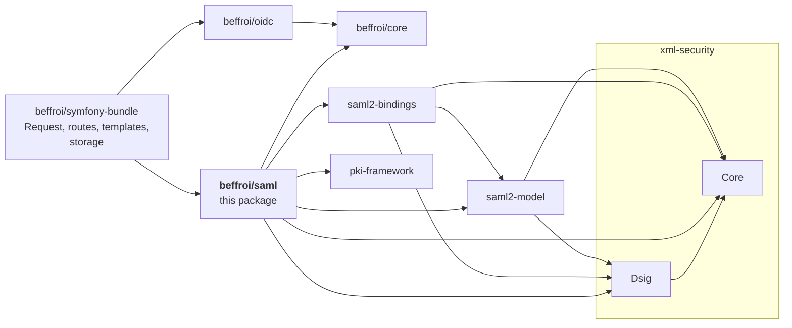

# saml: specification

The SAML 2.0 module of the identity provider: the profile written on `saml2-model` and `saml2-bindings` for the tenants, the users and the sessions of the core. It holds what both packages leave to their consumer, the HTTP request aside, which is the bundle's: the identity provider and the service providers of a tenant, their metadata, the attributes mapped from the claims, the `NameID` derived from the `sub`, Single Logout on the session of the core.

| | |
|---|---|
| Repository | `src/saml` of the monorepo `beffroi-php/beffroi`, mirrored read only into `beffroi-php/saml` (section 10) |
| Package | `beffroi/saml` |
| Namespace | `Beffroi\Saml`, next to `Beffroi\Oidc` of `beffroi/oidc` |
| Runtime | PHP 8.4 or later; `beffroi/core`; `beffroi/saml2-model`, `beffroi/saml2-bindings` and `beffroi/xml-security`, their public classes (section 2); `spomky-labs/pki-framework`, for the X.509 certificate around a tenant's key. Nothing else. |
| Consumers | `beffroi/symfony-bundle`, which holds the HTTP request, the routes, the templates and the storage (decision 0007) |
| Design | Sub-spike 9c of [spike 9](https://github.com/beffroi-php/design/blob/main/spikes/09-saml/README.md), the identity provider role (epic beffroi-php/beffroi#645); [decision 0013](https://github.com/beffroi-php/design/blob/main/docs/decisions/0013-saml-formats-xml-ecrits-ici.md) (the stack writes its SAML formats, `beffroi/saml` is the profile on them), [decision 0007](https://github.com/beffroi-php/design/blob/main/docs/decisions/0007-bibliotheque-et-bundle-des-le-premier-commit.md) (the bundle keeps HttpFoundation), [decision 0006](https://github.com/beffroi-php/design/blob/main/docs/decisions/0006-sur-par-defaut.md) (no option to do it wrong) of the identity provider's design repository |

This document states what the package does, what it refuses and what it guarantees; the code conforms to it, or the document changes first, in its own commit, with its reason. The specifications of `saml2-model` and `saml2-bindings` are cited as `model.md` and `bindings.md`, their invariants as `M-n` and `B-n`; those of `xml-security` as `core.md`, `dsig.md` and `enc.md`. Its sections bear the numbers of theirs, so that a reference to one holds while the stories of section 12 write the sections this document does not have yet: its threat model, its invariants (`S-n`), its public API, its limits and its acceptance hold what the stories built so far, each story adding what it builds, the identity provider of a tenant, its key, its certificate and its metadata first (issue #728), then the service providers of a tenant, read from their metadata (issue #729), then the authentication a request of one of them needs (issue #730), then single sign-on, the request received and the signed assertion posted back (issue #731).

## 1. Why this package exists

`saml2-model` validates one message against what its consumer states, and `saml2-bindings` carries one message across one binding against what its consumer states; neither knows a tenant, a user, a session, a key the core keeps, or the state that makes a statement true. Both specifications end on the duties of that consumer, `bindings.md` section 6.8 and `model.md` section 6.9, and name it: `beffroi/saml`. Decision 0013 puts the profile here, the identity provider and the service provider of a tenant, the attributes, the `NameID` derived from the `sub`, the metadata, Single Logout on the session of the core, so that the SAML user and the OpenID Connect user are one user of the core, one model and two entry protocols.

Most of those duties are code this package writes (section 6). Two are the opposite, what its code never calls: the binding's authentication is the word of `saml2-bindings` only, and the guarantee that a received message and the signature verified over it come from one input holds only while nothing reaches into `Beffroi\Saml2\Bindings\Internal\`. `saml2-bindings` cannot close either from its side (`bindings.md` section 12); section 8 closes both here, by static analysis.

## 2. Position



The package is a module of the identity provider, at the level of `beffroi/oidc` (decision 0013), and takes its four layers (`docs/11-architecture.md` section 2): `Domain`, the objects, the values and the exceptions (`Exception/` belongs to it, as in the core and in `beffroi/oidc`); `Port`, the interfaces to the outside; `Application`, the use cases; `Bridge`, the implementations of the ports. It depends on the core, its use cases included, as `beffroi/oidc` does, and never on `beffroi/oidc`, nor `beffroi/oidc` on it: protocols never depend on each other.

The SAML stack is a brick of the module, as JOSE is of `beffroi/oidc`: the `Bridge` implements the ports on it, and sees the public classes of `saml2-model` (`model.md` section 5), of `saml2-bindings` (`bindings.md` section 5) and of the `Core` and `Dsig` namespaces of `xml-security`; never a class of their `Internal\` namespaces, nor of `Enc`, which the assertion encrypted for a service provider that asks for it brings (issue #733). `pki-framework` is the `Bridge`'s too, for the self-signed certificate around a tenant's key (decision 0013, `model.md` section 6.9). `Domain`, `Port` and `Application` see the core and the PSR interfaces, as those of `beffroi/oidc` do: a story whose class needs the stack in an inner layer adds that edge with its reason, as `.ci-tools/deptrac.yaml` asks of every new dependency.

It knows no HTTP object (decisions 0007, 0013): no `Request`, no PSR-7 message, no superglobal, no route, no template. The bundle holds the request and hands the package what `bindings.md` section 6.8 names, the raw query string, the fields of a form, the URL of the endpoint from the tenant's configuration; the bundle writes the HTTP answer and the page that posts the form (`bindings.md` section 6.7). Deptrac holds the layers and the graph, `.ci-tools/deptrac.yaml`: the `Saml*` layers, nothing of Symfony but its `Uid` component, nothing of `Psr\Http`, as for `beffroi/oidc`.

## 3. Threat model

Each row is an attack class this package answers, the rule that answers it, and where the rule lives; the invariants are numbered in section 4. The threats of a message, its reading, its signature and its bytes on a binding, are those of `model.md` and `bindings.md` section 3, answered there. This section grows with the stories of section 12, each adding the rows of what it builds.

| Threat | Vector | Rule | Where |
|---|---|---|---|
| A forged assertion | The private half of the SAML key of a tenant, read where the keys are stored, in a backup or in a dump | The key is a key of the tenant as every other one: generated in the process, sealed by the KMS before anything is written, opened in memory only | S-1, the core's key custody |
| A forged assertion | The private half read from what the identity provider publishes or keeps between two requests | The metadata carries certificates, public members only; what serving them leaves in a process is the certificate, never the key, the only private half a process keeps open being the active key of a process that signs, held by the core to sign (S-15) | S-1, `SigningCertificates` |
| An outage at a rotation | A service provider that knows the current certificate only, handed an assertion signed by the next key | The next key in the metadata, its certificate beside the current one, for its staging window before it signs anything | S-2, section 6.1 |
| An outage at a rotation | A service provider that refreshes the metadata once a day, or holds a certificate an administrator uploaded, handed an assertion signed by a key staged minutes ago | The SAML key a family of its own, its staging window counted in days; the metadata saying, in its `cacheDuration`, how long it may be kept, shorter than that window | S-12, sections 6.1 and 7 |
| Key substitution | A certificate in the metadata that is not around the key, or not signed by it | Built around the public half the tenant holds, signed by that key, its signature verified before it is published, `openssl_verify()` compared to `1` | S-3, `SelfSignedCertificateIssuer` |
| A broker that signs nothing | Metadata that does not ask for signed requests, read by a broker's importer | `WantAuthnRequestsSigned` is `true` unless the tenant turns it off (`model.md` section 6.9) | S-4 |
| A request nobody signed, under the name of a provider that signs | An `AuthnRequest` stripped of its signature, or written by anybody, whose `Issuer` is a service provider that signs its requests | A signature required unless the declaration of the provider says it does not sign and its metadata do not say it does; no setting of the tenant or of the deployment relaxes it | S-9, section 6.3 |
| Assertion theft through the request | An `AssertionConsumerServiceURL` or an index naming a location of the attacker, in a request nobody had to sign | The assertion consumer service is one of the accepted document of the provider, resolved by M-9; the declaration holds none and the request adds none | S-10, section 6.3 |
| A metadata the request rewrote | The `Host` header, or the path the request arrived at, written into the entity ID or an endpoint | Every URL of the metadata from the configuration of the tenant | S-4, section 6.1 step 3 |
| The KMS reached by anyone | The metadata, which anybody reads, opening every key with the KMS at every request | The certificate of a key built once per process and kept, the private half opened for it dropped at once: the KMS asked once per key and per process for the metadata, never once per request; a process that signs opens the active key once more and keeps it to sign (S-15) | S-3, `SigningCertificates` |
| A service provider impersonated | Metadata read from a channel nobody vouches for, a plain HTTP URL, a redirect, a document that names another entity | The metadata of a service provider come from the location its declaration names, a file of the deployment or an `https` URL that is never redirected, read by `readTrusted()` for that channel or by `readSigned()` under the certificates the declaration pins; their entity ID is the declared one | S-5, section 6.2 steps 1 to 4 |
| A rollback | A document older than the one accepted served again, by a mirror, a cache or anybody who kept a copy signed by the pinned key | The newest accepted document is kept: one whose `validUntil` is earlier, or that has none where the accepted one had one, is refused; a signed document without `validUntil` is refused (`model.md` section 6.5 step 3); only an operator forgets the accepted document, by hand | S-6, section 6.2 steps 3 and 6 |
| Expired metadata | A document past its `validUntil`, kept or served again | Read under M-7 at every reading, the registration and every refresh, the accepted document kept when a newer one is refused | S-6, section 6.2 step 3 |
| An assertion in clear for a service provider that asked for it encrypted | A declaration asking for encryption, its metadata without an encryption key; or any request of such a provider while the identity provider encrypts nothing (issue #733) | Refused at the registration and at every refresh, the accepted document kept; its requests refused, without a SAML answer, until #733 | S-7, sections 6.2 step 5 and 6.4 step 2 |
| A provider no request can be verified for | A declaration that keeps `signs_authn_requests` `true`, the default, or metadata saying `AuthnRequestsSigned`, with no signing key in the metadata to verify the signature by: every request of that provider is refused, and it is found at its first login | Refused at the registration and at every refresh, the accepted document kept | S-11, section 6.2 step 5 |
| A person in a dump | The `md:ContactPerson` of a metadata document, its names, its electronic addresses and its telephone numbers | The accepted document sealed under the data key of its tenant (decision 0011) | S-8, the bundle's mapping |
| A worker held, memory exhausted | A metadata URL that never answers, or answers more than any metadata needs | A timeout, and a read that stops at the `maxBytes` of `Core` before the document is loaded | Section 7 |
| A person followed from one service provider to the next | The `NameID` two service providers compare, or one that holds the `sub` an OpenID Connect client was given | A persistent identifier of its own per service provider, the hash of its entity ID, the `sub` and a secret of the tenant, which nobody computes without that secret | S-13, section 6.4 step 5 |
| An assertion used where it was not addressed | An assertion posted to another service provider, or to another endpoint of the same one, or presented as the answer to another request | Its `Audience` the entity ID of the service provider that asked, its `Destination` and `Recipient` the endpoint the model resolved, its `InResponseTo` the ID of that request, its `Issuer` the entity ID of the tenant | S-14, section 6.4 step 7 |
| An assertion kept and played later | An assertion read from a browser, a log or a proxy and posted again | Five minutes of validity, the response and the assertion both signed by the SAML key of the tenant | S-15, section 6.4 step 7 |
| A claim sent where it was not meant to go, a value forged by its owner | An attribute nobody declared for that service provider, or a claim a user writes holding a NUL, which the DOM cuts, or a character XML 1.0 does not carry | Only the attributes the declaration maps, from claims the provider serves, refused otherwise right after the container of the deployment is compiled, in the same build, and at its first use for a declaration holding an environment variable; a value outside the `Char` of XML 1.0 refused when it is built, its attribute not sent | S-16, section 6.4 step 6 |
| A session used against the wish of the service provider | A `ForceAuthn` answered from a session opened earlier, an `IsPassive` answered with a login page | A login of the second the request was received in, or later, for `ForceAuthn`; `NoPassive` rather than a page for `IsPassive` | S-17, section 6.4 step 4 |
| A second assertion for one request, a request finished in another browser | A request parked for the login, resumed twice, or resumed from a browser that did not send it | The request parked in the session of the browser that sent it, for ten minutes, forgotten when it is answered | S-18, section 6.4 step 3 |

## 4. Invariants

Each invariant is code, never a constructor option or a flag, has at least one test in section 9, and names the attack class it closes.

- **S-1. The key never leaves the KMS in clear.** The SAML signing key of a tenant is a key of the tenant (`TenantKey`, architecture §3.3) of an algorithm that implements `SamlSigningAlgorithmInterface`: drawn by the key pair generator in the process, its private half sealed by the KMS before anything is written and stored as that envelope only, opened in memory by the KMS when the process needs it, exactly as the keys of spike 2. It is never in the JWK Set, since `SamlSigningAlgorithmInterface` does not extend the core's `PublishedKeyAlgorithmInterface`; never in the metadata; never in what this package keeps between two calls, which is certificates. Nothing of this package writes, logs or returns a private member. A forged assertion.
- **S-2. The next certificate is published before it signs.** The metadata lists the certificate of every SAML key of the tenant in service, staged, active and retiring, in creation order: a staged key is there for its staging window before it signs anything, a retiring one until its retirement window ends. The steps of that life and their commands are those of every key of the tenant (`beffroi:keys:generate`, `beffroi:keys:rotate`, `beffroi:keys:activate`, `beffroi:keys:retire`, the scheduled step), and nothing of them is written again here. An outage at a rotation.
- **S-3. The certificate is the key's own.** A self-signed X.509 certificate around the public half of the key and signed by that key, built with `pki-framework`, its signature verified under that public half before it is published, the result of `openssl_verify()` compared to `1` and never to a boolean. Its bytes are a function of the key and of the tenant (section 6.1 step 2), so that two processes, or one that builds it again, publish the same certificate; a process builds it once and keeps it while the key is in service. The private half opened to build it is dropped as soon as it is built, the active key's as any other, so that serving the metadata leaves no private half open in the process (S-1): the KMS is asked once per key and per process for its certificate, and a process that signs opens the active key once more, through the core, which keeps it open to sign (S-15, the core's `OpenedKeys`). Custody is worth that one opening more. Key substitution, the KMS reached by anyone.
- **S-4. The metadata states the configuration of the tenant.** Its entity ID, its endpoints and `WantAuthnRequestsSigned` come from the configuration of the tenant, never from the request that asked for the metadata; `WantAuthnRequestsSigned` is `true` unless the tenant turns it off (`model.md` section 6.9, decision 0006). It is what the metadata announce to the service providers, never what a request received needs, which is S-9's: the setting neither adds a signature to that requirement nor takes one from it. A metadata the request rewrote, a broker that signs nothing.
- **S-5. The metadata of a service provider come from its declaration.** A service provider is declared in the configuration of the deployment, never registered by a request nor through a page (epic beffroi-php/beffroi#645); its metadata are read from the location the declaration names, a file of the deployment or an `https` URL, no redirect followed, nothing else reaching the network; through `MetadataReader::readSigned()` when the declaration pins the certificates of the signer of the metadata, and through `readTrusted()` otherwise, the reason being the channel: a file the operator of the deployment put there, the administrator's upload of `model.md` section 5.6, or a URL over TLS the configuration names, the pinned URL of the same section. The entity ID of the document is the declared one, compared exactly (M-8), and the document holds a service provider role. A service provider impersonated.
- **S-6. Never older, never expired.** A document past its `validUntil`, or past the `validUntil` of its service provider role, is refused at every reading (M-7). The newest document accepted for a service provider is kept, and a document is older than it when its `validUntil`, the one of its `md:EntityDescriptor`, is earlier than the accepted one's, kept to the second, or when it has none and the accepted one has one; an older document is refused and the accepted one kept. Nothing but an operator goes back on it: forgetting the accepted document of a service provider is a command run by hand, never a step of the schedule nor a request, after which the next reading registers the service provider as a first one (section 6.2). A document read by `readSigned()` carries a `validUntil`: without one, an older document signed by the same pinned key would verify as well, which is the rollback `model.md` section 6.5 step 3 leaves to this package. A rollback, expired metadata.
- **S-7. Encryption asked, encryption possible.** A declaration that asks for encrypted assertions is refused while the metadata of its service provider hold no key for encryption, a `KeyDescriptor` whose `use` is `encryption` or absent (`model.md` section 6.5 step 5): at the registration, and at a refresh, which keeps the accepted document. An assertion in clear for a service provider that asked for it encrypted.
- **S-8. The document is sealed.** The accepted document is kept as the bytes that were read, never written again, sealed under the data key of its tenant in the family of its own table (decisions 0011 and 0018), since an `md:ContactPerson` names people. A person in a dump.
- **S-9. A request is unsigned only where its provider says so.** An `AuthnRequest` needs a signature, XML or over its binding, unless the declaration of its service provider says it does not sign (`signsAuthnRequests` `false`) and the accepted metadata of that provider do not say it does (`AuthnRequestsSigned` absent or `false`): the provider's own statement wins towards safety, a declaration that signs refusing an unsigned request whatever the metadata say, metadata that sign requiring a signature whatever the declaration says. Nothing else decides it: not `WantAuthnRequestsSigned` of the tenant, which is what the metadata announce (S-4), nor any setting of the deployment (decision 0006). A signature a request carries is verified whatever the requirement (M-2), under the keys of the provider's metadata (M-3). The requirement reaches `saml2-model` as both its flags, the `authnRequestsSigned` of the service provider and the `wantAuthnRequestsSigned` of the identity provider handed to `validate()`, the model refusing an unsigned request when either is `true` (`model.md` section 6.2 step 2). A request nobody signed, under the name of a provider that signs.
- **S-10. The assertion goes where the accepted metadata say.** The assertion consumer services a request is resolved among are those of the accepted document of its service provider, read back, and none other: the declaration holds none, and an `AssertionConsumerServiceURL` or an `AssertionConsumerServiceIndex` of the request is honoured only when it designates one of them (M-9, `UnknownEndpoint` otherwise), signed or not. A request refused so gets no SAML answer (`model.md` section 6.2). Assertion theft through the request.
- **S-11. A signature required, a key to verify it by.** A service provider whose requests need a signature under S-9, because its declaration says it signs them (`signsAuthnRequests` `true`, the default) or its metadata say `AuthnRequestsSigned`, is refused while the metadata hold no key for signing, a `KeyDescriptor` whose `use` is `signing` or absent (`model.md` section 6.5 step 5): at the registration, and at a refresh, which keeps the accepted document. Without that key every request of the provider is refused (section 6.3 step 4), at its first login and not at the command, as S-7 refuses encryption without a key for it. A provider declared unsigned whose metadata say nothing of signing needs none (S-9). A provider no request can be verified for.
- **S-12. The window of a SAML key outlasts the cache of its metadata.** The SAML signing key is a family of keys of its own: it declares its own staging delay and its own age, seven days and 365 days by default (section 7), where every other key of the tenant keeps the figures of `beffroi.keys`, 360 s and 90 days, so that a rotation of the SAML key publishes the next certificate for days before it signs and a rotation of a JOSE key is not slowed by it. The metadata carries a `cacheDuration` (Metadata §2.3.2), one day by default, strictly shorter than that staging delay and refused otherwise, by `IdentityProviderMetadataHandler` when it is built and by the configuration of the bundle when it is read: a service provider that honours it has fetched the metadata again, and with it the next certificate, before that certificate signs. An outage at a rotation.
- **S-13. One persistent identifier per service provider.** The `NameID` of an assertion is of the `persistent` format (Core §8.3.7), its `NameQualifier` the entity ID of the tenant and its `SPNameQualifier` the entity ID of the service provider; its value is the SHA-256 of the entity ID of the service provider, the `sub` of the user and the salt of the tenant, each followed by a NUL, in base64url without padding: 43 characters, within the 256 of the format. Core §8.3.7 asks for "pseudo-random values that have no discernible correspondence with the subject's actual identifier", so it is never the `sub`, nor a username, nor an address. It is computed and never drawn: the same user signing in to the same service provider gets the same value at every login, in every worker, after a restore and after an import that keeps the subjects (decision 0002), and two service providers get two values they cannot relate. The salt is the secret of the tenant its pairwise subjects are computed with (OIDC Core §8.1), sealed by its KMS, so that one secret of the tenant makes every pseudonym of its users, and nobody who knows a `sub` an OpenID Connect client holds computes the `NameID` of a service provider. A person followed from one service provider to the next.
- **S-14. The assertion is addressed to the request that asked for it.** The `Destination` of the response and the `Recipient` of its bearer confirmation are the location of the `AssertionConsumerService` the model resolved among the accepted metadata (S-10), its `InResponseTo` and the one of the confirmation the ID of the accepted request, the one `AudienceRestriction` holds one `Audience`, the entity ID of the service provider, compared exactly as the declaration holds it, and the `Issuer` of the response and of the assertion is the entity ID of the tenant, the URL of its metadata, with no `Format`. Nothing of it is read from the request as it arrived (`model.md` section 6.9). An assertion used where it was not addressed.
- **S-15. Short, and signed.** An assertion is issued at the instant of the clock and is valid five minutes: its `Conditions` and its bearer confirmation end at that instant plus 300 seconds, within the `maxBearerWindow` of 3 600 seconds a validator of `saml2-model` applies and the `maxMessageAge` of 300 seconds within which it accepts the assertion at all (`model.md` section 7), no `NotBefore`, no `SessionNotOnOrAfter`. The assertion is signed, then the response over it (`SignedParts::AssertionAndResponse`), under RSA-SHA256, by the active SAML key of the tenant, opened by its KMS once per process to sign and kept for that by the core, besides the opening its certificate made and dropped (S-3); a service provider that wants either signed finds it, as SimpleSAMLphp signs both by default. A failure response is signed the same way. An assertion kept and played later.
- **S-16. The attributes the declaration maps, values XML carries.** An assertion carries one `Attribute` per mapping of the declaration of its service provider whose claim the user holds, under the name, the name format and the friendly name the mapping gives, and nothing else. A mapping names a claim the provider serves, refused otherwise right after the container of the deployment is compiled, in the same build, and at its first use for a declaration holding an environment variable (section 6.2 step 1). A value is the text of the claim: a string as it is, an integer in decimal, a boolean `true` or `false` (XML Schema Part 2 §3.2.2.1), a list each of its members; it holds only the `Char` of XML 1.0 §2.2, the NUL and the other control characters but the tab, the line feed and the carriage return, a surrogate, U+FFFE and U+FFFF, and bytes that are not UTF-8 refused when the value is built: the DOM cuts a string at its first NUL, so that a value written past it would be signed short, and the serializer of `Core` refuses the rest (issue #670). A claim whose value is none of these, a JSON object such as `address`, or that holds a value so refused, is not sent, and the refusal is written to the log, naming the service provider, the claim and the rule and never the value: an attribute is the user's statement to that provider, and a statement cut or rewritten by this provider would be one the user never made, while the sign-on, which the attribute does not decide, goes on. A claim sent where it was not meant to go, a value forged by its owner.
- **S-17. A session reused as the service provider allows.** A request is answered from the session the browser holds when that session is active, of the tenant, and, when the request says `ForceAuthn`, holds a proof made in the second the request was received in or later (Core §3.4.1): the core keeps a proof to the second, a Unix timestamp, so the instant of the request is compared at that precision, and a login typed in the same second as the request answers it instead of sending the browser to the login again; otherwise the browser goes to the login of the provider, its second factor included, the pages every flow of the provider signs in through, unless the request says `IsPassive`, which is answered `Responder` and `NoPassive` without a page (Core §3.4.1). A session used against the wish of the service provider.
- **S-18. A request waiting for a login is the browser's, once.** A request that waits for a login is kept in the session of the browser that sent it, never in a URL, under a reference drawn from `random_bytes()`, for ten minutes; it is answered once, and forgotten when it is answered, so that no second assertion is written for it; a browser that did not send it, or comes back later, finds nothing and is shown the page of a refusal. A second assertion for one request, a request finished in another browser.

## 5. Public API

### 5.1 The identity provider of a tenant

| Layer | Class | What it is |
|---|---|---|
| `Domain\Key` | `SamlSigningAlgorithmInterface` | The algorithm of a key a tenant signs its SAML messages with and publishes in its metadata as a certificate, kept out of its JWK Set (S-1): a `KeyAlgorithmInterface` of the core, of use `sig` and of key type `RSA`, the only keys `Dsig` takes (D-16). Its constants `STAGING_DELAY` and `AGE` are the default figures of its family (S-12). |
| `Domain\Metadata` | `Certificate` | `base64`, the DER of an X.509 certificate in the base64 of RFC 4648 §4, what an `X509Certificate` carries |
| | `IdentityProviderEndpoints` | `metadata`, `singleSignOn`, `singleLogout`: the URL of each, both bindings of a service at the same URL |
| | `IdentityProviderDescription` | `endpoints`, `signingCertificates` (one `Certificate` at least), `wantAuthnRequestsSigned`, `cacheDuration` (seconds, S-12); `entityId()`, the URL of the metadata |
| | `IdentityProviderMetadata` | `document`, the serialized `md:EntityDescriptor`; `headers`; `CONTENT_TYPE`, `application/samlmetadata+xml`; `assertCacheDuration(int $cacheDuration, int $stagingDelay)`, the rule of S-12, which the handler and the configuration of the bundle both call |
| `Port` | `CertificateIssuerInterface` | `selfSigned(UnsealedKey $key): Certificate`, the certificate of a key of the tenant opened by the KMS (S-3) |
| | `MetadataWriterInterface` | `write(IdentityProviderDescription $description): string` |
| | `IdentityProviderEndpointsInterface` | `locate(Tenant $tenant): IdentityProviderEndpoints`, the bundle's, which holds the routes |
| `Application` | `SigningCertificates` | `of(Tenant $tenant): list<Certificate>`: the certificate of each SAML key in service, built once per process and kept, the private half opened for it dropped at once (S-1, S-2, S-3) |
| | `IdentityProviderMetadataHandler` | `handle(Tenant $tenant): IdentityProviderMetadata` (section 6.1) |
| `Bridge\Pki` | `SelfSignedCertificateIssuer` | `CertificateIssuerInterface` on `pki-framework` |
| `Bridge\Model` | `ModelMetadataWriter` | `MetadataWriterInterface` on `MetadataWriter` and `Core`'s `Serializer` |

A tenant without a SAML key in service has no metadata: `IdentityProviderMetadataHandler` throws the core's `KeyNotFoundException`, which the bundle answers with a `404`. The bundle wires the algorithm `SAML-SIGNING`, an RSA key of the core's `RsaKeyBits` (3 072 bits by default), only when `beffroi.saml.identity_provider` is enabled, so that a deployment that serves no SAML draws no such key. A deployment that disables it after its tenant drew one leaves that key where it is: the key files read past a key whose algorithm the bundle knows and the configuration left off, so it is neither served, nor rotated, nor drawn again, the metadata answers `404` as for a tenant without a SAML key, the JWK Set, the tokens and the key commands go on with the other keys, and enabling the identity provider again puts the key back in service as it was; a key file that names an algorithm nothing of the bundle knows is still a fault of the storage. The bundle holds the routes the metadata names, `beffroi_protocol_saml_metadata`, `beffroi_interaction_saml_single_sign_on` (section 5.3) and `beffroi_interaction_saml_single_logout`, named so that the metadata names it and served by issues #734 and #735, the last two reached by the browser. The figures of S-12 are settings of the deployment, as those of `beffroi.keys` are, and of no tenant: `beffroi.saml.identity_provider.staging_delay`, `age` and `cache_duration`, in seconds, their defaults the constants `SamlSigningAlgorithmInterface::STAGING_DELAY` and `AGE` and `IdentityProviderMetadataHandler::DEFAULT_CACHE_DURATION`, which the bundle hands to the family of the SAML keys and to the handler (section 7).

### 5.2 The service providers of a tenant

| Layer | Class | What it is |
|---|---|---|
| `Domain\ServiceProvider` | `ServiceProvider` | The declaration of a service provider (S-5): `entityId`; `metadata`, its `MetadataLocation`; `metadataSigners`, the certificates that sign its metadata, none when the channel is trusted; `attributes`, a list of `AttributeMapping`; `encryptAssertions`, `false` by default (S-7); `signsAuthnRequests`, `true` by default (S-9); `readsSigned()` |
| | `MetadataLocation` | `value`: an `https` URL, or the absolute path of a file of the deployment |
| | `AttributeMapping` | `claim`, the name of a claim of the provider; `name`, `nameFormat` and `friendlyName`, the SAML attribute it is sent as (Core §2.7.3.1) |
| | `AttributeNameFormat` | The three name formats of Core §8.2, `uri` the default (section 6.2 step 1) |
| | `ServiceProviderMetadata` | What a reading returns: `entityId`, `validUntil`, `encryptionCertificates`, `signingCertificates`, the certificates of its service provider role a key for signing is in, a `KeyDescriptor` whose `use` is `signing` or absent (S-11), `authnRequestsSigned`, the `AuthnRequestsSigned` of its service provider role, `false` when absent (Metadata §2.4.4); every member required, none defaulted, so that a reading that leaves out what decides S-9 and S-11 fails where it is written rather than reporting a provider that says nothing and holds no key |
| | `AuthnRequestSigning` | The requirement of S-9 for the requests of one service provider: `entityId`, `required`; `of(ServiceProvider $declaration, ServiceProviderMetadata $metadata)` (section 6.3) |
| | `AcceptedMetadata` | The entity of the newest document accepted for a service provider of a tenant (S-6, S-8): `tenant`, `entityId`, `document`, `validUntil`, `acceptedAt`; `holds()`, `replaceWith()`, which refuses an older document |
| `Exception` | `MetadataRefusedException` | A document refused or out of reach, naming the rule, never a value of the document (M-16); a declaration that is not one is the core's `InvalidArgumentException`, as a `Certificate` that is not one is |
| `Port` | `ServiceProvidersInterface` | `of(Tenant $tenant): list<ServiceProvider>`, `find(Tenant $tenant, string $entityId): ?ServiceProvider` |
| | `MetadataFetcherInterface` | `fetch(MetadataLocation $location): string`, the bundle's, which holds the HTTP client and the file system |
| | `ServiceProviderMetadataReaderInterface` | `readTrusted(string $document): ServiceProviderMetadata`, `readSigned(string $document, list<Certificate> $signers): ServiceProviderMetadata` |
| | `AcceptedMetadataRepositoryInterface` | `find(Tenant $tenant, string $entityId): ?AcceptedMetadata`; `register(AcceptedMetadata $metadata): bool`, the first document of a service provider, `false` and nothing written when another process registered it first; `save(AcceptedMetadata $metadata): void`, the document that replaces the accepted one; the bundle's |
| | `CanForgetAcceptedMetadataInterface` | `forget(AcceptedMetadata $metadata): void`, the companion of the repository for the one use case that removes a row, the bundle's |
| `Application\ServiceProvider` | `ServiceProviderMetadataRefresh` | `refresh(Tenant $tenant, ServiceProvider $serviceProvider): MetadataRefreshment` (section 6.2), `refreshAll(Tenant $tenant): list<MetadataRefreshment>` |
| | `MetadataRefreshment` | `entityId`, `refused`, `what`: the outcome a terminal or a log reads, registered, registered by another process meanwhile, refreshed, unchanged, refused, or failed (section 6.2) |
| | `AcceptedMetadataForgetting` | `forget(Tenant $tenant, string $entityId): bool`, the accepted document of a service provider of the tenant removed, `false` when none is accepted for that entity ID (section 6.2) |
| `Bridge\Model` | `ModelServiceProviderMetadataReader` | `ServiceProviderMetadataReaderInterface` on `MetadataReader` and `SamlLoader` |
| | `ModelAuthnRequestParties` | The requirement of S-9 in the model's terms: built from an `AuthnRequestSigning`, the model's `ServiceProvider` read from the accepted document and the model's `IdentityProvider` of the tenant; `serviceProvider` and `identityProvider`, the two `validate()` is handed (section 6.3) |
| `Bridge\Configuration` | `ConfigurationServiceProviders` | `ServiceProvidersInterface` on the declarations of the deployment, validated when its container is compiled, the claim of a mapping right after, in the same build, a declaration holding an environment variable at its first use (section 6.2 step 1), those of one tenant named by its slug |

The bundle declares the service providers under `beffroi.saml.service_providers`, keyed by entity ID as the clients are keyed by `client_id`, refused at boot when the identity provider of the tenant is not enabled, and builds `ConfigurationServiceProviders` from them when its container is compiled, and again against the claims the provider serves right after, in the same build, so that a declaration that does not hold together fails the build of the deployment rather than its first refresh or its first login, one holding an environment variable excepted (section 6.2 step 1); it keeps the accepted documents in `beffroi_saml_service_provider`, one row per service provider of a tenant, the document sealed in the family `saml_service_provider`; it registers and refreshes them with `beffroi:saml:service-provider:refresh`, for one service provider or for all, and with a step of its schedule, hourly, which runs the same object and writes the outcome to the log; it forgets the accepted document of one service provider with `beffroi:saml:service-provider:forget`, by its entity ID, a command that writes and nothing else (section 6.2). A declaration removed from the configuration leaves its row, which nothing reads until an operator forgets it (section 12).

### 5.3 Single sign-on

| Layer | Class | What it is |
|---|---|---|
| `Domain\SingleSignOn` | `SignOnRequest` | An accepted request as the identity provider keeps it (S-18): `serviceProvider`, its entity ID; `id`; `assertionConsumerService`, the location the model resolved (S-10); `relayState`, as received; `forceAuthn`, `isPassive`; `nameIdFormat`, the `Format` of its `NameIDPolicy`, `null` without one; `authnContextRequested`; `receivedAt`; `expiresAt()`, ten minutes later; `toDocument()` and `fromDocument()` |
| | `SignOnStatus` | The failures section 6.4 answers with, a status the protocol fixes: `NoPassive` and `NoAuthnContext` under `Responder`, `InvalidNameIdPolicy` under `Requester` (Core §3.2.2.2) |
| | `PersistentNameId` | S-13: `value`; `derive(string $serviceProvider, Subject $subject, string $salt)` |
| | `AttributeValue` | S-16: `value`, refused when it holds a character outside the `Char` of XML 1.0; `ofClaim(mixed $claim)`, the values of a claim |
| | `ReleasedAttribute` | `name`, `nameFormat`, `friendlyName`, `values`, at least one |
| | `SignOnResponse` | What a success is written from: `identityProvider`, `request`, `nameId`, `attributes`, `sessionIndex`, `authnInstant`, `issuedAt`; `notOnOrAfter()`, `issuedAt` and the 300 seconds of S-15 |
| | `SignOnFailure` | What a failure is written from: `identityProvider`, `request`, `status`, `issuedAt` |
| | `PostedForm` | `action`, `fields`: the form the browser posts, the values as they go on the wire, not escaped for HTML |
| `Exception` | `SignOnRefusedException` | A request refused before its endpoint is established, or that cannot be answered any more: no SAML answer, the page of a refusal, naming the rule and never a value of the message (M-16, B-11) |
| `Port` | `AuthnRequestReceiverInterface` | `redirect(Tenant $tenant, string $queryString): SignOnRequest`, `post(Tenant $tenant, array $fields): SignOnRequest` (section 6.3) |
| | `SignOnResponderInterface` | `success(Tenant $tenant, SignOnResponse $response): PostedForm`, `failure(Tenant $tenant, SignOnFailure $failure): PostedForm` (section 6.4 step 7) |
| | `ServedClaimsInterface` | `names(): list<string>`, the claims the provider serves; `of(User $user, list<string> $names): array<string, mixed>`, their values for a user, the bundle's, which reads them where OpenID Connect does |
| | `PersistentIdentifierSaltInterface` | `saltOf(Tenant $tenant): string`, the secret of S-13, the bundle's |
| `Application\SingleSignOn` | `SingleSignOn` | `receiveRedirect()`, `receivePost()`: the request accepted (sections 6.3 and 6.4 steps 1 and 2); `answer(Tenant $tenant, SignOnRequest $request, ?AuthenticationSession $session): ?PostedForm`, the form, or `null` when a login is needed (section 6.4) |
| | `AttributeRelease` | `of(ServiceProvider $declaration, User $user): list<ReleasedAttribute>` (S-16) |
| `Bridge\Model` | `ModelAuthnRequestReceiver` | `AuthnRequestReceiverInterface` on `RedirectReceiver`, `PostReceiver` and `AuthnRequestValidator` (section 6.3) |
| | `ModelSignOnResponder` | `SignOnResponderInterface` on `PostSender` and the model's objects, signed by `Dsig`'s `PrivateKey` around the opened SAML key |
| | `ModelIdentityProvider` | The model's `IdentityProvider` of a tenant, which the metadata writer and the receiver both build |

The key that signs is the core's `KeptSigningKeyProviderInterface::activeKeptSigningKey()`, the active key of an algorithm the tenant keeps out of its JWK Set and signs with (`KeptSigningAlgorithmInterface`, which `SamlSigningAlgorithmInterface` extends), opened by the KMS once per process and forgotten at a rotation, as the keys the core signs JWS with are: the KMS is never asked at every login (decision 0018). That opening is the signer's own: the one that built the certificate of the same key was dropped (section 6.1 step 2), so a process that serves the metadata and signs asks the KMS twice for the active key, once for each. The bundle holds the two routes of the browser, `beffroi_interaction_saml_single_sign_on`, `GET` for HTTP-Redirect and `POST` for HTTP-POST at the one URL the metadata publish, and `beffroi_interaction_saml_single_sign_on_resume`, where the login of the provider sends the browser back (S-18); the page that posts the form (section 6.8); and the implementations of the two ports of the claims and the salt, the first reading the claims OpenID Connect serves and the second the salt of its pairwise subjects.

## 6. Processing rules

### 6.1 The metadata of the identity provider, in order

`IdentityProviderMetadataHandler::handle()`:

1. **The keys.** The keys of the tenant in service (`TenantKeyRepositoryInterface::findInService()`) whose algorithm implements `SamlSigningAlgorithmInterface`, in creation order; none is `KeyNotFoundException`.
2. **The certificates.** One per key, from `SigningCertificates`: the one this process built already, or the key opened by the KMS (`KeySealerInterface::unseal()`), handed to `CertificateIssuerInterface::selfSigned()` and dropped at once, never kept, the active key included, which a signature of the same process opens again for itself (S-1, S-3); a certificate whose key is no longer in service is forgotten. The certificate (S-3):
   - X.509 version 3, its serial number one more than the first seven bytes of the SHA-256 of the `kid` read as an unsigned integer: positive and at most 20 octets (RFC 5280 §4.1.2.2);
   - its subject and its issuer `CN=` the slug of the tenant, which the core holds to 63 characters, within the 64 of `ub-common-name` (RFC 5280 Appendix A);
   - valid from the creation of the key, to the second, until `99991231235959Z`, the date RFC 5280 §4.1.2.5 gives a certificate with no well-defined expiration date: the life of the key is its status (S-2), and a certificate in metadata is the notation of a key whose validity period nobody evaluates (Metadata Interoperability Profile §2.6.1, M-3);
   - the public key of the key's public JWK, its `n` and `e`; a private half that does not match it is refused before anything is signed;
   - one extension, `keyUsage` with `digitalSignature` alone, critical (RFC 5280 §4.2.1.3);
   - signed `sha256WithRSAEncryption`, its parameters `NULL` as RFC 4055 §5 requires of a producer, a PKCS #1 v1.5 signature, deterministic, by the key itself, then verified under the public key the certificate carries, `openssl_verify()` compared to `1`, a certificate that does not verify refused: a private exponent that is not the key's is caught there.
3. **The endpoints.** From `IdentityProviderEndpointsInterface`, under the issuer of the tenant (S-4): the entity ID is the URL of the metadata, the well-known location an entity ID resolves to (Metadata §4.1), which a service provider keeps, so that changing it is a new identity provider for every one of them (decided on 15 October 2026); the single sign-on service and the single logout service each at one URL, listed with `HTTP-Redirect` then `HTTP-POST` (`model.md` section 6.9). The bundle refuses routes that are not mounted under the issuer, as it does for the discovery document.
4. **`WantAuthnRequestsSigned`.** The setting of the tenant, `true` unless it says otherwise (S-4).
5. **Written** by `MetadataWriter`, unsigned: one `md:EntityDescriptor` holding one `md:IDPSSODescriptor`, a `KeyDescriptor use="signing"` per certificate, the `cacheDuration` of S-12 on the `md:EntityDescriptor`, no `validUntil`, no encryption certificate (issue #733), and one `NameIDFormat`, the `persistent` one of S-13 (issue #731); serialized by `Core`'s `Serializer`. Unsigned, because the key that would sign it is a key it publishes: a service provider trusts it by the channel, the URL over TLS or the document an administrator hands it (`readTrusted()`, `model.md` section 6.9).
6. **Served** as `application/samlmetadata+xml`, `Cache-Control: public, max-age=` the `jwks_max_age` of the keys of the tenant, five minutes by default: an HTTP cache on the way holds no copy older than that, so that a service provider that fetches the metadata finds the next certificate within minutes of its staging, far inside the staging window of the SAML key (S-2, S-12). The `cacheDuration` is the other number, how long a service provider keeps the document it fetched before it fetches it again.

### 6.2 The metadata of a service provider, in order

`ServiceProviderMetadataRefresh::refresh()`, which registers a service provider the first time and refreshes it every time after, one procedure:

1. **The declaration.** From `ServiceProvidersInterface`, a declaration that does not hold together refused in the build of the container of the deployment, the core's `InvalidArgumentException` turned by the bundle into the `InvalidConfigurationException` of the configuration, which names `beffroi.saml.service_providers` and the service provider. The checks are the constructors of the declaration and nothing else: no file is opened and nothing reaches the network, a container being built before the metadata exist. They run twice in the same build. When the container is compiled (the bundle's `ServiceProvidersPass`), every rule but the claim of a mapping: the claims the provider serves are those of the claims providers of the deployment, which a container being compiled has not built, so the declarations are built there with every claim they map served (the bundle's `DeclaredClaims`), and a refusal fails the compilation, before any container is written. Right after the compilation (the bundle's `MappedClaimsWarmer`, a cache warmer that is not optional, which Symfony runs as soon as it has compiled a container, in `cache:clear` and `cache:warmup` as at the first boot of a process that finds no container compiled), the same declarations built again against `ServedClaimsInterface::names()`, the claims providers built by then: a claim name the provider does not serve (S-16) fails the build there. A declaration holding an environment variable, whose value only the running deployment knows, is left out of both and built and refused, its claims included, when the container builds the service, at its first use. The container is written before the warmer runs: when it was compiled by a process that serves rather than by a command of the build, that process fails, and the next one, which reads the container back, runs no warmer, so the claim of a mapping is refused at the first use there, as a declaration holding an environment variable is. A declaration holds together with an entity ID of at most 1 024 characters with no whitespace, compared exactly to the metadata at step 4 (M-8); a `MetadataLocation` that is an `https` URL or an absolute path, nothing else, a plain `http` URL included (decision 0006); at most 16 metadata signers, each a `Certificate`; at most 256 attribute mappings, their names unique, each a claim name with no whitespace that the provider serves (S-16) and an attribute name of at most 1 024 characters with no whitespace, an absolute URI under the `uri` format (Core §8.2.2), `uri` by default as the SAML V2.0 interoperability profiles ask, a friendly name when given that is not empty.
2. **The bytes.** `MetadataFetcherInterface::fetch()`: a file read whole; an `https` URL fetched with one `GET`, `Accept: application/samlmetadata+xml`, nothing else sent, no redirect followed, a timeout, any status but `2xx` refused, the body read in chunks and refused as soon as it is longer than the `maxBytes` of `Core` (section 7). What cannot be read is `MetadataRefusedException`.
3. **The reading.** `ServiceProviderMetadataReaderInterface::readSigned()` with the metadata signers when the declaration pins any, `readTrusted()` otherwise (S-5). Either applies `model.md` section 6.5, the validity of M-7 among it, with the clock of the deployment and the bounds of `TimeBounds`; `readSigned()` then refuses a document without `validUntil` (S-6). A refusal of the model, or of `Core` and `Dsig` under it, is `MetadataRefusedException` carrying its message, which names a rule and no value (M-16).
4. **The entity.** The entity ID of the document is the declared one, compared exactly, and the document holds an `md:SPSSODescriptor` of SAML 2.0 (S-5); otherwise `MetadataRefusedException`.
5. **Keys.** A declaration whose `encryptAssertions` is `true` is refused while the document holds no certificate for encryption (S-7). A service provider whose requests need a signature, `AuthnRequestSigning::of()` of the declaration and the document read (S-9), is refused while the document holds no certificate for signing (S-11).
6. **Against the accepted document.** The `AcceptedMetadata` of the tenant and the entity ID, from `AcceptedMetadataRepositoryInterface`: none, a new one is built and registered, unless another process registered the service provider between that reading and this write, the console and the hourly step at the same minute: the unique index of the tenant and the entity ID keeps the first row, nothing is written, and the reading is skipped, reported as registered by another process, the next refresh comparing against what that process accepted; one that holds the same bytes, nothing is written, the service provider is unchanged; one that is newer, by S-6, refuses the document with `MetadataRefusedException` and is kept; otherwise it takes the bytes, the `validUntil` and the instant of the clock.
7. **Saved.** `AcceptedMetadataRepositoryInterface::register()` for the first document, `save()` for the one that replaces it; the bundle seals the document (S-8), and registers it with one `INSERT` that does nothing on a conflict with that index, rather than a flush of its unit of work, which a violation of the index would close for every service provider read after it.

Every refusal of steps 2 to 6 leaves the accepted document as it was, and `refresh()` returns it as a `MetadataRefreshment` whose `refused` is `true` rather than throwing, so that `refreshAll()` reads every service provider whatever one of them answers. `refreshAll()` isolates each service provider besides: an exception of any other kind thrown while one is read, a store or a reader that fails, is returned as a `MetadataRefreshment` whose `refused` is `true`, naming the class of the exception and never its message, which may carry a value of the document or of the query that failed (M-16), and the next service provider is read. `cacheDuration` is not read (`model.md` section 6.5 step 3): the bundle refreshes every service provider hourly, and a document that expires before a newer one is accepted is refused by every later reading of it, the accepted document being read back with `readTrusted()`, the channel being the provider's own sealed store.

**Forgotten.** S-6 holds a service provider to the newest document accepted, and nothing in the procedure above goes back on it: a service provider that published a document with a `validUntil` once, signed or not, and went back to one without is refused at every refresh, until its accepted document expires and every login with it. `AcceptedMetadataForgetting::forget()` removes the accepted document of a service provider of the tenant, its entity ID compared exactly, whether the configuration still declares it or not, through `CanForgetAcceptedMetadataInterface`; the next refresh finds none at step 6 and registers the service provider as a first one, its document read under steps 2 to 5 as any other. It is run by an operator, with `beffroi:saml:service-provider:forget`, and by nothing else, since dropping what S-6 holds is a person's decision; an entity ID for which nothing is accepted removes nothing and is answered so, the command failing as invalid, so that a mistyped entity ID is never taken for a forgotten one.

### 6.3 The authentication an authentication request needs, in order

What issue #731 does with every `AuthnRequest` it receives, before `ReceivedAuthnRequest::validate()`:

1. **The service provider.** The declaration the unverified `Issuer` names (`ServiceProvidersInterface::find()`, section 6.8) and its accepted document (`AcceptedMetadataRepositoryInterface::find()`), read back once with `readTrusted()`, the channel being the provider's own sealed store (section 6.2): into the `ServiceProviderMetadata` of step 2 and into the model's `ServiceProvider` of step 3, both from that one reading (`ModelServiceProviderMetadataReader::readAccepted()`). No declaration, no accepted document, or a document the reading refuses now, is a refusal that gets no SAML answer.
2. **The requirement.** `AuthnRequestSigning::of($declaration, $metadata)`, a signature required under S-9:

   | `signsAuthnRequests` of the declaration | `AuthnRequestsSigned` of the metadata | An unsigned request |
   |---|---|---|
   | `true`, the default | `true`, `false` or absent | refused, `SignatureRequired` |
   | `false` | `true` | refused, `SignatureRequired` |
   | `false` | `false` or absent | accepted, `Authentication::None` |

   The declaration and the metadata are of one entity ID, compared exactly; two entities are a programming error (the core's `InvalidArgumentException`). The `WantAuthnRequestsSigned` of the tenant is not read.
3. **The parties.** `ModelAuthnRequestParties`: the model's `ServiceProvider` with its `authnRequestsSigned`, and the model's `IdentityProvider` of the tenant with its `wantAuthnRequestsSigned`, each set to the requirement, every other value as it was. The identity provider the metadata publish carries the tenant's setting (section 6.1 step 4), which `validate()` would read as a requirement of its own: it is never the one handed over. A `ServiceProvider` of another entity ID than the requirement's, or whose `authnRequestsSigned` is `true` where the requirement says none, a requirement built from another document, is refused (the core's `InvalidArgumentException`).
4. **The validation.** `ReceivedAuthnRequest::validate()` with the two parties of step 3 and the URL of the endpoint (section 6.8). A signature present is verified whatever the requirement (M-2), under the signing keys of the accepted document (M-3): a signed request from a provider whose document holds none is refused, `NoVerificationKey` over HTTP-Redirect (B-4), `SignatureRequired` in the XML (M-3). An unsigned request accepted says `Authentication::None`.
5. **The endpoint.** The `assertionConsumerService` of the `AcceptedAuthnRequest`, resolved by the model among those of the document read back (S-10, M-9): an `AssertionConsumerServiceURL` or an index the document does not list is `UnknownEndpoint`, whatever step 2 required.

### 6.4 Single sign-on, in order

`SingleSignOn`, from the request the bundle received to the form the browser posts:

1. **Received.** `receiveRedirect()` with the raw query string, `receivePost()` with the fields of the form (section 6.8), and section 6.3 in order, at the URL of the single sign-on service of the tenant (`IdentityProviderEndpointsInterface`); what the binding or the model refuses there is `SignOnRefusedException`, with its message, and gets no SAML answer. The result is a `SignOnRequest`: the entity ID of the service provider, the request's ID, the location of the resolved `AssertionConsumerService` (S-10), the `RelayState` as `saml2-bindings` decoded it, `ForceAuthn`, `IsPassive`, the `Format` of the `NameIDPolicy`, whether a `RequestedAuthnContext` came, and the instant of the clock.
2. **The declaration.** The declaration of the service provider, read again at each step that needs it: one that asks for encrypted assertions is refused, `SignOnRefusedException`, until the identity provider encrypts them (S-7, issue #733); one removed from the configuration since the request came is refused the same way.
3. **Parked.** When a login is needed (step 4), the bundle keeps the `SignOnRequest` in the session of the browser under a reference of 32 bytes of `random_bytes()`, at most eight per browser, the oldest forgotten first, and sends the browser to the login of the provider, which sends it back to the resume route with that reference; a request found there past its ten minutes is refused, `SignOnRefusedException`; one answered is forgotten (S-18).
4. **What the request allows.** In this order, so that nobody signs in to be refused: a `NameIDPolicy` whose `Format` is neither `persistent` nor `unspecified` (Core §8.3.1, its 1.1 URI) is answered `Requester`, `InvalidNameIDPolicy` (Core §3.4.1.1), the identity provider writing no other format; a `RequestedAuthnContext` is answered `Responder`, `NoAuthnContext` (Core §3.3.2.2.1), the identity provider stating no class of its own (step 7); then the session of S-17: an active session of the tenant, holding a proof of the second of `receivedAt` or of a later one when the request says `ForceAuthn`, is answered (step 5), an `IsPassive` request without one is answered `Responder`, `NoPassive`, and any other request waits for a login (step 3).
5. **The subject.** `PersistentNameId::derive()` with the entity ID of the service provider, the `sub` of the user of the session and `PersistentIdentifierSaltInterface::saltOf()` (S-13).
6. **The attributes.** `AttributeRelease::of()`: the claims the mappings of the declaration name, from `ServedClaimsInterface::of()`, each turned into its values by `AttributeValue::ofClaim()`, a claim the user does not hold sending nothing, a claim refused under S-16 sending nothing and written to the log.
7. **Written.** `SignOnResponse` with the entity ID of the tenant, the request, the `NameID`, the attributes, the ID of the session as its `SessionIndex`, the one the `sid` of OpenID Connect carries, so that the session of the provider is the one Single Logout ends (issues #734 and #735), its latest proof as the `AuthnInstant`, and the instant of the clock; or `SignOnFailure` with the status of step 4. `SignOnResponderInterface` builds the model's objects (S-14, S-15): a `Response` of a new ID, its `Status` `Success`, its assertion of a new ID, the `AuthnContextClassRef` `urn:oasis:names:tc:SAML:2.0:ac:classes:unspecified`, the class that says nothing the identity provider has not mapped (section 12), each attribute without `xsi:type` (`model.md` section 12); it opens the active SAML key of the tenant, signs through `PostSender::response()`, or `failure()`, which writes, signs and encodes them, the `RelayState` received passed as it is, and returns the form.

### 6.8 The contract with saml2-bindings and saml2-model

The duties `bindings.md` section 6.8 and `model.md` section 6.9 give `beffroi/saml` on the identity provider's side, each the rule of the story that builds the code it applies to (section 12). What this package's code never calls is section 8, and holds from the first line of it.

- **The raw query string.** `QUERY_STRING` as the bundle received it, `$request->server->getString('QUERY_STRING')`, never a normalised one nor the parsed query (`bindings.md` section 6.8, B-2); built by issue #731.
- **The form.** The fields of an `application/x-www-form-urlencoded` body, `$request->request->all()`, any other content type refused with `415` before the package is called; built by issue #731.
- **The method and the peer.** The endpoint chooses the method of the receiver; the unverified `Issuer` chooses the service provider's metadata, and with them the signature its request needs (S-9, section 6.3).
- **`$receivedAt`.** The URL of the endpoint as the tenant's metadata publishes it, from the tenant's configuration, `IdentityProviderEndpointsInterface::locate()`, never rebuilt from the request (M-8).
- **`RelayState`.** The one it generates: an unguessable reference from `random_bytes()` to state kept on the server, at most 80 bytes, never a URL; single sign-on generates none, the identity provider sending no request. The one it received: echoed exactly in the answer, up to the 1 024 bytes of B-9, kept as `saml2-bindings` decoded it with the request while it waits for a login (S-18), and handed back to `PostSender` as it is.
- **The binding of each message.** The service provider's metadata says it, by the `Binding` of the endpoint the message goes to.
- **The metadata of the identity provider.** Written with `MetadataWriter`, the X.509 certificate around the tenant's key in it: an HTTP-POST single sign-on service next to the HTTP-Redirect one, and `WantAuthnRequestsSigned` a setting of the tenant, `true` by default, passed to `IdentityProvider`, whose constructor defaults it to `false` (`model.md` section 6.9); built by issue #728, section 6.1. What it announces is not what a request received needs: the `IdentityProvider` handed to `validate()` carries the requirement of S-9 instead, section 6.3.
- **The peers.** The metadata of each service provider of a tenant, read with `MetadataReader`, `readTrusted()` or `readSigned()` and the reason, stored and refreshed, the newest document accepted kept against a rollback (`model.md` sections 6.5 and 6.9); built by issue #729, section 6.2.
- **The logout endpoints.** A `LogoutResponse` goes to the `ResponseLocation`, or else the `Location`, of a `SingleLogoutService` of the service provider's metadata on the binding it answers over (M-9), never to a URL the request carried.
- **The cross-site post.** A post to a single logout service comes from the service provider's site, without a session cookie set `SameSite=Lax` or `Strict`: the state of a request sent is found by its `InResponseTo` or its `RelayState`. An `AuthnRequest` posted to the single sign-on service arrives the same way, so the session the browser holds is not seen by that request, which is answered after a login (section 12); one carried by HTTP-Redirect is a top-level `GET`, which a `Lax` cookie accompanies, and is answered from the session. The form the identity provider posts to the assertion consumer service is the service provider's to receive without its cookies, as `bindings.md` section 6.8 says.
- **The replay store.** Shared by every worker of the deployment, atomic, implementing `ReplayGuardInterface`. The model remembers the assertions of responses, and the logout messages it accepts once beffroi-php/beffroi#708 is built in the first story of Single Logout (`model.md` section 12); until then a `LogoutRequest` ID is forgotten once answered, and ending a session already ended is done.
- **The response.** Its `Destination`, its bearer `Recipient` and its `InResponseTo` from the `AcceptedAuthnRequest`, never from the request as received; the `NameID` derived from the `sub`; the attributes mapped from the claims, per service provider.
- **The answer.** A `302` or `303` to the URL `RedirectSender` returned, or the page that posts the form (`bindings.md` section 6.7), with the caching headers of the binding; a refusal is the bundle's page, and a request refused before its endpoint is established gets no SAML answer. The page that posts the form is the bundle's (`saml_post.html.twig`): the `action` and every value escaped for an HTML attribute by Twig, a script of one line, `document.forms[0].submit();`, the only one its `Content-Security-Policy` allows, by its SHA-256 (CSP Level 3 §6.6.2.2), as the page of the form post response mode of OpenID Connect names its own, `default-src 'none'`, `form-action` the origin of the assertion consumer service, `base-uri 'none'`, `frame-ancestors 'none'`, never `unsafe-inline`; a submit button inside `noscript`; `Cache-Control: no-cache, no-store` and `Pragma: no-cache` (Bindings §3.5.5.1). `bindings.md` section 6.7 allows a nonce or a hash: the script is a constant, so its hash is fixed and the page needs no randomness of its own; built by issue #731.
- **`validateAuthenticatedByBinding()`, and the scope of `Internal\`.** Never called, never reached: section 8.

## 7. Limits

| Bound | Value | Why |
|---|---|---|
| Signing certificates in the metadata | the SAML keys of the tenant in service, three in a rotation (staged, active, retiring); 16 at most | The count of `model.md` section 7, which `IdentityProvider` refuses beyond (`LimitExceeded`) |
| The RSA modulus of the key | 2 048 bits at the least, 3 072 by default | The core's `RsaKeyBits`, shared with its RSA algorithms; `Dsig` refuses less than 2 048 (D-16) |
| The `CN` of the certificate | 63 characters | The slug of a tenant, within the 64 of `ub-common-name` |
| A metadata document of a service provider | 1 048 576 bytes | The `maxBytes` of `Core`'s `Limits`, which loads it: the fetch stops there rather than handing the loader what it refuses (`MetadataRefusedException`) |
| The fetch of a metadata URL | 10 s | A step of the schedule or a command, never a request a browser waits on; a URL that hangs holds a worker no longer |
| Metadata signers of a service provider | 16 | The `maxVerificationKeys` of `Dsig` (dsig.md section 7), which `readSigned()` hands them to |
| Attribute mappings of a service provider | 256 | The attributes per statement of `model.md` section 7, which an assertion carries (S-16) |
| The refresh of the metadata | hourly | A step of the schedule of the bundle; `cacheDuration` is not read (section 6.2) |
| The `cacheDuration` of the metadata | 1 day (86 400 s) by default, one second at least, strictly shorter than the staging delay of the SAML key (S-12) | Once a day is how service providers refresh: SimpleSAMLphp's `metarefresh` runs from cron, "at least as often as the shortest cacheDuration in your metadata sources" (its documentation), daily in its own example for a federation; a Shibboleth SP 3 applies a `refreshDelayFactor`, 0.75 by default, to "the metadata's own validity or caching period" to determine the reload interval, bounded by `minRefreshDelay`, 600 s by default, and by `maxRefreshDelay`, which reloads nothing while it is 0, its default (so 18 hours for a day, before the bounds); Entra, from 30 days before the certificate it holds expires, tries to retrieve the new one from the metadata and, "if a new certificate isn't available", "monitors the metadata daily" (section 12 for what it needs a URL for). A day leaves the seven days of the staging delay to six refreshes that fail |
| The staging delay of a SAML key | 7 days (604 800 s) by default, configurable per deployment | Seven times the `cacheDuration`, so that a refresh that fails, a cron that did not run on a weekend, still leaves a service provider days to fetch the next certificate; and a calendar week, which is what an administrator of a service provider that holds an uploaded certificate needs to put the next one in place. AD FS, in the sample of its documentation, gives its partners five days (`CertificatePromotionThreshold` 5, "Relying Parties consuming your metadata have up to 5 days to detect your new certificate(s)"); a week is more, not less. Entra's federation with a SAML identity provider holds one signing certificate, which an administrator enters by hand or has taken from the metadata at a URL, "optional" and "strongly" recommended: with that URL, Entra "can automatically renew the signing certificate when it expires", by an autorollover that "attempts to retrieve a new certificate from the federation service metadata, 30 days before expiry of the current certificate"; and "if the certificate is rotated for any reason before the expiration time or if you don't provide a metadata URL, Microsoft Entra ID is unable to renew it", the certificate then being updated by hand. The URL is read by Microsoft's service and not by the administrator's browser, so a provider that Microsoft cannot reach, one on a local stack, offers none (a consequence drawn here, the pages do not say it). A certificate valid until 9999 is never renewed so (section 12), and a single certificate cannot be swapped before the next key signs without failing the current one. For that peer, the window is a date known a week ahead, `activationDueAt`, which `beffroi:keys:list` shows, and `beffroi:keys:activate` brings it to the minute the administrator chooses |
| The age of a SAML key | 365 days (31 536 000 s) by default, configurable per deployment | A rotation of the SAML key costs a manual step at every service provider that pins a certificate, so the key works a year: inside the one to three years NIST SP 800-57 Part 1 Rev. 5 §5.3.6 gives a private signature key, as the 90 days of the other keys are, and shorter than the three years AD FS gives the certificates it generates in the sample of its documentation (`CertificateDuration` 1095). It is longer than the retirement window of a signing key, which the succession requires of an age |
| The validity of an assertion | 300 s, fixed | S-15: the `maxMessageAge` within which a validator of `saml2-model` accepts an assertion at all, far inside its `maxBearerWindow` of 3 600 s; a browser posts the form at once, and a service provider whose clock is behind still has its skew |
| A request waiting for a login | 600 s, fixed | S-18: the ten minutes an interaction of the provider waits for its login, so that a request of SAML waits as long as one of OpenID Connect |
| Requests waiting in one browser | 8, the oldest forgotten first | The bound of the interactions a browser keeps (`BrowserSession::MAX_PENDING_INTERACTIONS`): a page of the HTTP session that a service provider cannot grow without end |

The figures of the SAML key are those its family declares (S-12); the rest of the tenant's keys keep `beffroi.keys.staging_delay` and `beffroi.keys.age`. Sources, read on 15 October 2026: SimpleSAMLphp, [Automated metadata management](https://simplesamlphp.org/docs/contrib_modules/metarefresh/simplesamlphp-automated_metadata.html); Shibboleth SP 3, [XMLMetadataProvider](https://shibboleth.atlassian.net/wiki/spaces/SP3/pages/2063696005/XMLMetadataProvider) (`refreshDelayFactor`, `minRefreshDelay`) and [ReloadableConfigurationAttributes](https://shibboleth.atlassian.net/wiki/spaces/SP3/pages/2067399914/ReloadableConfigurationAttributes) (`maxRefreshDelay`); Microsoft, [Add a SAML/WS-Fed identity provider](https://learn.microsoft.com/en-us/entra/external-id/direct-federation) and [samlOrWsFedExternalDomainFederation](https://learn.microsoft.com/en-us/graph/api/resources/samlorwsfedexternaldomainfederation?view=graph-rest-1.0) (`signingCertificate`, which carries the 30 days and the daily monitoring; its `metadataExchangeUri` is "the metadata exchange endpoint used for authentication from rich client applications" and not the metadata URL of the portal, for which the resource documents no property); [AD FS 2.0: Understanding AutoCertificateRollover Threshold Properties](https://learn.microsoft.com/en-us/archive/technet-wiki/16156.ad-fs-2-0-understanding-autocertificaterollover-threshold-properties).

## 8. What is refused, what is never called

**Never called**, in `src/` and in `tests/`, enforced by the rules of `.ci-tools/phpstan-saml.neon`, an analysis of its own at level max with no baseline, which `castor phpstan` runs after the other packages' and which `.ci-tools/phpstan.neon` excludes:

- `validateAuthenticatedByBinding()`, whatever the receiver: the binding's authentication is the word of `saml2-bindings` (B-5, `bindings.md` section 6.8, decided on 1 October 2026).
- `Closure::bind()`, `Closure::bindTo()` and `Closure::call()`, statically or on an instance: a closure bound to the scope of `Internal\Reception` builds a `Reception` that pairs the message of one input with the signature of another, which `validate()` accepts through the binding's authentication (`bindings.md` sections 9.8 and 12, decided on 1 October 2026).
- Reflection: every class of the Reflection API and what extends it, instantiated or called statically, and a method of a Reflection object however it was obtained (`ReflectionProperty::setValue()`, `ReflectionClass::newInstanceWithoutConstructor()`, a lazy ghost), for the same reason.
- `unserialize()` and `__unserialize()`, whatever the receiver: `unserialize()` builds an object of any class without its constructor, an `Internal\Reception` among them; the pairing holds today only because PHP refuses to serialize a `Dom\Element`, which the boundary must not rest on (finding 3 of the security review of `saml2-bindings`, 12 October 2026).

`bindings.md` section 6.8 bans the last three on the classes of `Beffroi\Saml2\Bindings\Internal\`; this package bans them everywhere in its code (decided on 15 October 2026). What such a call reaches is known at runtime only: `unserialize()` names no class, `Closure::bind()` takes its scope as a value, a Reflection object of a public class leads to the classes it holds; a ban scoped by type would have a way around it, and the package has no use for any of them.

**How the rules read a call** (`tests/saml/PhpStan/`). `BannedCallsRule` reads the name of every function, method and class called, as resolved, whatever its case. A function, a method or a class given as a value is read as PHPStan knows it: a constant string (`'unserialize'`, `'Closure::bind'`) or a constant callable array (`[$validator, 'validateAuthenticatedByBinding']`) naming one of the above is that call, as the callee and as an argument of any call, so that one handed to `array_map()`, `call_user_func()` or `Closure::fromCallable()` is refused where it is written; a call whose function, method or class is a value PHPStan cannot read is refused, a `Closure` called as a value let through. `BannedCallablesRule` hands it the call a first-class callable is made of (`unserialize(...)`, `Closure::bind(...)`), which PHPStan visits as a node of its own (issue #693, closed for these rules as `saml2-bindings` closes it for its own). Not seen: a callable whose value PHPStan cannot read, handed to a function that calls it.

**Proven** on a probe of `src/` written for the purpose and removed once read, as the rules of the other SAML packages were: each form above refused with its message, a control class that uses none of them accepted; the commit that brought the rules records the run.

Every other refusal of the module, of a message, a metadata document, a request or a configuration, is the rule of the story that builds it (section 12).

## 9. Acceptance

Every test cites the rule it verifies. Infection leaves no escaped mutant in the classes of `Domain\Metadata`, `Domain\ServiceProvider` and `Domain\SingleSignOn`, in `SingleSignOn`, `AttributeRelease`, `ModelAuthnRequestReceiver`, `ModelSignOnResponder`, `ModelIdentityProvider`, `SigningCertificates`, `IdentityProviderMetadataHandler`, `ModelMetadataWriter`, `ServiceProviderMetadataRefresh`, `MetadataRefreshment`, `AcceptedMetadataForgetting`, `ModelServiceProviderMetadataReader`, `ConfigurationServiceProviders` and `ModelAuthnRequestParties`, the list of `.castor/stack/qa.php` that `castor infect --strict` mutates whole. `SelfSignedCertificateIssuer` is not on it: four of its refusals answer a failure of OpenSSL no test can provoke, a key it built and cannot export, a certificate it signed and cannot encode, one that does not verify under its own key, and the catch around pki-framework; every line a test reaches is mutated by the run on the diff, none escaping. The fetcher of the bundle is not on it either, being the bundle's and reaching the network. The suite `saml` of `.ci-tools/phpunit.xml.dist` (`tests/saml/Unit/`) holds the package's; the bundle's suite holds what needs the kernel, the route and the KMS.

**The package** (`tests/saml/Unit/`, on the in-memory key store of the core and a sealer of the test):

| Rule | What is shown |
|---|---|
| S-3, section 6.1 step 2 | The certificate a key gets verifies under its own public key, `openssl_verify()` returning `1`; its public key is the key's; its subject, its issuer, its serial number, its validity and its one extension are those of step 2; built twice, it is the same bytes; a private half that is not the key's is refused |
| S-1, S-3 | `SigningCertificates` opens each key once per process for its certificate, keeps no private member, and forgets the certificate of a key that has retired; once the certificates are built, the core holds no private half of the SAML key open, and the first signature that follows opens the active key itself |
| S-2 | A staged key's certificate is listed beside the active one's, in creation order, and a retired one's is not |
| S-4, section 6.1 | The metadata written is read back by `saml2-model`'s `MetadataReader` (`readTrusted()`): its entity ID, its certificates, the two bindings of each service, `WantAuthnRequestsSigned` as configured and `true` by default |
| Section 6.1 step 1 | A tenant with no SAML key in service has no metadata |
| S-12, section 6.1 step 5 | The metadata written carries the `cacheDuration` of the handler; a `cacheDuration` under one second, or not shorter than the staging delay, is refused when the handler is built |
| S-5, section 6.2 step 1 | A declaration is refused when its entity ID, its location, a signer or an attribute mapping is not one; `encryptAssertions` is `false` and `signsAuthnRequests` `true` unless declared |
| S-5, section 6.2 steps 3 and 4 | The metadata of a SimpleSAMLphp 2.5.3.1 service provider (`tests/saml2-model/Fixture/real/`) read with `readTrusted()`: its entity ID and its encryption certificate; a document signed by a pinned key read with `readSigned()`, refused under another key; a document of another entity, and one without a service provider role, refused |
| S-6, section 6.2 step 3 | An expired document refused, the accepted one kept; a signed document without `validUntil` refused |
| S-6, section 6.2 step 6 | A document older than the accepted one refused, the accepted one kept; one without `validUntil` after one that had one refused; a later one accepted; the same bytes written nothing |
| S-6, section 6.2, forgotten | The accepted document of a service provider forgotten, the next refresh registering it from a document without `validUntil` where the forgotten one had one; an entity ID with nothing accepted forgetting nothing |
| Section 6.2 steps 6 and 7 | A service provider registered by another process between the reading of step 6 and the write skipped, reported so and not refused; a service provider whose reading throws an exception that is not a refusal reported failed, by the class of the exception, and the next one read |
| S-7, section 6.2 step 5 | A service provider asking for encryption without an encryption key in its metadata refused at its registration, and at a refresh that drops the key, the accepted document kept |
| S-9, section 6.2 step 3 | The `AuthnRequestsSigned` of a document read: `true` in the SimpleSAMLphp service provider's, `false` where it is absent |
| S-11, section 6.2 step 3 | The signing certificates of a document read: the SimpleSAMLphp service provider's, none in Entra's |
| S-11, section 6.2 step 5 | Entra's guest federation declared without `signs_authn_requests: false`, its metadata holding no key, refused at its registration; the same declared with `false` registered; a document saying `AuthnRequestsSigned="true"` and holding no key refused whatever the declaration says; a provider that signs whose refresh drops the signing key refused, the accepted document kept; a SimpleSAMLphp service provider, which holds the key, registered |
| S-9, section 6.3 step 2 | The requirement of each row of the table, and a declaration and metadata of two entities refused |
| S-9, section 6.3 steps 3 and 4 | On `saml2-model`'s `AuthnRequestValidator`, the identity provider handed over built with `WantAuthnRequestsSigned` `true` as the tenant publishes it: Entra's guest federation declared unsigned, its metadata written by hand as an administrator writes them for it (no `AuthnRequestsSigned`, no key, its assertion consumer service `https://login.microsoftonline.com/login.srf`), its unsigned request accepted, `Authentication::None`; the same request refused when the provider is not declared unsigned, and when its metadata say `AuthnRequestsSigned="true"`; a signed request accepted from a provider that signs; a `ServiceProvider` of another entity, and one that signs under a requirement that says none, refused |
| S-10, section 6.3 step 5 | An `AssertionConsumerServiceURL` the accepted document does not list refused, `UnknownEndpoint`, from the provider declared unsigned and from a provider that signs, its request signed |
| Section 6.3, section 6.4 step 1 | `ModelAuthnRequestReceiver`: a request of a provider that signs, signed over HTTP-Redirect and in its XML over HTTP-POST, accepted into a `SignOnRequest` holding its ID, its resolved endpoint, its `RelayState` byte for byte, its flags and the instant of the clock; one from an issuer nobody declared, one from a provider with no accepted document, and one the model refuses, `SignOnRefusedException` |
| S-13, section 6.4 step 5 | The `NameID` of a user at a service provider: 43 characters of base64url, the same at every derivation, another at another service provider and under another salt, never the `sub` |
| S-14, S-15, section 6.4 step 7 | `ModelSignOnResponder`: the form, read back by `PostReceiver` and validated by `saml2-model`'s `ResponseValidator` under the certificate of the key that signed it, the response and the assertion both signed; its action, `Destination`, `Recipient` and `InResponseTo`, its `Audience`, its `Issuer`, its persistent `NameID` and its qualifiers, its five minutes, its `SessionIndex` and its attributes; the `RelayState` received echoed; a failure read back with its status |
| S-16, section 6.4 step 6 | `AttributeValue` refuses a NUL, a control character, a surrogate, U+FFFE and U+FFFF, and bytes that are not UTF-8, and accepts the tab, the line feed and the carriage return; a claim turned into its values, a string, an integer, a boolean and a list, and a JSON object refused; `AttributeRelease` sends the mapped claims only, nothing for a claim the user does not hold, and nothing for a refused claim, which it writes to the log without its value; a declaration naming a claim the provider does not serve refused when it is built |
| S-17, section 6.4 step 4 | No session waits for a login; `IsPassive` without one is `NoPassive`; `ForceAuthn` with a proof of a second before the request waits for a login, and with one of the second the request was received in, or a later one, is answered; a `NameIDPolicy` of another format is `InvalidNameIDPolicy`, one of `persistent` or `unspecified` is answered; a `RequestedAuthnContext` is `NoAuthnContext` |
| S-18, section 6.4 step 3 | A `SignOnRequest` written to its document and read back whole; one past its ten minutes refused |
| S-7, section 6.4 step 2 | A request of a service provider that asks for encrypted assertions refused, without a SAML answer |

**The bundle** (`tests/symfony/`): the route `beffroi_protocol_saml_metadata` serves the metadata of the tenant, read back by `MetadataReader`, with the media type and the caching of step 6; its certificate is around the public half of the SAML key the tenant holds (S-3), and that key is not in the JWK Set (S-1); after `beffroi:keys:rotate --algorithm=SAML-SIGNING`, the staged key's certificate is served beside the active one's before the staged key is active (S-2); a tenant that holds no SAML key answers `404`; a rotation of the SAML key publishes the next certificate for the whole staging delay of its family, seven days, the scheduled step leaving it staged a second before the delay ends and activating it at the delay, while a key of the JOSE families staged beside it takes over at the delay of `beffroi.keys` (S-12); the `cacheDuration` of the metadata served is shorter than the staging delay the SAML key was staged with (S-12); the configuration refuses a `cache_duration` that is not shorter than the `staging_delay` of the SAML key. A kernel whose identity provider is disabled after a SAML key was drawn (`tests/symfony/Functional/Saml/DisabledIdentityProviderTest.php`) answers `404` at the metadata, serves the JWK Set without that key, issues tokens and runs the key commands; the key files read past a dormant key, read it back once its algorithm is wired again, and still refuse a name nothing knows (`tests/symfony/Unit/Key/FileTenantKeyRepositoryTest.php`). The extension of the bundle wires the algorithm `SAML-SIGNING` only when `beffroi.saml.identity_provider` is enabled, leaves it dormant otherwise, and hands the metadata `WantAuthnRequestsSigned` and the `max-age` of the keys (`tests/symfony/Unit/BeffroiBundleExtensionTest.php`).

**The bundle, the service providers** (`tests/symfony/`): a SimpleSAMLphp service provider declared in the configuration of the test is registered by `beffroi:saml:service-provider:refresh` from its metadata, a file, its row holding the bytes read, sealed (S-8); an expired document and an older one are refused by the command, which fails and keeps the accepted row; the extension refuses a service provider declared while the identity provider is not enabled, and hands the declarations to `ConfigurationServiceProviders`; the compilation of the container refuses a declaration whose entity ID, location, signer or attribute mapping is not one, with the message of the constructor that refused it, leaves the claim of a mapping to the warmer, and hands the warmer every declaration but one that holds an environment variable, left to its first use (`tests/symfony/Unit/Saml/ServiceProvidersPassTest.php`, `tests/symfony/Unit/Saml/DeclaredClaimsTest.php`); the warmer, which is not optional, refuses a mapping of a claim the provider does not serve with the same message, and builds one it serves (`tests/symfony/Unit/Saml/MappedClaimsWarmerTest.php`); a kernel whose configuration maps such a claim fails the boot that compiles its container (`tests/symfony/Functional/Saml/UnservedClaimTest.php`), section 6.2 step 1; `beffroi:saml:service-provider:forget` removes the row of the service provider, after which the refresh registers it from a document without `validUntil` the row had refused, and answers an entity ID nothing is accepted for as invalid, removing nothing; the repository asked to register a service provider a row is kept for writes nothing, answers so, and serves the readings that follow (`DoctrineAcceptedMetadataRepositoryTest`); the walk of the schema finds the document sealed in the family of its own table (`ClassifiedSchema`).

**The bundle, single sign-on** (`tests/symfony/Functional/Saml/`): a request signed over HTTP-Redirect and one signed in its XML over HTTP-POST from a service provider declared in the configuration of the test, the browser signed in, answered with the page whose form posts a response `saml2-model`'s `ResponseValidator` accepts under the certificate of the metadata the tenant serves (S-14, S-15); its `RelayState` given back byte for byte; a browser without a session sent to the login of the provider, and answered once signed in; a browser signed in before a request that says `ForceAuthn` sent to the login all the same, and, once signed in there again, answered with an `AuthnInstant` that is not before the request (S-17); a user signed in through the authorization endpoint of OpenID Connect not asked to sign in again, and given the same `NameID` at two logins to the same service provider (S-13, S-17); the page with its policy, its script named by its hash and the caching headers of the binding; a body that is not a form refused with `415`; a reference the browser did not park, and one already answered, refused (S-18).

**SimpleSAMLphp.** That a SimpleSAMLphp service provider reads the metadata the tenant serves is judged by issue #732, which configures its service provider from the URL of the metadata against the stack: the library half of `castor saml2-model-simplesamlphp --verify` refuses every certificate that is not one of the test certificates of `saml2-model`, which the certificate of a tenant is not. **Probed** on 15 October 2026, the probe written for the purpose and not kept: SimpleSAMLphp 2.5.3.1, installed apart, reads with `SAMLParser::parseDescriptorsString()` the metadata `IdentityProviderMetadataHandler` wrote for a tenant holding an active and a staged key, its entity ID, the two bindings of each service, two signing keys, and `sign.authnrequest` set from `WantAuthnRequestsSigned`.

## 10. Repository

In the shape of `beffroi/oidc` for the code, of the SAML packages for the specification: developed in `src/saml` of the monorepo `beffroi-php/beffroi` and mirrored read only into `beffroi-php/saml` by the split, the tests and the toolchain staying in the monorepo.

```
src/saml/              the package, what the mirror carries
  composer.json        beffroi/saml, MIT, php >=8.4; beffroi/core, beffroi/saml2-model, beffroi/saml2-bindings and
                       beffroi/xml-security at self.version (the release line of the monorepo), spomky-labs/pki-framework;
                       PSR-4 Beffroi\Saml\ => src/; no dev dependency: the tools live in the phpqa image
  README.md            the short version of this document
  spec/saml.md         this document, the law of the package
  src/                 Domain/, Exception/, Port/, Application/, Bridge/ (section 2), from the first class
tests/saml/            PhpStan/: the rules of section 8 (BannedCallsRule, BannedCallablesRule); Unit/: the suite of
                       the package, the testsuite saml of .ci-tools/phpunit.xml.dist (section 9)
at the root            the toolchain of the monorepo:
  composer.json        beffroi/saml replaced at self.version, Beffroi\Saml\ and Beffroi\Saml\Tests\ autoloaded
  .castor/             stack/qa.php: phpstan runs .ci-tools/phpstan-saml.neon after the other configurations
  .ci-tools/           phpstan-saml.neon (level max, no baseline, strict rules, deprecation rules, phpunit, the bans
                       of section 8), deptrac.yaml (the Saml* layers of section 2), phpunit.xml.dist
  .github/workflows/   ci.yml: the analysis of section 8 and Deptrac in the quality job, its result cache kept;
                       gitsplit.yml, which pushes the mirror
  .gitsplit.yml        src/saml to beffroi-php/saml
  LICENSE, SECURITY.md
```

**Versioning.** The release line of the monorepo: a version is a milestone of `beffroi-php/beffroi`, tagged there and pushed to the mirror by the split.

## 11. Out of scope

Not built, not planned here, and not added without a change of this document:

- HttpFoundation's `Request` and `Response`, PSR-7, the routes, the templates, the page that posts the form, the cookies and the session storage, the tables and the migrations (the bundle, decision 0007).
- Everything a message is: its reading, its validity, its signature, its bytes on a binding (`saml2-model`, `saml2-bindings`, `xml-security`).
- A third-party SAML or XML Signature library (decision 0013); the Artifact and SOAP bindings; SAML 1.x, WS-Federation; inter-institution federations; an administration interface for the service providers, which are configuration and a console command (epic beffroi-php/beffroi#645).
- The service provider role, sub-spike 9d (epic beffroi-php/beffroi#646).

## 12. Left to the sub-spike

Each item is marked **left**, with the issue it goes to, **open**, with who decides it, or **decided**, with the date and who decided it. None is built ahead.

**Left**: the stories of sub-spike 9c, in the order of their dependencies, each a pull request that writes the part of this document its code needs.

- beffroi-php/beffroi#727, `saml2-bindings`: the senders refuse a `Destination` that is neither `http` nor `https` (finding 1 of the security review); nothing here.
- beffroi-php/beffroi#732: the judge, a SimpleSAMLphp service provider played against the stack.
- beffroi-php/beffroi#733: the assertion encrypted for a service provider that asks for it, and `Enc` in the edges of section 2.
- beffroi-php/beffroi#734 and beffroi-php/beffroi#735: Single Logout, started by a service provider and by the identity provider, the session of the core as the pivot, the replay store of section 6.8.
- beffroi-php/beffroi#736: the Entra judge.
- beffroi-php/beffroi#737: the page that says what the identity provider signs, encrypts and refuses.

**Open**:

- **The salt of the persistent identifiers.** S-13 computes the `NameID` with the salt of the pairwise subjects of the tenant, one secret of the tenant for every pseudonym of its users, backed up once (decided by issue #731). Open, the maintainer's: whether SAML has a salt of its own, which would change every `NameID` the day it is drawn if it comes later.
- **An `AuthnRequest` posted from another site.** Under `SameSite=Lax`, the session cookie does not come with a post from the site of a service provider (section 6.8): a browser signed in is asked to sign in again over HTTP-POST, and the request that waits for the login opens an HTTP session whose cookie replaces the one the browser held, which the authorization endpoint of OpenID Connect does today for a request it is posted. Open, the maintainer's: whether the single sign-on service answers such a post with a page that posts the same fields again from the site of the provider, which the cookie accompanies, read by `Sec-Fetch-Site`, or whether the cookie of the session becomes `SameSite=None`.
- **The authentication context.** S-15 writes the class `unspecified`, and a request that asks for a class is answered `NoAuthnContext` (section 6.4 step 4): the classes of a tenant (decision 0010) are names of OpenID Connect, `1`, `2`, `phr`, and none is mapped to a class of SAML Authentication Context. Left to beffroi-php/beffroi#736, if Entra asks for one.
- **Single Logout by `NameID`.** A `LogoutRequest` names a `NameID` and a `SessionIndex` (Core §3.7.1): the `SessionIndex` is the ID of the session (section 6.4 step 7), which finds the session, and the `NameID` is compared with the one S-13 computes for the user of that session. Nothing is recorded for it; left to beffroi-php/beffroi#734.
- **What "older" means for a document without `validUntil`.** The only time the model reads of a metadata document is its `validUntil` (`model.md` section 6.5 step 3), so S-6 refuses an earlier one and one without where the accepted one had one, and requires one of a signed document; two trusted documents without it cannot be told apart, and the newest read replaces the accepted one, the channel vouching for it. Open, the maintainer's: whether that stands, or whether a trusted document without `validUntil` is refused too, which would refuse the metadata SimpleSAMLphp publishes by default.
- **A declaration removed.** Its row stays, read by nothing, since nothing finds a service provider the configuration does not declare (S-5), until an operator forgets it with `beffroi:saml:service-provider:forget` (section 6.2). Open, the maintainer's: whether `beffroi:saml:service-provider:refresh` deletes the rows of service providers no longer declared, as the scheduled step drops the clients nobody uses.
- **The staging window of a SAML key.** A key of the tenant is published for `beffroi.keys.staging_delay` before it signs, 360 s by default, derived from the `max-age` of the JWK Set, and the scheduled step stages a successor when a key has worked `beffroi.keys.age`, 90 days by default; both are one number for every key of the tenant (S-2). A service provider that refreshes the metadata daily, as SimpleSAMLphp's `metarefresh` is usually run, or that holds a certificate an administrator uploaded, as Entra may, meets a key it does not know for up to a day at every rotation. Open, the maintainer's: whether a family of keys declares its own staging window and its own age, and the SAML one a window counted in days and a `cacheDuration` in its metadata; until then, a deployment that serves SAML raises `staging_delay` for all its keys, or rotates its SAML key by hand. **Answered on 15 October 2026** (beffroi-php/beffroi#738): a family of keys declares its staging delay and its age, the JOSE families keep the figures of `beffroi.keys`, and the SAML one has its own, seven days and 365 days, with a `cacheDuration` of one day in its metadata (S-12, section 7).
- **The validity of the certificate.** `99991231235959Z` (section 6.1 step 2), since no peer evaluates it (Metadata Interoperability Profile §2.6.1). Open until Entra is played (issue #736): Entra is such a peer, its documentation having it retrieve a new certificate from the metadata "30 days before expiry of the current certificate" and nothing before (section 7), so that it would never refresh a certificate valid until 9999, and the end of the validity would then be the date the key is due to be replaced.
- **The entity ID.** Decided on 15 October 2026, by the maintainer: the URL of the metadata (section 6.1 step 3, Metadata §4.1), under the issuer, as SimpleSAMLphp and Shibboleth name theirs, and not the issuer of the tenant itself, as Keycloak names a realm. A service provider keeps it, so changing it later is a new identity provider for every one of them.

- **The scope of the bans of section 8.** Decided on 15 October 2026, by the maintainer: `bindings.md` section 6.8 bans Reflection and the binding of a closure on the classes of `Internal\`, and finding 3 of the security review adds `unserialize()` and `__unserialize()`; this package bans them in the whole of its code, the only ban without a way around it (section 8), and not on the types alone: what such a call reaches is known at runtime only (`unserialize()` names no class, the scope of `Closure::bind()` is a value), so a ban scoped by type is escaped. A use the package one day has of one of them is a change of section 8 first.
